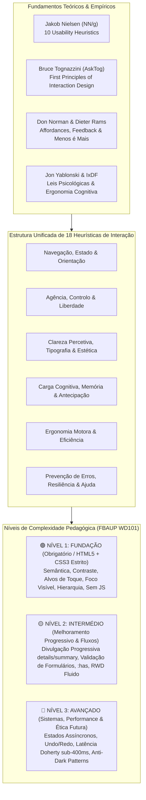

# 📐 Heurísticas de Usabilidade & Princípios de Design de Interação para a Web
## Um Compêndio Pedagógico Estruturado: Nielsen, Tognazzini, Leis de UX e Padrões de Interface
### Faculdade de Belas Artes da Universidade do Porto (FBAUP) • Licenciatura em Design de Comunicação
**Direção Pedagógica & Supervisão:** Prof. Pedro Amado (FBAUP / i2ADS)  
**Ano Letivo:** 2026/27 • Unidade Curricular: Web Design (WD101)  
**Fontes Teóricas Centrais:** Jakob Nielsen (10 Usability Heuristics, NN/g), Bruce Tognazzini (*First Principles of Interaction Design*, AskTog), Interaction Design Foundation (IxDF), Jon Yablonski (*Laws of UX*, 2024), Donald Norman (*The Design of Everyday Things*), Dieter Rams (*10 Principles for Good Design*), Ben Shneiderman (*Eight Golden Rules*), Harry Brignull (*Deceptive Patterns*, 2023).  
**Alinhamento Curricular:** Projeto de Investigação e Desenvolvimento Web — *Event & Brand Website* (`WD101-26-P-Research Project _ Event Website.docx`).

---

> *"As heurísticas de usabilidade não são dogmas rígidos, mas sim atalhos cognitivos e princípios orientadores consolidados por décadas de observação empírica da interação entre seres humanos e sistemas computacionais."*  
> — Jakob Nielsen & Bruce Tognazzini

---

## 🧭 Enquadramento Pedagógico & Transição Cognitiva

No primeiro contacto com o Web Design e o Design de Interação, os estudantes de Design de Comunicação tendem frequentemente a projetar websites sob uma perspetiva exclusivamente gráfica ou editorial estática (composição visual, paleta cromática, grelha compositiva impressa). Contudo, **um website não é um cartaz nem uma página de revista**: é um **sistema interativo dinâmico, reativo e adaptável**, operado por utilizadores com objetivos concretos, capacidades percetivas variáveis, limitações de memória de trabalho e tolerâncias temporais restritas.

Para apoiar esta transição, este compêndio expande a lista simplificada de 4 pilares introduzida no **Anexo 1** do projeto prático (`WD101-26-P-Research Project _ Event Website.docx`), harmonizando as **10 Heurísticas de Usabilidade de Jakob Nielsen** com os **Primeiros Princípios de Design de Interação de Bruce Tognazzini** (*AskTog*). Cada heurística é cruzada com as **Leis de UX**, os **Princípios Clássicos do Design** e os **Padrões de Interface Web (UI Patterns)**, classificados por um modelo pedagógico de 3 níveis de complexidade.

---

## 🪜 O Modelo Pedagógico dos 3 Níveis de Complexidade

Para evitar a sobrecarga cognitiva dos estudantes principiantes e permitir uma progressão pedagógica estruturada e motivadora, as heurísticas e as suas práticas de implementação foram estratificadas em três patamares de exigência:

### 🟢 Nível 1: Fundação (Essencial & Obrigatório para WD101)
*   **Destinatários:** Estudantes do 1.º ano a realizar o seu primeiro website estruturado.
*   **Âmbito Tecnológico:** **HTML5 Semântico Estrito + CSS3 Puro (Zero JavaScript)**.
*   **Foco Prático:** Estruturação semântica de marcos (`<header>`, `<nav>`, `<main>`, `<article>`, `<section>`, `<footer>`), distinção categórica entre hiperligações (`<a>`) e botões (`<button>`), contraste tipográfico acessível (WCAG AA $\ge 4.5:1$), alvos táteis mínimos para dedos em ecrãs táteis ($\ge 44 \times 44\text{px}$ / $48 \times 48\text{px}$), consistência entre breakpoint mobile e desktop, eliminação de ornamentação desnecessária e indicação clara da página atual (`aria-current="page"`).
*   **Correspondência:** Responde diretamente aos 4 focos obrigatórios do *Anexo 1 do Briefing*.

### 🟡 Nível 2: Intermédio (Melhoramento Progressivo & Comportamentos Reativos)
*   **Destinatários:** Estudantes a consolidar protótipos interativos e a refinar o seu portfólio.
*   **Âmbito Tecnológico:** **HTML5 Avançado + CSS Moderno (`:has()`, `:focus-visible`, `
/
`, `:target`, variáveis CSS, `clamp()`)**.
*   **Foco Prático:** Divulgação progressiva de informação sem recorrer a scripts, micro-interações suaves com feedback táctil/visual (`:active`, `:focus`), estados de validação de dados em tempo real (`:user-valid`, `:user-invalid`), migalhas de pão (*breadcrumbs*), menus recolhíveis acessíveis e realização de percursos cognitivos estruturados (*Cognitive Walkthrough*).

### 🔴 Nível 3: Avançado (Sistemas Complexos, Performance & Ética — Horizonte Futuro)
*   **Destinatários:** Exploração pós-curricular, transição para o 2.º semestre (JavaScript/DOM) e desenvolvimento de produto digital profissional.
*   **Âmbito Tecnológico:** **Engenharia de Frontend, Web APIs, Gestão de Estado Assíncrono e Frameworks de Acessibilidade**.
*   **Foco Prático:** Preservação de estado entre sessões (`localStorage`, rascunhos automáticos), arquiteturas de reversão profunda (*Undo/Redo* sem modais punitivas), limiar de resposta sub-400ms (*Doherty Threshold* com *skeleton loaders* e UI otimista), regiões dinâmicas ARIA (`aria-live`), e guarda-costas éticos contra padrões enganatórios (*Deceptive / Dark Patterns*).

---

## 🏛️ As 18 Heurísticas Harmonizadas de Interação & Usabilidade Web

Abaixo encontra-se a integração rigorosa das **10 Heurísticas de Jakob Nielsen** e dos **18 Primeiros Princípios de Bruce Tognazzini**, enriquecida com os cânones da *Interaction Design Foundation (IxDF)* e os volumes de referência de 2026.

---

### EIXO 1: NAVEGAÇÃO, ESTADO & ORIENTAÇÃO ESPACIAL

#### Heurística 1: Visibilidade do Estado do Sistema & Consciência de Modo
* **Atribuição:** **Jakob Nielsen #1** (*Visibility of System Status*) + **Bruce Tognazzini** (*State*).
* **Fundamento Teórico:** O sistema deve sempre manter os utilizadores informados sobre o que está a acontecer, através de feedback apropriado e atempado. O utilizador nunca deve duvidar de "onde estou?", "o que está o sistema a processar?" ou "em que modo de interação me encontro?".
* **Leis de UX Relacionadas:**
  * *Doherty Threshold* (feedback percetível antes dos 400ms).
  * *Lei de Jakob* (convenções espaciais universais de cabeçalho e rodapé).
* **Princípios Clássicos:** Don Norman (*Feedback* & *Signifiers*); Ben Shneiderman (*Offer Informative Feedback*).
* **Padrões de UI Web:**
  * Indicador de página ativa no menu de navegação (`aria-current="page"` com estilo visual diferenciador: sublinhado, contraste invertido ou barra de destaque).
  * Migalhas de pão (*Breadcrumbs*) em hierarquias com mais de 2 níveis.
  * Título semântico `<title>` na janela do navegador e cabeçalho visual `<h1>` unívoco em cada página.
* **Aplicação por Nível de Complexidade:**
  * 🟢 **Nível 1 (Fundação):** Em cada página HTML estática, a etiqueta do menu correspondente à página atual deve possuir uma classe ou atributo ativo (`aria-current="page"`) com estilo visual distintivo. O logótipo no cabeçalho deve ligar sempre à página principal (`index.html`).
  * 🟡 **Nível 2 (Intermédio):** Estados visuais reativos em controlos interativos: indicação imediata de `:hover`, `:active` e `:focus-visible` através de transições CSS suaves.
  * 🔴 **Nível 3 (Avançado):** Barras de progresso assíncronas, ecrãs esqueleto (*skeleton loaders*) durante o carregamento de dados remotos e anúncio auditivo via `aria-live="polite"`.
* **Armadilhas & Anti-Padrões:** Menus onde todas as opções parecem idênticas; ausência de feedback ao clicar num link ou botão; ecrãs em branco sem qualquer indicação de carregamento.
* **Checklist para o Aluno (Anexo 1):** *"Ao aterrar nesta página, o utilizador consegue identificar imediatamente o nome do website, a secção onde se encontra e o que pode fazer a seguir?"*

---

#### Heurística 2: Navegação Visível & Orientação Previsível
* **Atribuição:** **Bruce Tognazzini** (*Visible Navigation*) + **Jakob Nielsen #1 & #3**.
* **Fundamento Teórico:** A navegação nunca deve ser escondida ou tornada num jogo de adivinhas. Os utilizadores não navegam num website memorizando percursos invisíveis; procuram pontos de referência e marcas de orientação (*wayfinding*). Menus invisíveis aumentam drasticamente a carga de memória de trabalho.
* **Leis de UX Relacionadas:**
  * *Lei de Hick* (reduzir o número de opções de topo para acelerar a decisão: 5 a 7 itens).
  * *Efeito da Posição Serial* (os itens colocados no início e no final do menu são os mais recordados).
* **Princípios Clássicos:** Don Norman (*Discoverability* & *Mapping*); Ben Shneiderman (*Permit Easy Reversal of Actions*).
* **Padrões de UI Web:**
  * Barra de navegação global persistente (`<header>` / `<nav>`) no topo.
  * Padrão *Sticky Header* ou cabeçalho fixo com `position: sticky; top: 0;` (garantindo visibilidade sem obstruir o ecrã).
  * Rodapé semântico (`<footer>`) com sitemap secundário e contactos.
  * Link de salto direto para o conteúdo (*Skip to content / Skip Link*) no topo do documento.
* **Aplicação por Nível de Complexidade:**
  * 🟢 **Nível 1 (Fundação):** Manter a mesma estrutura de navegação idêntica em todas as páginas do projeto. Em desktop, a barra de navegação principal deve estar sempre visível. Em mobile, se for comprimida, deve usar um ícone convencional universalmente reconhecido e perfeitamente clicável.
  * 🟡 **Nível 2 (Intermédio):** Menu móvel com Pure CSS recorrendo a `:has()` ou ao seletor de checkbox oculto acessível, sem provocar saltos de layout (*layout shifts*).
  * 🔴 **Nível 3 (Avançado):** Padrão *Priority+ Navigation* que calcula o espaço horizontal disponível e agrupa automaticamente os itens excedentes sob um menu "Mais".
* **Armadilhas & Anti-Padrões:** Esconder a navegação desktop sob menus de hambúrguer desnecessários ("menu mistério"); trocar a ordem dos links entre páginas diferentes.
* **Checklist para o Aluno (Anexo 1):** *"O utilizador consegue regressar à Home ou saltar para qualquer secção principal em qualquer ponto da página com apenas um clique?"*

---

#### Heurística 3: Correspondência entre o Sistema e o Mundo Real (Metáforas & Linguagem Natural)
* **Atribuição:** **Jakob Nielsen #2** (*Match Between System and the Real World*) + **Bruce Tognazzini** (*Metaphors*).
* **Fundamento Teórico:** O sistema deve falar a linguagem do utilizador, com palavras, frases e conceitos que lhe sejam familiares, em vez de termos técnicos internos ou jargão de programador. As convenções e metáforas do mundo real devem ser respeitadas.
* **Leis de UX Relacionadas:**
  * *Lei de Jakob* (os utilizadores transferem expectativas de outros sites para o vosso).
  * *Modelos Mentais de Norman* (alinhar o modelo de design com o modelo do utilizador).
* **Princípios Clássicos:** Don Norman (*Conceptual Models* & *Natural Mapping*).
* **Padrões de UI Web:**
  * Nomenclatura clara nas secções: "Sobre Nós", "Programa", "Publicações", "Contactos" em vez de termos obscuros ou codificados.
  * Ícones universais: Lupa para pesquisa, Casa para início, Envelope para email, Marcador geográfico para localização física.
  * Ordenação cronológica intuitiva em agendas de eventos (do mais recente para o mais antigo, ou dias do festival em sequência natural).
* **Aplicação por Nível de Complexidade:**
  * 🟢 **Nível 1 (Fundação):** Escrever textos de hiperligação claros e contextuais. Proibir terminantemente links genéricos como "clique aqui" ou "saber mais" isolados — usar "Consulte o Programa do Festival 2026" ou "Descarregar Livro de Atas (PDF, 4MB)".
  * 🟡 **Nível 2 (Intermédio):** Utilizar listas de definição `<dl>`, `<dt>`, `<dd>` para metadados (datas, horários, oradores) e `<time datetime="...">` para datas legíveis por humanos e motores de busca.
  * 🔴 **Nível 3 (Avançado):** Metáforas espaciais e micro-interações táteis de manipulação direta (ex.: arrastar e soltar num organizador de horários).
* **Armadilhas & Anti-Padrões:** Criar vocabulário artificial para parecer "original" mas que confunde o visitante (ex.: chamar "Dimensão Cósmica" à página de "Contactos").
* **Checklist para o Aluno (Anexo 1):** *"A linguagem e os ícones utilizados são imediatamente compreendidos por um utilizador comum sem necessitar de instruções?"*

---

### EIXO 2: AGÊNCIA DO UTILIZADOR, CONTROLO & SEGURANÇA

#### Heurística 4: Controlo do Utilizador, Liberdade & Autonomia
* **Atribuição:** **Jakob Nielsen #3** (*User Control and Freedom*) + **Bruce Tognazzini** (*Autonomy*).
* **Fundamento Teórico:** Os utilizadores escolhem frequentemente funções do sistema por engano e necessitam de uma "saída de emergência" claramente visível para abandonar o estado indesejado sem terem de passar por diálogos extensos. O computador deve pertencer ao utilizador; o sistema sugere, mas o utilizador decide.
* **Leis de UX Relacionadas:**
  * *Locus de Controlo Interno de Shneiderman* (o utilizador deve sentir-se o iniciador das ações).
  * *Efeito de Posse Psicológica* (respeitar o tempo e o livre arbítrio do utilizador).
* **Princípios Clássicos:** Don Norman (*Forgiveness*); Ben Shneiderman (*Support Internal Locus of Control*).
* **Padrões de UI Web:**
  * Botões de fechar (`×` ou botão "Fechar") claros em gavetas laterais, modais ou banners promocionais.
  * Facilidade em fechar menus abertos premindo a tecla `Esc` ou clicando fora da área ativa (*backdrop click*).
  * Suporte nativo e perfeito ao botão "Retroceder" do navegador (nunca quebrar o histórico de navegação com âncoras mal formadas).
* **Aplicação por Nível de Complexidade:**
  * 🟢 **Nível 1 (Fundação):** Assegurar que nenhum link abre novas abas (`target="_blank"`) a menos que seja estritamente necessário (ex.: PDFs externos), mantendo o histórico de navegação funcional. Todos os elementos abertos devem ter forma óbvia de regressar.
  * 🟡 **Nível 2 (Intermédio):** Implementar gavetas e caixas de diálogo nativas com a etiqueta HTML5 `<dialog>` ou acordeões `
` que o utilizador pode abrir e fechar livremente sem qualquer travamento.
  * 🔴 **Nível 3 (Avançado):** Cancelamento de ações assíncronas em curso (ex.: botão "Cancelar envio" ou barra de progresso interrompível).
* **Armadilhas & Anti-Padrões:** Banners intrusivos sem botão de fechar; vídeos que arrancam com áudio automático (*autoplay* sem permissão); aprisionar o foco do teclado sem saída.
* **Checklist para o Aluno (Anexo 1):** *"O utilizador consegue desfazer uma ação ou fechar um painel aberto com facilidade e sem sensação de aprisionamento?"*

---

#### Heurística 5: Interfaces Exploratórias & Reversibilidade Segura
* **Atribuição:** **Bruce Tognazzini** (*Explorable Interfaces*) + **Ben Shneiderman** (*Permit Easy Reversal of Actions*).
* **Fundamento Teórico:** Interfaces ideais incentivam a curiosidade e a exploração. Para que o utilizador explore sem medo, o sistema deve garantir que nenhuma ação acidental provoca danos irreparáveis. As ações devem ser intrinsecamente seguras ou facilmente reversíveis.
* **Leis de UX Relacionadas:**
  * *Princípio da Parcimónia / Navalha de Occam* (reduzir o receio retirando caminhos destrutivos irrevogáveis).
* **Princípios Clássicos:** Don Norman (*Constraints* & *Safety Boundaries*).
* **Padrões de UI Web:**
  * Padrão "Desfazer" (*Undo snackbar / Toast*) em detrimento de caixas de diálogo agressivas de confirmação ("Tem a certeza?").
  * Breadcrumbs com navegação ascendente segura.
  * Filtros de pesquisa multifacetados onde cada filtro pode ser desativado individualmente através de um chip com `×` ou um botão "Limpar todos os filtros".
* **Aplicação por Nível de Complexidade:**
  * 🟢 **Nível 1 (Fundação):** Garantir que a navegação por âncoras internas em páginas longas (One-Page ou secções) possui links recíprocos de "Voltar ao Topo" (`#top`).
  * 🟡 **Nível 2 (Intermédio):** Uso do elemento `
` para exploração segura de conteúdos densos (FAQs, biografias longas, regulamentos) sem sobrecarregar a página principal.
  * 🔴 **Nível 3 (Avançado):** Histórico de estados e pilha de desfazer/refazer (*Undo/Redo*) com atalhos de teclado `Ctrl+Z` / `Cmd+Z`.
* **Armadilhas & Anti-Padrões:** Ações que apagam dados ou redirecionam o utilizador sem forma de regressar ao ponto exato onde se encontrava.
* **Checklist para o Aluno (Anexo 1):** *"Se o utilizador clicar num link ou abrir uma secção por curiosidade, ele consegue voltar ao estado anterior sem esforço?"*

---

#### Heurística 6: Proteção do Trabalho do Utilizador
* **Atribuição:** **Bruce Tognazzini** (*Protect Users' Work*) + **Alan Cooper** (*About Face: Polite Software*).
* **Fundamento Teórico:** O trabalho, o tempo e os dados do utilizador são preciosos. O sistema nunca deve permitir que o utilizador perca informação introduzida devido a um clique acidental, refresh de página, encerramento do navegador ou falha temporária de rede.
* **Leis de UX Relacionadas:**
  * *Efeito Zeigarnik* (a mente humana permanece tensa enquanto tarefas interrompidas não são resolvidas).
* **Princípios Clássicos:** Alan Cooper (*Polite Software preserves user state*); Don Norman (*Forgiveness*).
* **Padrões de UI Web:**
  * Guardado automático em segundo plano (*Autosave*).
  * Preservação dos campos de formulário preenchidos quando ocorre um erro de validação.
  * Confirmação defensiva antes de abandonar uma página com formulário em preenchimento (*beforeunload warning*).
* **Aplicação por Nível de Complexidade:**
  * 🟢 **Nível 1 (Fundação):** Em formulários HTML5, atribuir nomes e identificadores semânticos corretos (`name`, `id`, `autocomplete`) para permitir que os navegadores guardem e preencham automaticamente os campos em caso de refresh acidental.
  * 🟡 **Nível 2 (Intermédio):** Garantir que os botões de envio não limpam o formulário por acidente (nunca usar `<input type="reset">`).
  * 🔴 **Nível 3 (Avançado):** Persistência de rascunhos em tempo real recorrendo a `localStorage` ou `sessionStorage`.
* **Armadilhas & Anti-Padrões:** Formulários que, perante uma validação incorreta, apagam todos os campos já preenchidos forçando o utilizador a recomeçar do zero.
* **Checklist para o Aluno (Anexo 1):** *"O utilizador está protegido contra a perda acidental da sua informação ou percurso?"*

---

### EIXO 3: CLAREZA PERCETIVA, TIPOGRAFIA & FORMA

#### Heurística 7: Consistência, Normas & Padrões
* **Atribuição:** **Jakob Nielsen #4** (*Consistency and Standards*) + **Bruce Tognazzini** (*Consistency*).
* **Fundamento Teórico:** Os utilizadores não devem ter de adivinhar se palavras, situações ou ações diferentes significam a mesma coisa. A consistência deve ser mantida a quatro níveis: **Consistência Visual** (fontes, cores, grelhas), **Consistência Funcional** (o mesmo componente comporta-se sempre da mesma forma), **Consistência Interna** (entre todas as páginas do site) e **Consistência Externa** (com as convenções universais da web).
* **Leis de UX Relacionadas:**
  * *Lei de Jakob* (a consistência externa reduz a curva de aprendizagem).
  * *Lei de Miller* (a previsibilidade liberta capacidade da memória de trabalho).
* **Princípios Clássicos:** Don Norman (*Consistency*); Ben Shneiderman (*Strive for Consistency*).
* **Padrões de UI Web:**
  * Sistema de Design Tokens em CSS: variáveis globais `:root { --color-primary: ...; --font-body: ...; --space-md: ...; }`.
  * Estilização consistente de elementos: todos os links `<a>` com o mesmo tratamento de cor e sublinhado; todos os botões primários com a mesma forma e raio de curvatura.
  * Posição idêntica do logótipo, navegação e rodapé em todas as páginas secundárias (`about.html`, `events.html`, etc.).
* **Aplicação por Nível de Complexidade:**
  * 🟢 **Nível 1 (Fundação):** Utilizar uma única folha de estilos global partilhada por todas as 4 páginas do projeto capstone. Assegurar que títulos `<h2>` têm sempre a mesma dimensão e margens em todas as páginas.
  * 🟡 **Nível 2 (Intermédio):** Estrutura modular em `@layer` (Reset, Tokens, Layout, Componentes, Utilitários) para evitar colisões de especificidade CSS e incoerências visuais.
  * 🔴 **Nível 3 (Avançado):** Documentação formal de Design System (tokens, biblioteca de componentes no Figma ligada via Code Connect e catálogo de padrões).
* **Armadilhas & Anti-Padrões:** Mudar a cor dos links em páginas diferentes; usar termos sinónimos desnecessários ("Comprar Bilhete" na Home e "Adquirir Ingresso" no evento).
* **Checklist para o Aluno (Anexo 1):** *"O design mantém-se coerente e estável em todas as páginas? O utilizador consegue identificar imediatamente o que é um título, um texto, um link e um botão?"*

---

#### Heurística 8: Legibilidade, Ritmo Tipográfico & Contraste Cromático
* **Atribuição:** **Bruce Tognazzini** (*Readability & Color*) + **W3C WCAG 2.2** (SC 1.4.3 & SC 1.4.6).
* **Fundamento Teórico:** O texto num website existe para ser lido e descodificado sem esforço visual. O contraste cromático, o tamanho do corpo de texto, a entrelinha e o comprimento da linha (*measure*) devem ser rigorosamente calibrados para garantir conforto ótico e acessibilidade universal a pessoas com fadiga visual ou daltonismo.
* **Leis de UX Relacionadas:**
  * *Efeito Estética-Usabilidade* (a beleza tipográfica aumenta a perceção de facilidade).
  * *Lei de Weber-Fechner* (perceção proporcional do contraste visual).
* **Princípios Clássicos:** Dieter Rams (*Good Design is Honest and Thorough*); Irene Pereyra (*Legibility over Decoration*).
* **Padrões de UI Web:**
  * Rácio de contraste de texto: Mínimo 4.5:1 para texto normal e 3:1 para texto grande (WCAG AA); idealmente 7:1 (WCAG AAA).
  * Comprimento de linha otimizado para leitura: Entre 45 e 75 caracteres por linha (CSS `max-width: 65ch;`).
  * Entrelinha proporcional: `line-height: 1.5;` a `1.6;` em texto corrido; `1.1;` a `1.2;` em títulos de grande escala.
  * Nunca confiar exclusivamente na cor para transmitir significado (acompanhar sempre cores com texto explicativo ou ícones).
* **Aplicação por Nível de Complexidade:**
  * 🟢 **Nível 1 (Fundação):** Definir o tamanho de texto base do corpo em pelo menos `16px` / `1rem` e `line-height: 1.5;`. Garantir contraste elevado entre o texto e o fundo (testar com inspecionador de acessibilidade do navegador).
  * 🟡 **Nível 2 (Intermédio):** Tipografia fluida com CSS `clamp()` (ex.: `font-size: clamp(1rem, 0.9rem + 0.5vw, 1.25rem);`) para adaptação contínua entre ecrãs móveis e ecrãs panorâmicos.
  * 🔴 **Nível 3 (Avançado):** Suporte nativo ao modo escuro via `light-dark()` no espaço de cor perceptivo OKLCH e personalização de preferências de acessibilidade (`prefers-contrast: more`).
* **Armadilhas & Anti-Padrões:** Texto cinzento claro sobre fundo branco; parágrafos com 150 caracteres de largura que se estendem de uma ponta à outra de um monitor 4K; texto justificado na web que gera "rios brancos" e prejudica pessoas com dislexia.
* **Checklist para o Aluno (Anexo 1):** *"O texto é perfeitamente legível a 1 metro de distância do monitor ou no telemóvel à luz do dia? O comprimento das linhas é confortável para ler?"*

---

#### Heurística 9: Estética, Design Minimalista & Redução ao Essencial
* **Atribuição:** **Jakob Nielsen #8** (*Aesthetic and Minimalist Design*) + **Bruce Tognazzini** (*Simplicity*) + **Dieter Rams** (*Princípio #10: "Gutes Design ist so wenig Design wie möglich"*).
* **Fundamento Teórico:** As interfaces não devem conter informação irrelevante ou raramente necessária. Cada elemento visual adicional compete com as unidades de informação relevantes e diminui a sua visibilidade relativa. O minimalismo não é uma questão de estilo artístico ("estilo escandinavo"), mas de **economia funcional**: retirar tudo o que não cumpra uma função concreta de informação ou interação.
* **Leis de UX Relacionadas:**
  * *Navalha de Occam* (a solução mais simples que resolve o problema é a preferível).
  * *Efeito Estética-Usabilidade* (a limpeza e proporção visual geram confiança e tolerância cognitiva).
* **Princípios Clássicos:** Dieter Rams (*Weniger, aber besser* — Menos, mas melhor); Irene Pereyra (*Less is More*).
* **Padrões de UI Web:**
  * Espaço negativo / Espaço em branco generoso (*white space*) usado como elemento ativo de respiração e agrupamento.
  * Grelhas visuais ordenadas com CSS Grid e calhas consistentes (`gap: var(--space-md);`).
  * Eliminação de molduras, sombras artificiais pesadas ou linhas divisórias redundantes quando o espaço em branco já desempenha essa função.
* **Aplicação por Nível de Complexidade:**
  * 🟢 **Nível 1 (Fundação):** Fazer a "auditoria de ruído": percorrer a página e justificar cada caixa, fundo colorido ou borda. Se não estiver a informar, alertar ou separar conteúdos, removê-la.
  * 🟡 **Nível 2 (Intermédio):** Organização de informação densa através de cartões limpos (*Card UI pattern*) com hierarquia tipográfica precisa e padding proporcional.
  * 🔴 **Nível 3 (Avançado):** Eliminação do "efeito árvore de natal": paletas de cor estritamente contidas (uma cor primária funcional, neutros equilibrados e cor de destaque reservada exclusivamente para ações-chave).
* **Armadilhas & Anti-Padrões:** Tratar a página web como tela decorativa, enchendo espaços vazios com gráficos gratuitos, separadores decorativos ou elementos animados que distraem da mensagem.
* **Checklist para o Aluno (Anexo 1):** *"Todos os elementos presentes na página cumprem uma função clara de informação ou navegação, ou existem elementos que são mera decoração dispensável?"*

---

#### Heurística 10: Objetos de Interface Humana & Manipulação Direta
* **Atribuição:** **Bruce Tognazzini** (*Human Interface Objects*) + **Don Norman** (*Affordances & Signifiers*).
* **Fundamento Teórico:** Os objetos no ecrã devem ser visíveis, expressar a sua função através da sua aparência visual (*affordance* percebida) e reagir imediatamente ao toque ou ao cursor do utilizador, criando uma sensação convincente de controlo direto sobre o objeto físico virtual.
* **Leis de UX Relacionadas:**
  * *Lei da Região Comum* (agrupar controlos relacionados dentro de fronteiras percetíveis).
  * *Lei de Fitts* (a área interativa deve coincidir com a extensão visual do objeto).
* **Princípios Clássicos:** Don Norman (*Perceived Affordances* & *Signifiers*); Ben Shneiderman (*Direct Manipulation*).
* **Padrões de UI Web:**
  * Botões que se parecem com botões: preenchimento, cantos tratados, elevação ou contraste que convida ao clique.
  * Mudança de cursor: `cursor: pointer;` em elementos clicáveis; `cursor: text;` em áreas de edição.
  * Toda a área do cartão (*Card*) clicável sem quebrar a semântica interior.
* **Aplicação por Nível de Complexidade:**
  * 🟢 **Nível 1 (Fundação):** Nunca retirar o sublinhado dos links em texto corrido sem fornecer outra distinção percetiva inconfundível (peso tipográfico e cor de alto contraste). Nunca associar `cursor: pointer` a elementos estáticos não clicáveis.
  * 🟡 **Nível 2 (Intermédio):** Micro-interações de clique: ligeira compressão no estado ativo (`transform: scale(0.98);` em `:active`) para simular o afundamento mecânico de uma tecla.
  * 🔴 **Nível 3 (Avançado):** Componentes tácteis com suporte a gestos de arrasto e transições contínuas de física inercial.
* **Armadilhas & Anti-Padrões:** Textos com aparência de botões que não são clicáveis; botões planos sem qualquer contraste que se confundem com texto informativo estático.
* **Checklist para o Aluno (Anexo 1):** *"O utilizador consegue distinguir sem hesitar o que é apenas texto para ler e o que é um elemento clicável para interagir?"*

---

### EIXO 4: CARGA COGNITIVA, MEMÓRIA & ANTECIPAÇÃO

#### Heurística 11: Reconhecimento em Vez de Recordação & Descoberta
* **Atribuição:** **Jakob Nielsen #6** (*Recognition Rather Than Recall*) + **Bruce Tognazzini** (*Discoverability*).
* **Fundamento Teórico:** A memória de trabalho humana é efémera e restrita. É muito mais fácil reconhecer uma opção visualmente apresentada do que recordar uma informação abstrata da memória. Os objetos, ações e opções devem estar visíveis no momento em que são necessários.
* **Leis de UX Relacionadas:**
  * *Lei de Miller* (limite de 7 ± 2 blocos de informação na memória imediata).
  * *Efeito de Von Restorff* (itens visualmente distintos são recordados com maior facilidade).
* **Princípios Clássicos:** Don Norman (*Knowledge in the World vs. Knowledge in the Head*); Ben Shneiderman (*Reduce Short-Term Memory Load*).
* **Padrões de UI Web:**
  * Menus de navegação explícitos que mostram as secções disponíveis em vez de obrigarem a pesquisar mentalmente.
  * Ícones acompanhados de etiquetas textuais (*Icon + Label*), em vez de ícones isolados crípticos.
  * Sugestões visuais de conteúdo (ex.: cartões de resumo com miniatura, título, data e autor).
* **Aplicação por Nível de Complexidade:**
  * 🟢 **Nível 1 (Fundação):** Acompanhar ícones essenciais de uma palavra explicativa (ex.: "Menu ☰", "Pesquisa 🔍", "Email ✉️"). Em grelhas de eventos, exibir data e local diretamente no cartão sem obrigar a entrar no detalhe para ver quando acontece.
  * 🟡 **Nível 2 (Intermédio):** Divulgação progressiva inteligente (*Progressive Disclosure*): apresentar a informação primordial no primeiro nível e permitir expandir pormenores secundários através de `
`.
  * 🔴 **Nível 3 (Avançado):** Histórico visual de páginas recentemente visitadas ou pesquisas recentes sugeridas em caixas de busca.
* **Armadilhas & Anti-Padrões:** Forçar o utilizador a memorizar códigos, datas ou instruções vistas numa página para conseguir preencher um formulário noutra página.
* **Checklist para o Aluno (Anexo 1):** *"Toda a informação necessária para tomar uma decisão está visível no ecrã sem obrigar o utilizador a recordar coisas que viu noutra página?"*

---

#### Heurística 12: Antecipação & Valores por Omissão Sensatos (*Smart Defaults*)
* **Atribuição:** **Bruce Tognazzini** (*Anticipation & Defaults*).
* **Fundamento Teórico:** O sistema deve antecipar os desejos e necessidades do utilizador, colocando à sua disposição a informação e as ferramentas certas no momento exato em que são necessárias. Os valores predefinidos (*defaults*) devem representar a escolha mais segura, comum e ecológica para a maioria dos utilizadores.
* **Leis de UX Relacionadas:**
  * *Lei de Hick* (escolhas pré-configuradas aceleram exponencialmente o tempo de decisão).
  * *Efeito de Padrão / Default Effect* (utilizadores tendem a manter a opção sugerida pelo sistema).
* **Princípios Clássicos:** Bruce Tognazzini (*Anticipation*); Irene Pereyra (*Remove Needless Decisions*).
* **Padrões de UI Web:**
  * Atributo `autocomplete` em campos de formulário (nome, email, telefone, cidade) para preenchimento imediato pelo navegador.
  * Ordenação predefinida lógica: lista de eventos ordenada por proximidade de data (os próximos eventos em primeiro lugar).
  * Foco de entrada inicial sensato (sem provocar saltos de ecrã não solicitados).
* **Aplicação por Nível de Complexidade:**
  * 🟢 **Nível 1 (Fundação):** Em listas cronológicas de eventos ou notícias, posicionar o evento mais relevante ou iminente no topo em lugar de destaque (*Hero / Featured Card*).
  * 🟡 **Nível 2 (Intermédio):** Configuração de atributos HTML5 de formulário (`type="email"`, `inputmode="numeric"`, `placeholder` que ilustra o formato pretendido).
  * 🔴 **Nível 3 (Avançado):** Deteção automática do fuso horário local do utilizador para exibição correta das horas da conferência internacional.
* **Armadilhas & Anti-Padrões:** Deixar campos de seleção importantes em branco forçando opções redundantes; caixas de subscrição de publicidade pré-selecionadas por omissão (padrão enganatório).
* **Checklist para o Aluno (Anexo 1):** *"O website antecipa a próxima dúvida ou passo lógico do utilizador e fornece uma resposta ou atalho imediato?"*

---

### EIXO 5: ERGONOMIA MOTORA & EFICIÊNCIA DE UTILIZAÇÃO

#### Heurística 13: Ergonomia Motora & Aquisição de Alvos (Lei de Fitts)
* **Atribuição:** **Bruce Tognazzini** (*Fitts's Law*) + **W3C WCAG 2.2** (SC 2.5.5 Target Size & SC 2.5.8 Target Size Minimum).
* **Fundamento Teórico:** O tempo necessário para alcançar um alvo motor é uma função da distância até ao alvo e do tamanho desse alvo. Em interfaces táteis e rato, botões minúsculos ou excessivamente afastados criam fadiga física, hesitação e cliques falhados.
* **Leis de UX Relacionadas:**
  * *Lei de Fitts* ($T = a + b \log_2(1 + D/W)$).
  * *Lei de Direção / Steering Law* (túneis de navegação devem ser largos e sem descontinuidades).
* **Princípios Clássicos:** Don Norman (*Physical Affordances & Ergonomics*); Bruce Tognazzini (*Infinite Edges*).
* **Padrões de UI Web:**
  * Área de toque mínima em dispositivos móveis: Pelo menos $44 \times 44\text{px}$ ou $48 \times 48\text{px}$ com espaçamento de segurança entre controlos adjacentes.
  * Alvos nas bordas do ecrã: barras de navegação fixas na base (*Bottom Navigation*) ou no topo (*Sticky Header*) tornam-se virtualmente mais fáceis de atingir.
  * Aumentar a área interativa de etiquetas de formulário associando explicitamente o `<label for="id">` ao input.
* **Aplicação por Nível de Complexidade:**
  * 🟢 **Nível 1 (Fundação):** Definir padding generoso em todas as hiperligações e botões (`padding: 0.75rem 1.25rem; display: inline-block;` ou `display: flex;`) para garantir que mesmo dedos grandes conseguem clicar facilmente no telemóvel.
  * 🟡 **Nível 2 (Intermédio):** Tornar o cartão visual inteiro clicável através do truque de pseudo-elemento CSS no link principal (`a::after { content: ''; position: absolute; inset: 0; }`).
  * 🔴 **Nível 3 (Avançado):** Otimização da "Zona do Polegar" (*Thumb Zone*) em ecrãs móveis, colocando as ações prioritárias no terço inferior do ecrã.
* **Armadilhas & Anti-Padrões:** Links de texto minúsculos (12px) colados uns aos outros no rodapé móvel, provocando múltiplos toques acidentais no link errado.
* **Checklist para o Aluno (Anexo 1):** *"Num telemóvel real, é fácil carregar nos botões e links com o polegar sem errar o alvo?"*

---

#### Heurística 14: Flexibilidade, Aceleradores & Eficiência do Utilizador
* **Atribuição:** **Jakob Nielsen #7** (*Flexibility and Efficiency of Use*) + **Bruce Tognazzini** (*Efficiency of the User*).
* **Fundamento Teórico:** O tempo do ser humano é muito mais valioso do que o tempo de processamento do computador. As interfaces devem ser simples para principiantes, mas oferecer aceleradores (atalhos, personalizações) que permitam a utilizadores experientes navegar com velocidade acrescida.
* **Leis de UX Relacionadas:**
  * *Princípio de Pareto (80/20)* (80% das visitas focam-se em 20% das ações-chave; acelerar essas 20%).
* **Princípios Clássicos:** Ben Shneiderman (*Enable Frequent Users to Use Shortcuts*).
* **Padrões de UI Web:**
  * Suporte rigoroso à navegação completa por teclado (tecla `Tab`, `Shift+Tab`, `Enter`, `Espaço`).
  * Indicador de foco visual de alto contraste e nunca suprimido (`:focus-visible { outline: 3px solid var(--accent); outline-offset: 2px; }`).
  * Mecanismo de salto rápido de navegação (*Skip to main content*).
* **Aplicação por Nível de Complexidade:**
  * 🟢 **Nível 1 (Fundação):** Nunca utilizar a regra destrutiva `outline: none;` sem fornecer um substituto visual óbvio para utilizadores de teclado. Testar a página inteira desligando o rato e navegando exclusivamente com a tecla `Tab`.
  * 🟡 **Nível 2 (Intermédio):** Implementar um link de salto acessível escondido fora do ecrã que se torna visível ao receber foco (`.skip-link:focus { top: 0; }`).
  * 🔴 **Nível 3 (Avançado):** Atalhos globais de teclado (ex.: premir `/` para focar imediatamente a barra de pesquisa; paleta de comandos rápida tipo `Cmd+K`).
* **Armadilhas & Anti-Padrões:** Suprimir o anel de foco do teclado por mero "capricho estético", tornando o website inutilizável para quem depende de navegação motora ou de teclado.
* **Checklist para o Aluno (Anexo 1):** *"Se navegar pelo site usando apenas o teclado, consigo ver sempre onde está o foco e aceder a todos os links e botões?"*

---

### EIXO 6: PREVENÇÃO DE ERROS, RESILIÊNCIA & SUPORTE

#### Heurística 15: Prevenção de Erros & Design Defensivo
* **Atribuição:** **Jakob Nielsen #5** (*Error Prevention*) + **Bruce Tognazzini** (*Defaults*) + **Don Norman** (*Constraints*).
* **Fundamento Teórico:** Melhor do que boas mensagens de erro é um design cuidadoso que previne a ocorrência de problemas em primeiro lugar. Devem eliminar-se condições propensas a erros ou verificá-las e apresentar aos utilizadores opções de confirmação antes de executarem a ação.
* **Leis de UX Relacionadas:**
  * *Lei de Postel / Princípio da Robustez* ("Sê tolerante no que aceitas e rigoroso no que envias").
  * *Funções Coercivas / Forcing Functions de Norman* (impedir passos incorretos na interface física ou lógica).
* **Princípios Clássicos:** Don Norman (*Constraints* & *Slips vs. Mistakes*); Ben Shneiderman (*Prevent Errors*).
* **Padrões de UI Web:**
  * Utilização de tipos de input semânticos apropriados: `<input type="date">` em vez de texto livre para datas; seletores e menus pendentes para opções restritas.
  * Validação de restrições em HTML5 (`required`, `pattern`, `minlength`, `maxlength`).
  * Desativação ou aviso em botões de envio quando existem requisitos por cumprir.
* **Aplicação por Nível de Complexidade:**
  * 🟢 **Nível 1 (Fundação):** Em todos os formulários de contacto ou inscrição, utilizar etiquetas `<label>` devidamente emparelhadas com `id`, campos com tipo correto (`type="email"`, `type="tel"`) e mensagens informativas sobre o formato exigido.
  * 🟡 **Nível 2 (Intermédio):** Validação visual não intrusiva com CSS `:user-invalid` (só mostra o estado de erro após o utilizador interagir com o campo e sair, nunca antes de começar a escrever).
  * 🔴 **Nível 3 (Avançado):** Máscaras dinâmicas de introdução inteligente de dados (ex.: auto-formatação de cartões de cidadão ou NIFs enquanto o utilizador digita).
* **Armadilhas & Anti-Padrões:** Formulários que mostram mensagens de erro a vermelho mal o utilizador clica na primeira letra de um campo vazio.
* **Checklist para o Aluno (Anexo 1):** *"A interface impede ativamente que o utilizador introduza dados errados ou se engane no percurso?"*

---

#### Heurística 16: Reconhecimento, Diagnóstico & Recuperação Graciosa de Erros
* **Atribuição:** **Jakob Nielsen #9** (*Help Users Recognize, Diagnose, and Recover from Errors*) + **Bruce Tognazzini** (*Explorable Interfaces*).
* **Fundamento Teórico:** As mensagens de erro devem ser expressas em linguagem clara (sem códigos obscuros de servidor), indicar com precisão o problema e sugerir construtivamente uma solução viável de resolução imediata.
* **Leis de UX Relacionadas:**
  * *Regra do Pico-Fim / Peak-End Rule* (a forma como o sistema lida com um erro no final da jornada determina a memória afetiva que o utilizador guarda).
* **Princípios Clássicos:** Don Norman (*Feedback* & *Error Messages as Helpful Conversations*).
* **Padrões de UI Web:**
  * Mensagens de erro em linha (*Inline validation*) colocadas imediatamente abaixo do campo afetado, nunca agregadas numa caixa remota no topo da página.
  * Página 404 personalizada e acolhedora: explica com empatia que a página não foi encontrada, oferece links para a página inicial e um sitemap resumido.
  * Texto explicativo com solução: "O email deve incluir um símbolo @ e um domínio (ex.: nome@dominio.pt)" em vez de "Email inválido".
* **Aplicação por Nível de Complexidade:**
  * 🟢 **Nível 1 (Fundação):** Criar uma página `404.html` estilizada com o mesmo cabeçalho e rodapé do website do projeto, oferecendo caminho de regresso claro para a `index.html`.
  * 🟡 **Nível 2 (Intermédio):** Mensagens de erro associadas com `aria-describedby` para leitores de ecrã e destacadas com contraste adequado e ícone de aviso (não apenas texto a vermelho).
  * 🔴 **Nível 3 (Avançado):** Sugestões de correção ortográfica automática ("Quis dizer...?").
* **Armadilhas & Anti-Padrões:** Erros crípticos do tipo `Error 0x80004005` ou páginas em branco de erro de servidor que deixam o utilizador num beco sem saída.
* **Checklist para o Aluno (Anexo 1):** *"Quando algo corre mal, a mensagem explica com clareza o que aconteceu e como o utilizador pode resolver o problema?"*

---

#### Heurística 17: Redução de Latência & Responsividade Percetível
* **Atribuição:** **Bruce Tognazzini** (*Latency Reduction*) + **Jon Yablonski** (*Doherty Threshold*).
* **Fundamento Teórico:** As pessoas operam a ritmos cognitivos biológicos precisos. Respostas de interface que ocorrem abaixo de 100ms são percecionadas como instantâneas; tempos de resposta abaixo de 400ms mantêm a atenção contínua e a sensação de produtividade mútua (*Doherty Threshold*). Latências superiores a 1 segundo provocam quebra no fio de pensamento do utilizador.
* **Leis de UX Relacionadas:**
  * *Limiar de Doherty* (produtividade atinge o pico quando computador e utilizador interagem a menos de 400ms).
  * *Ilusão do Trabalho / Labor Illusion* (quando um processo complexo demora algum tempo, mostrar etapas operacionais reais aumenta a perceção de valor e reduz a frustração).
* **Princípios Clássicos:** Don Norman (*System Response Times*); Bruce Tognazzini (*Perceived Latency*).
* **Padrões de UI Web:**
  * Otimização do peso das imagens: formatos modernos WebP/AVIF com dimensões intrínsecas e `loading="lazy"`.
  * Transições CSS rápidas e elásticas: durações entre 150ms e 250ms para reações táteis; transições de estado acima de 400ms parecem lentas e pegajosas.
  * Prevenção de saltos de layout através de reserva explícita de espaço (`aspect-ratio` em imagens e blocos de conteúdo).
* **Aplicação por Nível de Complexidade:**
  * 🟢 **Nível 1 (Fundação):** Otimizar e comprimir todas as imagens locais do projeto. Declarar sempre atributos `width` e `height` nas tags `` para evitar que a página dê saltos durante o carregamento (*Cumulative Layout Shift - CLS = 0*).
  * 🟡 **Nível 2 (Intermédio):** Animações suaves aceleradas por hardware usando apenas `opacity` e `transform`, respeitando a preferência de acessibilidade `@media (prefers-reduced-motion: reduce)`.
  * 🔴 **Nível 3 (Avançado):** *Optimistic UI* (atualizar o aspeto visual da interface instantaneamente assumindo sucesso na operação antes da confirmação do servidor).
* **Armadilhas & Anti-Padrões:** Carregar fotografias originais de 15 Megabytes sem compressão; animações lentas que atrasam a visualização dos conteúdos principais.
* **Checklist para o Aluno (Anexo 1):** *"A página abre e reage a cliques de forma quase instantânea, sem atrasos perceptíveis ou saltos descontrolados na composição?"*

---

#### Heurística 18: Apoio Contextual, Documentação & Aprendibilidade (*Learnability*)
* **Atribuição:** **Jakob Nielsen #10** (*Help and Documentation*) + **Bruce Tognazzini** (*Learnability*).
* **Fundamento Teórico:** O melhor sistema é aquele que pode ser utilizado intuitivamente sem necessidade de documentação. Contudo, quando o conteúdo é especializado (ex.: arquivos académicos, bases de dados de tipografia, processos de inscrição em conferências), pode ser necessário fornecer instruções concisas, focadas na tarefa do utilizador e fáceis de pesquisar.
* **Leis de UX Relacionadas:**
  * *Efeito Zeigarnik* (apoio no fecho de tarefas incompletas).
  * *Teoria da Carga Cognitiva de Sweller* (o apoio contextual reduz a carga cognitiva estranha).
* **Princípios Clássicos:** Ben Shneiderman (*Design Dialogs to Yield Closure*); Alan Cooper (*Good Interfaces are Self-Explaining*).
* **Padrões de UI Web:**
  * Dicas de contexto (*Tooltips* não obstrutivos e acessíveis com `role="tooltip"`).
  * Secção de Perguntas Frequentes (*FAQ*) colapsável com `
`.
  * Texto explicativo discreto em campos com requisitos especiais (ex.: "Formato aceite: PDF até 10MB").
* **Aplicação por Nível de Complexidade:**
  * 🟢 **Nível 1 (Fundação):** Página de Contactos ou secção de Apoio com formulário claro, endereço físico com mapa de localização e email de suporte devidamente formatado (`<a href="mailto:...">`).
  * 🟡 **Nível 2 (Intermédio):** Seção de FAQ organizada por categorias temáticas com acordeões nativos `
` e `
`.
  * 🔴 **Nível 3 (Avançado):** Centros de ajuda com pesquisa em tempo real e guias interativos de boas-vindas (*onboarding tours*).
* **Armadilhas & Anti-Padrões:** Manuais de instruções densos de 10 páginas para explicar como usar um website simples; esconder informação de contacto ou suporte.
* **Checklist para o Aluno (Anexo 1):** *"Se o utilizador tiver uma dúvida sobre o evento ou publicação, consegue encontrar uma resposta rápida ou um contacto direto sem sair do fluxo?"*

---

## 🛡️ O Imperativo Ético: Erradicar os Padrões Enganatórios (*Anti-Deceptive Patterns*)

Uma formação contemporânea em Design de Comunicação na FBAUP exige a incorporação de uma postura ética inegociável. As mesmas leis psicológicas e heurísticas de interação que reduzem o atrito cognitivo podem ser pervertidas por empresas tecnológicas para manipular os utilizadores em seu proveito — prática documentada como **Padrões Enganatórios / Deceptive Patterns** (Harry Brignull, 2023).

No âmbito de WD101, os estudantes devem reconhecer e rejeitar ativamente as seguintes armadilhas:
1. **Falso Sentimento de Urgência (*Fake Urgency*):** Contadores decrescentes falsos ("Só restam 2 bilhetes para o festival!") quando os lugares são ilimitados.
2. **Caixas Escondidas & Custos Ocultos (*Hidden Costs / Drip Pricing*):** Revelar taxas de serviço ou custos de inscrição adicionais apenas no último ecrã de pagamento.
3. **Vergonha de Confirmação (*Confirmshaming*):** Textos manipuladores em botões de recusa (ex.: botão de subscrição "Sim, quero aprender" e link de rejeição "Não, prefiro continuar desinformado").
4. **Armadilha de Baratas (*Roach Motel*):** Tornar o processo de inscrição extremamente fácil (1 clique) e o processo de cancelamento propositadamente labiríntico e doloroso.

---

## 📊 Matriz Global de Cruzamento de Heurísticas, Leis, Princípios & Padrões

A tabela seguinte estabelece a cartografia completa entre as heurísticas, a sua proveniência teórica, a classificação pedagógica e a sua âncora técnica em HTML5 e CSS3:

| # | Heurística Unificada | Proveniência | Nível de Complexidade | Leis de UX Conectadas | Princípios Clássicos | Padrão UI & Âncora Técnica |
| :---: | :--- | :---: | :---: | :--- | :--- | :--- |
| **01** | **Visibilidade do Estado & Modo** | Nielsen #1 • Tog: State | 🟢 Fundação | Doherty Threshold, Jakob | Norman: Feedback | `aria-current="page"`, Active nav styling |
| **02** | **Navegação Visível & Wayfinding** | Tog: Visible Nav • Nielsen #1/#3 | 🟢 Fundação | Hick, Serial Position | Norman: Discoverability | Sticky `<header>`, Landmarks, Skip-Link |
| **03** | **Correspondência com Mundo Real** | Nielsen #2 • Tog: Metaphors | 🟢 Fundação | Jakob, Modelos Mentais | Norman: Natural Mapping | Ícones semânticos, `datetime`, Nomes claros |
| **04** | **Controlo, Liberdade & Autonomia** | Nielsen #3 • Tog: Autonomy | 🟢 Fundação | Locus de Controlo Interno | Norman: Forgiveness | Botão Fechar visível, Histórico `history.back` |
| **05** | **Interfaces Exploratórias** | Tog: Explorable • Shneiderman | 🟡 Intermédio | Occam, Hick | Shneiderman: Reversal | `
/
`, Undo toast, Chips `×` |
| **06** | **Proteção do Trabalho** | Tog: Protect Work • Cooper | 🔴 Avançado | Zeigarnik, Inércia Cognitiva | Cooper: Polite Software | `autocomplete`, Autosave em `localStorage` |
| **07** | **Consistência & Standards** | Nielsen #4 • Tog: Consistency | 🟢 Fundação | Jakob, Miller | Norman: Consistency | CSS Design Tokens `:root`, Grelha estável |
| **08** | **Legibilidade & Contraste** | Tog: Readability • WCAG 2.2 | 🟢 Fundação | Estética-Usabilidade, Weber | Rams: Honesto e Criterioso | WCAG AA/AAA $\ge 4.5:1$, `max-width: 65ch` |
| **09** | **Estética & Design Minimalista** | Nielsen #8 • Tog: Simplicity | 🟢 Fundação | Occam, Estética-Usabilidade | Rams: Menos mas melhor | Espaço negativo, Redução de ruído gráfico |
| **10** | **Objetos & Manipulação Direta** | Tog: Objects • Norman | 🟢 Fundação | Região Comum, Fitts | Norman: Signifiers | Estilo de botão tátil, `cursor: pointer` |
| **11** | **Reconhecimento vs. Recordação** | Nielsen #6 • Tog: Discoverability | 🟡 Intermédio | Miller, Von Restorff | Norman: Knowledge in World | Menus visíveis, Rótulo + Ícone, Card UI |
| **12** | **Antecipação & Smart Defaults** | Tog: Anticipation & Defaults | 🟡 Intermédio | Hick, Default Effect | Pereyra: Sem atritos | Ordenação cronológica, `type="email"` |
| **13** | **Ergonomia Motora (Fitts)** | Tog: Fitts's Law • Nielsen #7 | 🟢 Fundação | Fitts, Steering Law | Norman: Ergonomia | Alvos de toque $\ge 44\times 44\text{px}$, Padding |
| **14** | **Flexibilidade & Aceleradores** | Nielsen #7 • Tog: Efficiency | 🟡 Intermédio | Pareto (80/20) | Shneiderman: Shortcuts | `:focus-visible`, Navegação por `Tab` |
| **15** | **Prevenção de Erros & Defesa** | Nielsen #5 • Norman: Constraints | 🟡 Intermédio | Postel, Funções Coercivas | Norman: Constraints | `required`, `:user-invalid`, Seletores |
| **16** | **Diagnóstico & Recuperação** | Nielsen #9 • Tog: Explorable | 🟢 Fundação | Peak-End Rule | Norman: Diálogo construtivo | Página `404.html` amiga, Inline error help |
| **17** | **Redução de Latência & Fluidez** | Tog: Latency • Doherty | 🔴 Avançado | Doherty Threshold, Labor | Norman: Tempo de resposta | WebP/AVIF, Layout estável CLS=0, Transições |
| **18** | **Apoio Contextual & Aprender** | Nielsen #10 • Tog: Learnability | 🟡 Intermédio | Carga Cognitiva Sweller | Cooper: Auto-explicativo | Secção FAQ com `
`, Ajuda em linha |

---

## 📋 Aplicação Prática: Protocolo de Avaliação para Estudantes (WD101)

Este quadro heurístico foi desenhado para operacionalizar diretamente os dois momentos de avaliação previstos no briefing do projeto prático:

### Protocolo Formativo (Fase de Mockups & Arquitetura):
1. **Passo 1: Auto-Avaliação Heurística de Nível 1 (Fundação)**  
   Cada grupo de 3 estudantes deve testar o seu protótipo HTML5/CSS3 contra as 8 Heurísticas Fundamentais (🟢 Nível 1):
   * [ ] **Visibilidade:** O menu destaca inequivocamente em que página estou?
   * [ ] **Navegação:** O cabeçalho é persistente e o logótipo devolve à página principal?
   * [ ] **Controlo:** Consigo navegar para a frente e para trás sem bloqueios?
   * [ ] **Consistência:** A grelha, fontes e estilos mantêm-se idênticos em todas as páginas e no mobile?
   * [ ] **Tipografia & Contraste:** O contraste cumpre WCAG AA (texto preto/cinzento escuro sobre branco ou inverso)? As linhas têm menos de 75 caracteres?
   * [ ] **Minimalismo:** Removi todas as linhas, caixas e cores que serviam apenas de "decoração"?
   * [ ] **Significadores:** Os links e botões parecem inequivocamente clicáveis?
   * [ ] **Ergonomia (Fitts):** Todos os botões no telemóvel têm pelo menos 44px de altura e largura?

2. **Passo 2: Percurso Cognitivo (*Cognitive Walkthrough*)**  
   Convidar um colega de outro grupo para executar duas tarefas nucleares (ex.: "Encontrar o horário da conferência no dia 2" e "Descarregar o catálogo da exposição em PDF"):
   * O colega pensa em voz alta (*Think-Aloud Protocol*).
   * O grupo anota onde o colega hesitou, onde procurou primeiro e quantos cliques foram necessários.
   * Ajustam-se os mockups para aproximar a informação do percurso natural do utilizador.

### Protocolo Sumativo (Fase de Entrega do Website Final):
* Aplicação do teste "Quick & Dirty" com 3 a 5 utilizadores externos em ecrã Mobile e Desktop.
* Cálculo da taxa de sucesso de conclusão de tarefas e registo de pontos de atrito.
* Elaboração do relatório de auto-reflexão crítica com pontos fortes e planos de evolução futura (rumo aos Níveis 2 e 3).

---

## 📚 Bibliografia & Referências Recomendadas

### Obras Disponíveis na Pasta `_Materiais de Apoio (2026)`:
* **Cooper, Alan; Reimann, Robert; Cronin, David; Noessel, Christopher.** (2014). *About Face: The Essentials of Interaction Design* (4th Edition). Indianapolis: John Wiley & Sons.
* **Norman, Donald A.** (2013). *The Design of Everyday Things: Revised and Expanded Edition*. New York: Basic Books.
* **Yablonski, Jon.** (2024). *Laws of UX: Using Psychology to Design Better Products & Services* (2nd Edition). Sebastopol, CA: O’Reilly Media.
* **Brignull, Harry.** (2023). *Deceptive Patterns: Exposing the Tricks Tech Companies Use to Control You*. Testimonium Limited.
* **Lidwell, William; Holden, Kritina; Butler, Jill.** (2023). *Universal Principles of Design: 100 More Timeless Design Principles* (3rd Edition). Beverly, MA: Rockport Publishers.
* **Pereyra, Irene.** (2023). *Universal Principles of UX: 100 Timeless Strategies to Create Positive Interactions Between People and Digital Products*. Beverly, MA: Rockport Publishers.
* **Shneiderman, Ben; Plaisant, Catherine; Cohen, Maxine; Jacobs, Steven.** (2016). *Designing the User Interface: Strategies for Effective Human-Computer Interaction* (6th Edition). Boston: Pearson.
* **Saffer, Dan.** (2013). *Microinteractions: Designing with Details*. Sebastopol, CA: O’Reilly Media.
* **Colborne, Giles.** (2010). *Simple and Usable Web, Mobile, and Interaction Design*. Berkeley: New Riders.
* **Hoober, Steven.** (2024). *Touch Design for Mobile Interfaces*. Smashing Media.

### Recursos Online & Cânones Institucionais:
* **AskTog / Bruce Tognazzini:** *First Principles of Interaction Design* (Updated Edition). [asktog.com](https://asktog.com/atc/principles-of-interaction-design/)
* **Nielsen Norman Group (NN/g):** *10 Usability Heuristics for User Interface Design*. [nngroup.com](https://www.nngroup.com/articles/ten-usability-heuristics/)
* **Interaction Design Foundation (IxDF):** *Heuristic Evaluation & Usability Principles*. [interaction-design.org](https://www.interaction-design.org/)
* **Laws of UX (Jon Yablonski):** [lawsofux.com](https://lawsofux.com/)
* **W3C WAI:** *Web Content Accessibility Guidelines (WCAG) 2.2*. [w3.org/WAI](https://www.w3.org/WAI/)
