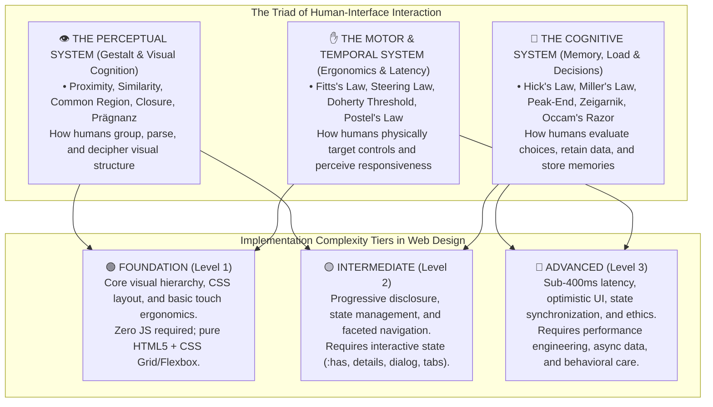

# 🧠 UX Laws, Principles & UI Patterns for Web Design
## A Comprehensive Compendium for Communication Designers & Front-End Architects
### Faculdade de Belas Artes da Universidade do Porto (FBAUP) • Licenciatura em Design de Comunicação
**Pedagogical Direction:** Prof. Pedro Amado (FBAUP / i2ADS)  
**Academic Year:** 2026/27 • Web Design (WD101)  
**Primary Research Sources:** Interaction Design Foundation (IxDF), Jon Yablonski (*Laws of UX*, 2nd Ed. 2024), William Lidwell et al. (*Universal Principles of Design*, 3rd Ed. 2023), Irene Pereyra (*Universal Principles of UX*, 2023), Don Norman (*The Design of Everyday Things*), Harry Brignull (*Deceptive Patterns*, 2023).

---

> *"Design is not just what it looks like and feels like. Design is how it works."*  
> — Steve Jobs
>
> *"Good design takes into consideration the physical and cognitive limits of the human being."*  
> — Don Norman, *The Design of Everyday Things*

---

## 🧭 Executive Summary & Conceptual Framework

As communication design students transition from visual composition and pure CSS layout architecture into interactive digital product design, a vital epistemological shift must occur: **moving from purely subjective visual styling to empirical cognitive ergonomics**.

Users do not arrive at a website with a blank slate. They bring deeply ingrained neurological wiring, perceptual habits, short-term memory constraints, physical motor-coordination thresholds, and expectations shaped by millions of previous online sessions. 

The **"UX Laws"** are not legal statutes, but **predictive empirical models and psychological heuristics** rooted in cognitive psychology, human factors engineering (ergonomics), Gestalt perceptual science, and behavioral economics. When understood deeply, they allow designers to:
1. **Reduce Extraneous Cognitive Load:** Free up users' mental bandwidth so they can focus on content, narrative, and tasks.
2. **Accelerate Motor Acquisition:** Minimize physical friction and mis-clicks across mouse pointers, trackpads, and mobile touch screens.
3. **Bridge the Gulf of Execution & Evaluation:** Help users instantly intuit *what can be done* (affordance) and *what just happened* (feedback).
4. **Prevent Deceptive Exploitation:** Recognize when psychological mechanisms are being weaponized against users as dark patterns, maintaining an unwavering ethical standard.



---

## 🪜 The 3-Tier Categorization Model

To provide a practical learning roadmap for web design students and practitioners, the laws in this compendium are organized into **three distinct tiers of implementation complexity**:

*   🟢 **Foundation (Level 1 — Essential / Core Ergonomics & Visual Perception):**  
    Principles that every web designer must apply directly at the structural CSS and HTML markup stage. Implementing these does not require complex scripting or dynamic data management. They rely on semantic HTML5, CSS layout mechanics (Flexbox, CSS Grid, Box Model padding and gap), typographical hierarchy, and basic touch target sizing.
*   🟡 **Intermediate (Level 2 — Structural / Information Architecture & Interaction Flow):**  
    Laws that govern how users navigate choices, evaluate content sequences, and handle progressive tasks. Implementing these requires intentional information architecture, multi-state UI components (e.g., accordions, faceted search, steppers, modal dialogs, tab interfaces), and responsive layout adaptation via modern CSS (`:has()`, container queries) and light vanilla JavaScript state.
*   🔴 **Advanced (Level 3 — Systemic / Performance Engineering, Latency & Cognitive State):**  
    Laws dealing with high-performance responsiveness (sub-400ms feedback loops), state synchronization across distributed servers, handling irreducible system complexity, memory retention over time, and behavioral psychology. Implementing these requires performance tuning (Core Web Vitals), optimistic UI rendering, skeleton loaders, persistent local storage, and strict ethical safeguards against deceptive design.

---

# 🟢 LEVEL 1: FOUNDATION (Core Ergonomics & Visual Perception)

---

### 1. Fitts’s Law
* **Domain:** Human Motor Ergonomics / Touch & Pointer Acquisition
* **Scientific Origin:** Formulated in 1954 by psychologist **Paul Fitts** (*"The information capacity of the human motor system in controlling the amplitude of movement"*).
* **Mathematical Formula:**  
  $$MT = a + b \log_2\left(rac{2D}{W}
ight)$$  
  *(Where $MT$ is Movement Time, $D$ is the distance to the target center, and $W$ is the width/size of the target along the axis of motion).*

#### Core Axiom
> The time required to rapidly move to a target area is a function of the ratio between the **distance to the target** and the **width of the target**. In short: **larger targets that are closer to the user's starting point are acquired dramatically faster and with fewer errors.**

#### Best Practices for Web Design
*   **Touch Target Minimums:** Adhere strictly to **WCAG 2.2 Success Criterion 2.5.8 (Target Size — Minimum: 24×24px)** and the Apple HIG / Material Design standard of **at least 44×44px to 48×48px** for all interactive touch elements on mobile.
*   **The Magic of Infinite Edges (Desktop):** In desktop browser viewports, screen edges and corners act as "infinitely wide" targets because the mouse cursor cannot overshoot them. Place top navigation or fixed toolbars flush with viewport edges.
*   **The Thumb Zone (Mobile):** Place primary actions (floating action buttons, bottom navigation bars, primary checkout triggers) in the bottom-middle quadrant of mobile viewports, where the user's thumb naturally rests without awkward stretching.
*   **Pad Small Links:** Never present tiny inline text links bunched together. Expand the clickable area using CSS padding (`padding: 0.75rem 1rem; display: inline-block;`).
*   **DON'T:** Create microscopic close ("×") buttons on modals or dropdowns that require surgical precision on touchscreens.

#### Cross-Referenced Principles & Patterns
*   **Design Principles:** Don Norman's *Affordance* & *Signifiers*; Jakob Nielsen's Usability Heuristic #7 (*Flexibility and Efficiency of Use*); WCAG 2.2 SC 2.5.5 (Target Size - Enhanced) & SC 2.5.8.
*   **UI Patterns:** Sticky Bottom Navigation Bar, Floating Action Button (FAB), Full-width CTA Buttons on mobile forms, Card Clickability (making the entire card container a hit area).
*   **Modern Web Implementation Tip:**
    ```css
    /* Expand touch target without disrupting visual typography */
    .button-subtle {
      position: relative;
    }
    .button-subtle::after {
      content: "";
      position: absolute;
      inset: -10px; /* Expands interactive hit target by 10px in all directions */
    }
    ```

---

### 2. Law of Proximity
* **Domain:** Gestalt Visual Perception
* **Scientific Origin:** Discovered by Gestalt psychologist **Max Wertheimer** (1923) in his foundational research on perceptual organization.

#### Core Axiom
> Objects or shapes that are positioned close to one another are perceived by the human brain as belonging to the **same functional group**, whereas objects placed farther apart are perceived as distinct and unrelated.

#### Best Practices for Web Design
*   **Label-to-Input Binding:** Form field labels must always sit closer to their corresponding `<input>` or `<textarea>` than to the preceding form field. 
*   **Macro vs. Micro Spacing:** Establish a mathematical spacing scale (e.g., 4px, 8px, 16px, 24px, 32px, 48px, 64px). Ensure that margin/gap *between* distinct sections is at least 2× to 3× larger than the spacing *inside* components.
*   **Metadata Clustering:** In blog posts, news cards, or product listings, place author avatars, publish dates, and reading time tags immediately adjacent to the headline, separated from body excerpts.
*   **DON'T:** Use uniform vertical margins across all elements on a page. When every paragraph, heading, and button has `margin-bottom: 20px`, proximity cues are completely obliterated, causing cognitive disorientation.

#### Cross-Referenced Principles & Patterns
*   **Design Principles:** Visual Hierarchy; Information Chunking; WCAG 2.2 SC 1.3.1 (*Info and Relationships*).
*   **UI Patterns:** Form Groups (`.form-group`), Card Metadata Bars, Definition Lists (`<dl>`, `<dt>`, `<dd>`), Sub-navigation clusters.
*   **Modern Web Implementation Tip:**
    ```css
    /* Modern CSS Grid & Flexbox gap ensures consistent proximity */
    .card-cluster {
      display: flex;
      flex-direction: column;
      gap: 0.5rem; /* Tight internal grouping */
    }
    .page-section {
      margin-block-end: 4rem; /* Generous macro-separation */
    }
    ```

---

### 3. Law of Similarity
* **Domain:** Gestalt Visual Perception
* **Scientific Origin:** Formulated by **Max Wertheimer** (1923).

#### Core Axiom
> Visual elements that share similar physical characteristics—such as **color, shape, size, typography, orientation, or elevation**—are perceived as performing the same function or belonging to the same entity.

#### Best Practices for Web Design
*   **Consistent Semantic Colors:** If interactive action links are styled in electric blue, do not use electric blue for non-clickable body text or static headings.
*   **Button Hierarchy & Shape:** All primary action buttons must share an identical border-radius, font-weight, and padding convention across the entire website. Secondary and tertiary buttons must share consistent secondary styles.
*   **Status Indicators:** Use standardized badge shapes and colors across the app (e.g., green pill = active, amber = pending, red = cancelled).
*   **DON'T:** Randomly style one link as an underline, another as bold blue, and a third as an italic pill within the same interface. Visual discrepancy forces users to question whether elements behave differently.

#### Cross-Referenced Principles & Patterns
*   **Design Principles:** Don Norman's *Consistency*; Jakob Nielsen's Usability Heuristic #4 (*Consistency and Standards*); Visual Rhythm.
*   **UI Patterns:** Design System Tokens (`btn--primary`, `btn--secondary`, `badge--pill`), Global Hyperlink Styling, Navigation Tab Strips.
*   **Modern Web Implementation Tip:**
    ```css
    /* Centralize shared attributes in CSS Design Tokens */
    :root {
      --link-color: var(--color-primary-600);
      --link-decoration: underline;
      --link-offset: 3px;
    }
    a:not([class]) {
      color: var(--link-color);
      text-decoration: var(--link-decoration);
      text-underline-offset: var(--link-offset);
    }
    ```

---

### 4. Law of Common Region
* **Domain:** Gestalt Visual Perception / Spatial Enclosure
* **Scientific Origin:** Discovered empirically by perceptual scientist **Stephen Palmer** (1992) (*"Common region: A new principle of perceptual grouping"*).

#### Core Axiom
> Elements located within the same closed boundary, border, or colored background surface are perceived as belonging to a unified, distinct functional group, even if they differ in shape or have wide internal spacing.

#### Best Practices for Web Design
*   **Cards as Autonomous Modules:** Wrap interrelated headlines, imagery, descriptions, and CTA buttons inside explicit card surfaces using contrasting background fills (`background-color: var(--surface-container)`), borders, or subtle elevation shadows.
*   **Fieldsets for Complex Forms:** Group related checkout fields (e.g., "Shipping Address" vs. "Billing Address") within semantic HTML `<fieldset>` containers bounded by `<legend>` tags and distinct background cards.
*   **Table Row Highlight & Grouping:** Group table cells into distinct rows using alternate striping (`:nth-child(even)`) or subtle borders to maintain visual association across wide displays.
*   **DON'T:** Rely exclusively on whitespace when separating deeply distinct conceptual modules. Without an enclosing common region, wide viewports cause elements to visually disperse.

#### Cross-Referenced Principles & Patterns
*   **Design Principles:** Containment; Spatial Scaffolding; WCAG 2.2 SC 1.3.1 (*Info and Relationships*).
*   **UI Patterns:** Card Grids, Modal Dialogs (`<dialog>`), Sidebar Panels, Accordion Bodies, Table Containers.
*   **Modern Web Implementation Tip:**
    ```css
    /* Explicit boundary establishes common region instantly */
    .module-card {
      background-color: light-dark(#ffffff, #1e1e1e);
      border: 1px solid light-dark(#e2e8f0, #334155);
      border-radius: 12px;
      padding: 1.5rem;
    }
    ```

---

### 5. Jakob’s Law (Jakob’s Law of Internet User Experience)
* **Domain:** Cognitive Mental Models & Habituation
* **Scientific Origin:** Formulated in 2000 by web usability pioneer **Dr. Jakob Nielsen** (Nielsen Norman Group).

#### Core Axiom
> Users spend most of their time on **other** websites. Therefore, users expect your website to work the same way as all the other websites they already know and use daily.

#### Best Practices for Web Design
*   **Standard Conventions are Gold:** Keep the site logo in the top-left corner linking to `/`, place search in the header with a magnifying glass icon, place user profile and shopping cart in the top-right, and place terms/privacy/sitemap in the footer.
*   **Don't Reinvent Established Controls:** Use standard form controls (checkboxes for multi-select, radio buttons for single-select, toggles for instant binary states). Never invert their conventional meanings.
*   **Innovation Where It Counts:** Reserve your creative, avant-garde design brilliance for unique storytelling, typography, custom photography, and brand identity—**not** for core navigation, scrolling physics, or checkout checkout funnels.
*   **DON'T:** Hijack native browser scrolling (scroll-jacking) or invent obscure replacement icons for universally understood actions (e.g., using a stylized origami swan instead of a shopping bag icon).

#### Cross-Referenced Principles & Patterns
*   **Design Principles:** Don Norman's *Mental Models* & *Conceptual Models*; Jakob Nielsen's Usability Heuristic #4 (*Consistency and Standards*); Sweller's Cognitive Load Theory (eliminating Extraneous Load).
*   **UI Patterns:** Global Header & Footer, Hamburger Navigation Drawer, Standard Search Bar, Tabbed Navigation, Shopping Cart Badge.
*   **Modern Web Implementation Tip:**
    ```html
    <!-- Standard HTML5 semantic landmark structure guarantees Jakob's Law adherence -->
    <header role="banner">
      <a href="/" class="site-logo" aria-label="Home">...</a>
      <nav role="navigation">...</nav>
      <div class="user-actions">...</div>
    </header>
    <main id="main-content">...</main>
    <footer role="contentinfo">...</footer>
    ```

---

### 6. Aesthetic–Usability Effect
* **Domain:** Cognitive Affect & Emotional Design
* **Scientific Origin:** First studied experimentally in 1995 by **Masaaki Kurosu and Kaori Kashimura** at the Hitachi Design Center in Tokyo, and corroborated in 1997 by **Noam Tractinsky** (*"Aesthetics and Apparent Usability: Empirically Justifying What We Know in Our Hearts"*).

#### Core Axiom
> Users frequently perceive visually attractive, aesthetically polished designs as **more usable, reliable, and trustworthy**, and they are significantly more tolerant of minor usability glitches or delays when an interface is beautiful.

#### Best Practices for Web Design
*   **Harmonic Visual Foundations:** Invest deeply in a disciplined typographic scale, refined whitespace balance, and accessible, pleasing color harmony (e.g., using OKLCH color spaces and CSS `light-dark()`).
*   **Micro-Polish Signals Professionalism:** Subtle hover transitions, crisp SVG iconography, and responsive layout polish give users subconscious confidence that the underlying technology is secure and competent.
*   **A Warning on the "Pretty Facade Trap":** While aesthetics create high initial satisfaction, beauty cannot salvage a fundamentally broken information architecture. Aesthetic delight buys patience, not permanent forgiveness.
*   **DON'T:** Conceal broken forms, confusing navigation, or severe accessibility barriers behind flashy visual effects or 3D animations.

#### Cross-Referenced Principles & Patterns
*   **Design Principles:** Don Norman's *Emotional Design* (Visceral, Behavioral, and Reflective Design levels); First Impression Bias; The Halo Effect.
*   **UI Patterns:** Hero Section Storytelling, Glassmorphic / Tonal Elevation Surfaces, Fluid Micro-Transitions, Responsive Typographic Hierarchy.
*   **Modern Web Implementation Tip:**
    ```css
    /* Fluid, harmonious typography scale using modern CSS clamp() */
    h1 {
      font-size: clamp(2rem, 1.5rem + 2.5vw, 3.75rem);
      line-height: 1.15;
      letter-spacing: -0.02em;
      text-wrap: balance; /* Modern CSS prevents awkward typographical runts */
    }
    ```

---

### 7. Occam’s Razor (Law of Parsimony)
* **Domain:** Epistemology / Minimalist Interaction Design
* **Scientific Origin:** Attributed to 14th-century Franciscan friar and philosopher **William of Ockham** (*"Entities should not be multiplied beyond necessity"* / *Novacula Occami*).

#### Core Axiom
> Among competing explanations or design solutions that achieve the exact same outcome, **the simplest solution with the fewest unnecessary elements, steps, or assumptions should always be chosen.**

#### Best Practices for Web Design
*   **Radical Subtraction:** Audit every page element, border, gradient, icon, and form field. Ask: *"Does this element directly assist the user in achieving their goal?"* If the answer is no, delete it.
*   **Single Primary CTA:** Avoid cluttering hero banners with 4 competing buttons. Provide one unambiguous primary action and, at most, one subtle secondary text link.
*   **Streamline Form Inputs:** Never ask for phone number, fax, company name, and secondary address if you only need an email address to create an account.
*   **DON'T:** Add decorative widgets, social feed ticker widgets, or ornamental borders simply to "fill empty space" (avoiding *Horror Vacui*).

#### Cross-Referenced Principles & Patterns
*   **Design Principles:** Dieter Rams' Principle #10 (*"Good design is as little design as possible"*); Irene Pereyra's Principle #11 (*"Less is more"*); Jakob Nielsen's Usability Heuristic #8 (*Aesthetic and Minimalist Design*).
*   **UI Patterns:** Single-Field Newsletter Signups, Clean Single-Column Landing Pages, Progressive Elimination of Redundant Navigation.
*   **Modern Web Implementation Tip:**
    ```css
    /* CSS reset and clean box architecture eliminate redundant decorative noise */
    * {
      box-sizing: border-box;
      margin: 0;
      padding: 0;
    }
    /* Leverage whitespace as an active design element, not emptiness */
    .hero-container {
      display: grid;
      place-items: center;
      gap: 1.5rem;
      padding: clamp(3rem, 8vw, 8rem) 1.5rem;
    }
    ```

---

### 8. Miller’s Law
* **Domain:** Cognitive Psychology / Working Memory Capacity
* **Scientific Origin:** Published in 1956 by cognitive psychologist **George A. Miller** (*"The Magical Number Seven, Plus or Minus Two: Some Limits on Our Capacity for Processing Information"*).

#### Core Axiom
> The average person can hold approximately **7 (plus or minus 2) discrete chunks of information** in their short-term working memory at any one time.

#### Best Practices for Web Design
*   **Chunking Information:** Break long strings of data into smaller, meaningful semantic clusters (chunks). Format 16-digit credit cards into 4 blocks of 4 digits (`#### #### #### ####`), and chunk telephone numbers with spaces or dashes.
*   **Menu Item Restraint:** Top-level navigation bars should contain between **5 and 7 primary options**. If you have 20 categories, group them into 5 parent hubs with structured sub-menus.
*   **Don't Weaponize the Number 7:** Miller's Law is frequently misinterpreted as *"every list must have exactly 7 items"*. It is about **working memory storage**, not visual scanning. Users can scan a list of 50 states if organized alphabetically; they cannot *memorize* 15 unsorted options.
*   **DON'T:** Display uninterrupted blocks of 20 unformatted numbers, un-grouped feature checklists, or mega-menus lacking categorized taxonomy headers.

#### Cross-Referenced Principles & Patterns
*   **Design Principles:** Information Architecture Chunking; Sweller's Cognitive Load Theory (Intrinsic Load); Working Memory Optimization.
*   **UI Patterns:** Chunked Input Masking, Segmented Button Groups, Stepped Pagination, Categorized Mega-Menu Columns.
*   **Modern Web Implementation Tip:**
    ```html
    <!-- Use input type, pattern, and inputmode for semantic chunking -->
    <input 
      type="text" 
      inputmode="numeric" 
      pattern="[0-9\s]{13,19}" 
      autocomplete="cc-number" 
      maxlength="19" 
      placeholder="4532 8901 2345 6789"
    />
    ```

---

### 9. Law of Symmetry and Order (Prägnanz Baseline)
* **Domain:** Gestalt Visual Perception
* **Scientific Origin:** Gestalt psychology foundational research (Wertheimer, Koffka, Köhler, early 20th century).

#### Core Axiom
> People perceive complex visual elements as symmetrical and organized around a center point whenever possible. The human brain seeks visual balance and stability to minimize mental effort.

#### Best Practices for Web Design
*   **Grid Column Alignment:** Align cards, content blocks, and media against a consistent column grid (e.g., 12-column desktop grid, 4-column mobile grid).
*   **Controlled Measure for Text:** Symmetrical, centered headlines work beautifully, but **never center-align long body copy** (more than 3 lines). Centered body text forces the user's eye to constantly search for varying line start positions, inducing ocular fatigue. Left-align body copy for left-to-right languages.
*   **Balanced Comparison Modules:** When displaying 2-column or 3-column pricing or feature comparisons, keep the heights, padding, and vertical anchor positions balanced.
*   **DON'T:** Use arbitrary, ungrounded offset alignments that lack purposeful asymmetric tension, as they look like accidental CSS layout bugs.

#### Cross-Referenced Principles & Patterns
*   **Design Principles:** Visual Balance, Structural Grid Systems, Readability & Legibility; Gutenberg Diagram.
*   **UI Patterns:** Symmetrical Card Grids (`display: grid; grid-template-columns: repeat(auto-fit, minmax(...));`), Split-Screen Hero Banners, 2-Column Comparison Tables.
*   **Modern Web Implementation Tip:**
    ```css
    /* Modern auto-fitting symmetrical CSS grid */
    .grid-symmetrical {
      display: grid;
      grid-template-columns: repeat(auto-fit, minmax(280px, 1fr));
      gap: 1.5rem;
      align-items: stretch;
    }
    ```

---

### 10. Law of Closure
* **Domain:** Gestalt Visual Perception
* **Scientific Origin:** Formulated by **Kurt Koffka** (1935) in *Principles of Gestalt Psychology*.

#### Core Axiom
> The human brain will automatically fill in missing visual information and connect gaps to perceive an incomplete shape or pattern as a unified, complete whole.

#### Best Practices for Web Design
*   **The "Peeking Card" Affordance in Carousels:** When designing horizontal swipeable carousels on mobile, always allow the edge of the next card to partially bleed into the right viewport boundary (showing 1.2 or 2.3 cards). The user's brain fills in the cut-off card, instantly deducing that horizontal scrolling is available without requiring explicit arrows.
*   **Iconography & Stencils:** Minimalist line icons (e.g., Lucide, Feather, Material Symbols) rely on closure to depict objects with minimal pixel density, reducing visual clutter.
*   **Skeleton Card Boundaries:** Skeleton loaders with dashed or faint outline containers trigger closure, allowing users to anticipate the incoming layout structure.
*   **DON'T:** Clip cards precisely flush with the screen edge in carousels. This creates an "illusion of completeness" where users assume the page has ended and never scroll horizontally.

#### Cross-Referenced Principles & Patterns
*   **Design Principles:** Perceptual Completion; Visual Affordance; Norman's *Signifiers*.
*   **UI Patterns:** Horizontal Swiping Carousels with Peek Overflow, Outlined Iconography, Accordion Chevron Indicators, Skeleton Wireframes.
*   **Modern Web Implementation Tip:**
    ```css
    /* Horizontal scroll carousel with peeking card affordance */
    .carousel-track {
      display: flex;
      overflow-x: auto;
      scroll-snap-type: x mandatory;
      gap: 1rem;
      padding-inline: 1rem;
    }
    .carousel-card {
      flex: 0 0 85%; /* 85% width ensures the 15% remainder peeks from the edge */
      scroll-snap-align: center;
    }
    ```

---

# 🟡 LEVEL 2: INTERMEDIATE (Information Architecture & Flow)

---

### 11. Hick’s Law (The Hick–Hyman Law)
* **Domain:** Cognitive Processing / Decision Time
* **Scientific Origin:** Formulated in 1952 by psychologists **William Edmund Hick and Ray Hyman** (*"On the rate of gain of information"*).
* **Mathematical Formula:**  
  $$RT = b \log_2(n + 1)$$  
  *(Where $RT$ is Reaction Time, $n$ is the number of equally probable alternatives, and $b$ is an empirical constant representing cognitive processing speed).*

#### Core Axiom
> The time it takes for a person to make a decision increases **logarithmically with the number and complexity of choices** available. More choices lead to decision fatigue, longer deliberation, and elevated abandonment rates.

#### Best Practices for Web Design
*   **Progressive Disclosure:** Break complex, intimidating forms into stepped multi-screen wizards (e.g., Step 1: Personal Info → Step 2: Shipping → Step 3: Payment).
*   **Faceted Filters:** When displaying e-commerce catalogs with hundreds of products, provide hierarchical faceted search filters with default collapsed states rather than a giant flat list of 80 checkboxes.
*   **Highlighted "Recommended" Choice:** In SaaS pricing tables with 3 or 4 tiers, visually elevate the "Most Popular" plan (larger scale, badge, primary color) so users do not experience analysis paralysis.
*   **DON'T:** Present users with mega-dropdown menus containing 60 unorganized links, or landing pages with 8 conflicting calls to action.

#### Cross-Referenced Principles & Patterns
*   **Design Principles:** Progressive Disclosure; Don Norman's *Constraints*; Barry Schwartz's *The Paradox of Choice*; Nielsen Usability Heuristic #8.
*   **UI Patterns:** Multi-Step Checkout Steppers, Accordions (`<details>` / `<summary>`), Tiered Pricing Cards, Tabbed Layouts, Search Autocomplete.
*   **Modern Web Implementation Tip:**
    ```html
    <!-- Native progressive disclosure with zero JS using HTML5 details -->
    <details class="advanced-settings">
      <summary>Advanced Developer Options (Expand to configure)</summary>
      <div class="settings-drawer">
        <!-- Deep options hidden until requested by power users -->
      </div>
    </details>
    ```

---

### 12. Von Restorff Effect (The Isolation Effect)
* **Domain:** Visual Salience / Cognitive Attention & Memory
* **Scientific Origin:** Discovered in 1933 by German psychiatrist and pediatrician **Hedwig von Restorff** (*"Über die Wirkung von Bereichsbildungen im Spurenfeld"*).

#### Core Axiom
> When multiple homogeneous (similar) stimuli are presented together, the single stimulus that **visually differs from the rest** is the most likely to be noticed, prioritized, and remembered.

#### Best Practices for Web Design
*   **Primary vs. Secondary Action Salience:** In a button pair (e.g., "Cancel" vs. "Confirm Purchase"), make "Confirm Purchase" a bold, high-contrast filled button and "Cancel" a quiet ghost or text button.
*   **Featured Tier Calling:** In pricing tables, apply a contrasting border or accent color to the tier you want users to buy.
*   **Inline Contextual Alerts:** Use bright, isolated warning badges or banner bars to highlight critical status changes or system errors.
*   **DON'T:** Highlight everything! When every element on a page is pulsing, blinking, or styled in saturated neon, nothing stands out. Isolation requires a calm, consistent background baseline.

#### Cross-Referenced Principles & Patterns
*   **Design Principles:** Visual Hierarchy, Focal Points, Visual Salience; WCAG 2.2 SC 1.4.1 (*Use of Color — ensure distinction is conveyed through shape/text, not color alone*).
*   **UI Patterns:** Primary Action Button vs. Secondary Links, "Featured" Ribbon / Badge, Callout Boxes, Hero Banner Value Proposition.
*   **Modern Web Implementation Tip:**
    ```css
    /* Isolate the featured plan cleanly with CSS scale and accent outline */
    .pricing-card.is-popular {
      border: 2px solid var(--color-primary);
      transform: scale(1.05);
      position: relative;
      z-index: 2;
    }
    ```

---

### 13. Serial Position Effect (Primacy & Recency)
* **Domain:** Cognitive Memory & Sequential Perception
* **Scientific Origin:** Discovered in 1885 by memory psychologist **Hermann Ebbinghaus** (*Über das Gedächtnis*).

#### Core Axiom
> In a sequential list or series of items, humans have a marked cognitive bias to remember the **first items (Primacy Effect)** and the **last items (Recency Effect)** best, while items in the middle suffer the highest rate of omission and recall decay.

#### Best Practices for Web Design
*   **Navigation Bar Sequencing:** Place the most critical, foundational link on the far left (e.g., "Home" / "Explore") and the primary conversion link on the far right (e.g., "Get Started" / "Log In"). Place secondary, utilitarian links in the middle.
*   **Key Selling Points:** In landing pages, place your strongest value proposition in the top hero fold, and reiterate your ultimate guarantee or social proof directly above the closing footer CTA.
*   **Mobile Bottom Bar Ordering:** In a 5-icon bottom navigation bar, place the primary dashboard on tab 1 and profile/settings on tab 5.
*   **DON'T:** Bury your core conversion goal, contact link, or critical product feature in the middle of a 12-item navigation list.

#### Cross-Referenced Principles & Patterns
*   **Design Principles:** Attention Curves, Visual Trajectory, Information Architecture Sequencing.
*   **UI Patterns:** Navigation Bar Layout, Landing Page Narrative Arc, Onboarding Slide Carousels, Pricing Feature Tables.
*   **Modern Web Implementation Tip:**
    ```html
    <!-- Anchor key items at extremes in navigation using flexbox justify-content: space-between -->
    <nav class="primary-nav">
      <a href="/" class="nav-primacy">Home</a>
      <div class="nav-middle-utilities">
        <a href="/features">Features</a>
        <a href="/pricing">Pricing</a>
        <a href="/about">About</a>
      </div>
      <a href="/signup" class="nav-recency-cta">Sign Up</a>
    </nav>
    ```

---

### 14. Postel’s Law (The Robustness Principle)
* **Domain:** Software Architecture & Forgiving Interaction Design
* **Scientific Origin:** Formulated in 1980 by internet pioneer **Jon Postel** in RFC 760 (DoD Standard Internet Protocol): *"Be conservative in what you do, be liberal in what you accept from others."*

#### Core Axiom
> Be liberal and forgiving in what you accept as user input, and be conservative, strict, and precise in what you output or send back. Anticipate human variability and error.

#### Best Practices for Web Design
*   **Forgiving Form Inputs:** Allow users to type phone numbers with or without international country codes, parentheses, hyphens, or spaces (`+351 912 345 678` vs. `00351912345678`). Clean and sanitize the string programmatically on the client/server rather than barking an error.
*   **Postal Codes & Credit Cards:** Automatically strip out spaces from credit card inputs or postal codes instead of rejecting the submission.
*   **Lenient Search Queries:** Accommodate common typos, singular/plural variations, and diacritics in search bars (e.g., searching for *"portugues"* should return *"português"*).
*   **DON'T:** Hit the user with rigid, hostile error messages like *"Invalid format: must match ^[0-9]{3}-[0-9]{3}$"* for a simple phone number or postal code.

#### Cross-Referenced Principles & Patterns
*   **Design Principles:** Don Norman's *Forgiveness*; Jakob Nielsen's Usability Heuristics #5 (*Error Prevention*) and #9 (*Help Users Recognize, Diagnose, and Recover from Errors*).
*   **UI Patterns:** Intelligent Form Input Sanitizers, Auto-Formatting Masked Inputs, "Did you mean?" Search Suggestions, Inline Real-Time Validation.
*   **Modern Web Implementation Tip:**
    ```html
    <!-- HTML5 input with flexible regex and auto-correction disabled for technical strings -->
    <input 
      type="tel" 
      id="phone" 
      name="phone"
      autocomplete="tel"
      placeholder="e.g. 912 345 678"
    />
    ```

---

### 15. Law of Uniform Connectedness
* **Domain:** Gestalt Visual Perception / Visual Connection
* **Scientific Origin:** Established in 1994 by perceptual psychologists **Stephen Palmer and Irvin Rock** (*"Rethinking perceptual organization: The role of uniform connectedness"*).

#### Core Axiom
> Visual elements that are physically connected by uniform visual properties (such as lines, color bands, arrows, or enclosing frames) are perceived as **more strongly related than elements related by proximity or similarity alone**.

#### Best Practices for Web Design
*   **Progressive Steppers:** Connect circular step indicators (Step 1, Step 2, Step 3) with a solid or filled horizontal line to show a unified sequential workflow.
*   **Breadcrumbs:** Connect hierarchical page pathways using clear directional divider glyphs (`/` or `›`) to show parent-child taxonomic relationships.
*   **Connected Tabs:** The active navigation tab should visually merge seamlessly with the content container below it (sharing the same background color and border stroke) with no dividing line between them.
*   **DON'T:** Leave floating, detached step numbers in a checkout flow with no connecting graphic line, as users will perceive them as isolated milestones.

#### Cross-Referenced Principles & Patterns
*   **Design Principles:** Connectedness Overrides Proximity; Structural Flow; Spatial Cohesion.
*   **UI Patterns:** Stepper Wizard Navigation, Breadcrumb Trails (`<nav aria-label="Breadcrumb">`), Tab-to-Panel Seamless Joining, Tree Navigators.
*   **Modern Web Implementation Tip:**
    ```css
    /* Seamless connection between active tab and content panel */
    .tab-btn.is-active {
      background: var(--surface-bg);
      border-bottom: 2px solid transparent; /* Drops boundary into panel */
      margin-bottom: -1px;
    }
    .tab-panel {
      background: var(--surface-bg);
      border: 1px solid var(--border-color);
    }
    ```

---

### 16. Law of Continuity (Good Continuation)
* **Domain:** Gestalt Visual Perception / Eye Movement Trajectories
* **Scientific Origin:** Discovered by **Max Wertheimer** (1923).

#### Core Axiom
> The human eye naturally follows smooth continuous paths, straight lines, or gentle curves from one object to the next, preferring continuous visual trajectories over sharp, abrupt changes in direction.

#### Best Practices for Web Design
*   **Vertical Alignment Lines:** Align all body text, headings, and input fields along a continuous left margin line. Staggered, irregular indentations break the eye's natural vertical scanning rhythm.
*   **Timeline Feeds:** Use an unbroken vertical line running through chronological feeds (e.g., activity history, order tracking) to lead the reader's eye smoothly through the sequence.
*   **Reading Paths (F-Shape & Z-Pattern):** Structure content along established optical pathways—horizontal across top headers, then sweeping diagonally down to the next key milestone.
*   **DON'T:** Scatter content blocks with randomly varying horizontal margins across a page, creating an unpredictable zigzag eye path that rapidly causes visual fatigue.

#### Cross-Referenced Principles & Patterns
*   **Design Principles:** Eye Tracking Paths (Gutenberg Diagram, Z-Pattern, F-Pattern); Visual Flow; Scannability.
*   **UI Patterns:** Vertical Delivery Tracking Timelines, Masonry Image Feeds, Left-Aligned Article Layouts, Step-by-Step Roadmaps.
*   **Modern Web Implementation Tip:**
    ```css
    /* Unbroken vertical timeline line using CSS pseudo-elements */
    .timeline-container {
      position: relative;
      padding-left: 2rem;
    }
    .timeline-container::before {
      content: "";
      position: absolute;
      top: 0;
      bottom: 0;
      left: 0.75rem;
      width: 2px;
      background: var(--color-border);
    }
    ```

---

### 17. Law of Prägnanz (Law of Good Form / Simplicity)
* **Domain:** Gestalt Visual Perception / Cognitive Economy
* **Scientific Origin:** Formulated in 1935 by Gestalt pioneer **Kurt Koffka** (*Prägnanz* is a German word meaning "conciseness", "pithiness", or "meaningful precision").

#### Core Axiom
> The human mind interprets ambiguous, complex, or cluttered visual scenes in the **simplest, most orderly, and most regular form possible**, expending the minimum cognitive energy necessary.

#### Best Practices for Web Design
*   **Universal Symbolic Icons:** Use the simplest possible geometrical forms to communicate actions (a magnifying glass for search, a gear for settings, a bookmark ribbon, a trash can).
*   **Declutter Dense Data:** Present complex tables with clean borders, ample row breathing room, and clear alignment rather than complex multi-layered 3D styling.
*   **Simplify Layout Geometry:** Stick to clean rectangular content cards and orthogonal grids rather than hyper-complex diagonal or skewed layouts that require high visual parsing effort.
*   **DON'T:** Use hyper-detailed, photorealistic, or overly conceptual icons when a clean, geometric vector glyph communicates the idea instantly.

#### Cross-Referenced Principles & Patterns
*   **Design Principles:** Cognitive Efficiency, Iconic Representation, Visual Economy; Don Norman's *Signifiers*.
*   **UI Patterns:** Standardized SVG Iconography, Minimalist Card Architecture, Orthogonal Layout Grids.
*   **Modern Web Implementation Tip:**
    ```css
    /* Vector SVG icons sized consistently with currentColor inherit */
    .icon {
      width: 1.25rem;
      height: 1.25rem;
      stroke-width: 2;
      stroke: currentColor;
      fill: none;
      vertical-align: middle;
    }
    ```

---

### 18. Steering Law (Accot–Zhai Steering Law)
* **Domain:** Human Motor Control / Constrained Path Traversal
* **Scientific Origin:** Formulated in 1997 by **Johnny Accot and Shumin Zhai** as an extension of Fitts's Law for navigating along closed 2D channels.
* **Mathematical Formula:**  
  $$T = a + b \int_C rac{ds}{W(s)}$$  
  *(Where $T$ is navigation time, $C$ is the trajectory curve, and $W(s)$ is the corridor width at point $s$).*

#### Core Axiom
> The time required to navigate or "steer" a mouse pointer or cursor through a constrained physical tunnel, path, or corridor is determined by the **length of the path divided by the path's narrowness**.

#### Best Practices for Web Design
*   **The Infamous Dropdown Menu Trap:** When a user hovers over a top menu to access a nested sub-menu, moving the cursor diagonally often crosses outside the narrow hit area, abruptly collapsing the menu (the classic Amazon mega-menu problem).
*   **Triangular Safe Hover Zones:** Implement directional hover prediction (or slight dismissal delays of 300–500ms) so that users can steer diagonally toward submenus without losing focus.
*   **Wide Scrubbing Tunnels:** Make video playback scrub bars, audio sliders, and range sliders thick enough (or give them an invisible hit channel of 32px) so dragging doesn't slip off the track.
*   **DON'T:** Build deeply nested, 3-level flyout menus with thin, 20px-high hover strips that require surgeon-like mouse coordination.

#### Cross-Referenced Principles & Patterns
*   **Design Principles:** Motor Precision Limits; Accot-Zhai Ergonomics; Fitts's Law Extension.
*   **UI Patterns:** Mega-Menus with Diagonal Safe Trajectories, Thick Range Sliders (`<input type="range">`), Scrubber Bars, Tree-View Navigators.
*   **Modern Web Implementation Tip:**
    ```css
    /* Modern CSS :has() and transition delays preserve submenu open state during steering */
    .nav-item:has(.sub-menu:hover) > .sub-menu,
    .nav-item:hover > .sub-menu {
      display: block;
      transition-delay: 200ms; /* Prevents immediate collapse on diagonal mouse slippage */
    }
    ```

---

### 19. Peak–End Rule
* **Domain:** Behavioral Economics / Affective Memory Recall
* **Scientific Origin:** Discovered in 1993 by Nobel laureate **Daniel Kahneman, Barbara Fredrickson, et al.** (*"When More Pain Is Preferred to Less: Adding a Better End"*).

#### Core Axiom
> People judge and remember a past experience largely based on how they felt at **its most emotionally intense point (the Peak)** and at **its conclusion (the End)**, rather than on the mathematical average or sum of every single moment.

#### Best Practices for Web Design
*   **Celebrate the Finish Line (The End):** Never end a checkout flow or form submission with a dry, cold message like *"Record saved."* Provide a delightful, reassuring confirmation screen (e.g., order summary, delivery timeline, celebratory illustration, or subtle confetti micro-animation).
*   **Turn Peaks of Pain into Delight:** When an inevitable error occurs (e.g., a 404 page or broken network connection), turn the painful peak into a positive experience with helpful navigation links, witty and empathetic copywriting, or an interactive easter egg (like Chrome's Dino Runner).
*   **Smooth Offboarding:** Cancellation and unsubscription flows must be clean, respectful, and dignified. An aggressive or guilt-tripping cancellation flow leaves a bitter final memory that destroys brand equity permanently.
*   **DON'T:** Abandon the user on a blank white page after they've spent 20 minutes completing a high-stakes application or transaction.

#### Cross-Referenced Principles & Patterns
*   **Design Principles:** Affective Memory, Customer Journey Mapping, Emotional Design (Don Norman).
*   **UI Patterns:** Post-Purchase Confirmation Pages, Empathetic 404 Pages, Account Creation Success Modals, Graceful Cancellation Dialogs.
*   **Modern Web Implementation Tip:**
    ```html
    <!-- Empathetic, recovery-oriented 404 error page structure -->
    <div class="error-hero">
      <span class="status-code">404</span>
      <h2>We searched the galaxy, but that page has drifted away.</h2>
      <p>Let's get you back on course:</p>
      <div class="recovery-links">
        <a href="/" class="btn-primary">Return to Homepage</a>
        <a href="/search" class="btn-secondary">Search the Archive</a>
      </div>
    </div>
    ```

---

### 20. Goal-Gradient Effect
* **Domain:** Behavioral Motivation & Gamification
* **Scientific Origin:** Discovered in 1932 by behaviorist **Clark Hull** (*"The goal gradient hypothesis applied to rats"*), later applied to human consumer psychology by Ran Kivetz et al. (2006).

#### Core Axiom
> The closer people perceive themselves to reaching a defined goal or milestone, the **faster, more engaged, and more motivated they become** to complete the final steps.

#### Best Practices for Web Design
*   **Artificial Progress / Endowed Progress:** An onboarding checklist that begins with *"Step 1 of 5 completed: Account Created!"* (20% progress already achieved) sees dramatically higher completion rates than one starting at 0%.
*   **Visual Steppers in Checkouts:** Display clear numbered progress indicators in checkout funnels (e.g., *"Cart → Shipping → Payment → Review"*). Highlight the advancing fill bar.
*   **Profile Completion Badges:** LinkedIn's "Profile Strength: Intermediate (80%) — Add 1 skill to reach All-Star" famously drove millions of users to complete their profiles.
*   **DON'T:** Use open-ended forms where users have no idea how many steps remain or how close they are to finishing.

#### Cross-Referenced Principles & Patterns
*   **Design Principles:** Motivation Scaffolding, Progress Feedback, Endowed Progress Effect; Zeigarnik Synergy.
*   **UI Patterns:** Checkout Progress Bars, Onboarding Task Checklists, Loyalty Point Fill Gauges, Stepped Wizards.
*   **Modern Web Implementation Tip:**
    ```html
    <!-- Semantic HTML5 progress bar for goal advancement -->
    <div class="progress-wrapper">
      <label for="checkout-progress">Step 3 of 4: Payment Details (75% Complete)</label>
      <progress id="checkout-progress" max="100" value="75">75%</progress>
    </div>
    ```

---

# 🔴 LEVEL 3: ADVANCED (Latency, Systems Architecture, State & Ethics)

---

### 21. Doherty Threshold
* **Domain:** Temporal Perception & Human-Computer Symbiosis
* **Scientific Origin:** Published in 1979 by IBM researchers **Walter J. Doherty and Ahrvid Thadhani** (*"The Economic Value of Rapid Response Time"*).

#### Core Axiom
> Human productivity and conversational flow soar exponentially when computer response time drops **below 400 milliseconds (0.4 seconds)**. At this threshold, neither the user nor the computer has to wait on the other, maintaining unbroken mental focus.

#### Best Practices for Web Design
*   **Optimistic UI Updates:** When a user clicks a "Like" heart or "Add to Cart" button, mutate the visual DOM state immediately (< 50ms) rather than freezing the button while waiting for the network API round-trip. If the backend fails, rollback gracefully with a toast notification.
*   **Skeleton Screens Over Spinners:** Replace centered blocking spinners with animated pulsing skeleton wireframes. Skeleton screens make load times feel 30% faster by previewing the layout geometry before data arrives.
*   **Instant Interaction States:** Ensure interactive elements provide immediate visual feedback on `:hover` and `:active` states (color shifts, subtle button depressions) with zero delay.
*   **Core Web Vitals Alignment:** Keep **INP (Interaction to Next Paint)** under 200ms and **LCP (Largest Contentful Paint)** under 2.5s to preserve the Doherty flow state.
*   **DON'T:** Leave users looking at a frozen, unresponsive screen after a click with zero feedback, prompting them to furiously click the button multiple times.

#### Cross-Referenced Principles & Patterns
*   **Design Principles:** Don Norman's *Feedback* (< 100ms for instant perception, < 1s for flow); Jakob Nielsen's Usability Heuristic #1 (*Visibility of System Status*); Core Web Vitals (INP / LCP / TTFB).
*   **UI Patterns:** Optimistic UI Updates, Shimmering Skeleton Wireframes, Instant Button Pressed States (`:active`), Micro-loaders.
*   **Modern Web Implementation Tip:**
    ```css
    /* Shimmering skeleton loader animation in pure modern CSS */
    .skeleton-box {
      background: linear-gradient(
        90deg, 
        var(--surface-muted) 25%, 
        var(--surface-highlight) 50%, 
        var(--surface-muted) 75%
      );
      background-size: 200% 100%;
      animation: skeleton-shimmer 1.5s infinite linear;
      border-radius: 6px;
    }
    @keyframes skeleton-shimmer {
      0% { background-position: 200% 0; }
      100% { background-position: -200% 0; }
    }
    ```

---

### 22. Tesler’s Law (Law of Conservation of Complexity)
* **Domain:** Systems Architecture & Cognitive Load Distribution
* **Scientific Origin:** Coined in the mid-1980s by computer scientist and Xerox PARC/Apple interaction pioneer **Larry Tesler** (the inventor of cut, copy, paste).

#### Core Axiom
> Every system possesses an inherent, irreducible amount of complexity. The only architectural choice is **who bears the burden of that complexity: the software engineer/designer, or the end user.**

#### Best Practices for Web Design
*   **Absorb Complexity in the System:** Instead of asking the user to manually enter their credit card issuer (Visa vs. Mastercard), identify it automatically from the first 4 digits typed. Instead of asking for city and district, auto-populate them from the postal code.
*   **Smart Sensor & API Defaults:** Detect the user's preferred color scheme via CSS `@media (prefers-color-scheme)` and their preferred language via browser headers, rather than forcing manual configuration on first visit.
*   **The Over-Simplification Warning:** Tesler cautioned against stripping away controls so aggressively that expert users can no longer accomplish complex tasks. Hide complexity behind intelligent defaults and progressive disclosure, but don't eradicate necessary capability.
*   **DON'T:** Offload internal backend data structures onto the user interface (e.g., forcing users to select internal database ID codes or system status codes).

#### Cross-Referenced Principles & Patterns
*   **Design Principles:** Cognitive Load Transfer; Don Norman's *Mapping* & *Conceptual Models*; Systemic Ergonomics.
*   **UI Patterns:** Smart Autocomplete, Geo-IP Currency Detection, Payment Card Auto-Detection, Sensible Preset Defaults.
*   **Modern Web Implementation Tip:**
    ```css
    /* Automatic system-level dark mode adaptation absorbs configuration complexity */
    :root {
      color-scheme: light dark;
      --bg: light-dark(#ffffff, #121212);
      --text: light-dark(#1a1a1a, #f5f5f5);
    }
    body {
      background-color: var(--bg);
      color: var(--text);
    }
    ```

---

### 23. Zeigarnik Effect
* **Domain:** Cognitive Tension & Task Resumption
* **Scientific Origin:** Discovered in 1927 by Soviet psychologist and psychiatrist **Bluma Zeigarnik** (*"Das Behalten erledigter und unerledigter Handlungen"*), based on Kurt Lewin's gestalt field theory.

#### Core Axiom
> People remember uncompleted, interrupted, or pending tasks **significantly better than tasks that have been finished**, because incomplete tasks generate an unresolved cognitive tension in working memory.

#### Best Practices for Web Design
*   **Persistent Draft Recovery:** When a user is authoring a blog post or filling out a long form, auto-save their state to `localStorage` continuously. If they accidentally close the tab and return, greet them with: *"We restored your uncompleted draft!"*
*   **Visual Cart & Task Badges:** Display a persistent item count badge on shopping cart icons (`[ 3 ]`) or notification bells to gently remind users of unfinished journeys.
*   **Gamified Onboarding Progress:** Keep progress indicators visible during complex setup workflows so users feel an intrinsic desire to achieve closure.
*   **DON'T:** Use the Zeigarnik effect to create manipulative, anxiety-inducing notification spam that pesters users with relentless false emergencies.

#### Cross-Referenced Principles & Patterns
*   **Design Principles:** Cognitive Closure; Kurt Lewin's Tension Systems; Task Resumption Architecture.
*   **UI Patterns:** Persistent Saved Drafts, Shopping Cart Count Badges, Profile Completion Rings, "Pick Up Where You Left Off" Banners.
*   **Modern Web Implementation Tip:**
    ```javascript
    // Persist incomplete form fields to localStorage for seamless task resumption
    const form = document.querySelector('#checkout-form');
    form.addEventListener('input', (e) => {
      localStorage.setItem(`draft_${e.target.name}`, e.target.value);
    });
    ```

---

### 24. Parkinson’s Law
* **Domain:** Behavioral Productivity & Time Allocation
* **Scientific Origin:** Coined in 1955 by British naval historian and author **C. Northcote Parkinson** in an essay for *The Economist*: *"Work expands so as to fill the time available for its completion."*

#### Core Axiom
> A task will expand to consume whatever amount of time or resources is allocated for its completion. In UX: users will deliberate, wander, or abandon tasks if an interface is open-ended and lacks structured pacing.

#### Best Practices for Web Design
*   **Bounded Checkout Sessions:** In high-demand ticketing (e.g., concert or festival tickets like Drumtiks '26), reserve the user's selected seats for a clear, reasonable duration (e.g., *"Seats reserved for 10:00 minutes"*). This provides clear structure and prevents inventory hoarding.
*   **Inline Auto-Focus & Pacing:** Auto-focus the first field in single-purpose modal forms, and automatically advance focus to the next field when a fixed-length code is typed (e.g., 6-digit SMS 2FA codes).
*   **Streamlined Decision Windows:** Reduce open-ended browsing fatigue in transactional flows by limiting auxiliary distractions.
*   **DON'T:** Fake countdown timers! Inventing artificial 5-minute countdowns that simply reset on refresh is a notorious, unethical dark pattern that destroys user trust.

#### Cross-Referenced Principles & Patterns
*   **Design Principles:** Bounded Rationality, Pacing, Focused Attention.
*   **UI Patterns:** Cart Reservation Countdowns, Two-Factor Code Auto-Tab Inputs, Focused Modal Dialogs, Quick-Checkout Express Buttons.
*   **Modern Web Implementation Tip:**
    ```html
    <!-- Native HTML5 autofocus and input autocomplete streamline time to completion -->
    <input 
      type="text" 
      id="two-factor" 
      maxlength="6" 
      autofocus 
      autocomplete="one-time-code"
      placeholder="123456"
    />
    ```

---

### 25. Pareto Principle (The 80/20 Rule)
* **Domain:** Systems Analysis & Resource Optimization
* **Scientific Origin:** Named after Italian economist **Vilfredo Pareto** (1896), formalized by management consultant **Joseph M. Juran** (1941) (*"The vital few and the trivial many"*).

#### Core Axiom
> In almost any complex system, approximately **80% of outcomes or user interactions originate from 20% of inputs, features, or elements**.

#### Best Practices for Web Design
*   **Ruthless Feature Prioritization:** Analyze your web traffic and analytics. Identify the 20% of navigation links, tools, and pages that receive 80% of user traffic. Elevate these vital few into the primary view; tuck the remaining 80% into structured secondary drawers or utility menus.
*   **Eliminate Feature Bloat:** Resist the urge to add 50 configuration options to an application. Optimize the default experience for the 80% use case, and provide progressive disclosure for the 20% power-user niche.
*   **Responsive Priority Guides:** On mobile viewports, ruthlessly hide the non-essential 80% of dashboard columns or table data behind an expandable row drawer.
*   **DON'T:** Give equal visual weight and primary navigation real estate to a page that receives 0.1% of visits compared to the core product catalog.

#### Cross-Referenced Principles & Patterns
*   **Design Principles:** Feature Creep Prevention; Progressive Disclosure; Don Norman's *Activity-Centered Design*.
*   **UI Patterns:** Priority+ Navigation Pattern, Collapsible Table Row Drawers, Core Action Toolbars, Segmented Settings (Basic vs. Advanced).
*   **Modern Web Implementation Tip:**
    ```css
    /* The Priority+ Navigation pattern: hide lower-tier links on small screens */
    .nav-secondary-links {
      display: none;
    }
    @media (min-width: 1024px) {
      .nav-secondary-links {
        display: flex;
      }
    }
    ```

---

### 26. Labor Illusion
* **Domain:** Perceived Value & Algorithmic Transparency
* **Scientific Origin:** Experimentally demonstrated in 2011 by Harvard Business School researchers **Ryan Buell and Michael Norton** (*"The Labor Illusion: How Operational Transparency Increases Satisfaction with Service Operations"*).

#### Core Axiom
> People place significantly higher subjective value, trust, and satisfaction on a digital service's results when they **perceive the system actively exerting effort and labor on their behalf**, even when the wait time is intentionally introduced.

#### Best Practices for Web Design
*   **Transparent Aggregators:** Travel search sites (Kayak, Skyscanner) famously display animated step-by-step progress tickers: *"Searching 450 airlines... Checking 12,000 hotel rates... Finding cheapest connection..."* Even though modern servers could return the JSON data in 150ms, showing the active search makes users trust that the system conducted an exhaustive search.
*   **AI & Synthesis Feedback:** When generating complex reports, data visualizations, or AI responses, show streaming text tokens or step-by-step reasoning badges rather than a static spinner.
*   **Security & Encryption Scans:** Showing a brief 1-second visual scan animation during bank transfers or security verifications reinforces user perception of safety.
*   **DON'T:** Artificially delay simple, everyday operations (like loading an article or rendering a form). Only employ the labor illusion for genuinely complex or high-value algorithmic synthesis.

#### Cross-Referenced Principles & Patterns
*   **Design Principles:** Operational Transparency; Trust Architecture; System Visibility.
*   **UI Patterns:** Step-by-Step Search Progress Bars, Streaming Text Tokens, Verification Checklists, Animated Data Parsers.
*   **Modern Web Implementation Tip:**
    ```html
    <!-- Animated step-by-step progress ticker communicating systemic effort -->
    <div class="labor-ticker" aria-live="polite">
      <div class="spinner-pulse"></div>
      <p class="ticker-message">Searching 340 flight databases for lowest fares...</p>
    </div>
    ```

---

### 27. Weber–Fechner Law (Just Noticeable Difference — JND)
* **Domain:** Psychophysics / Sensory Stimulus Discrimination
* **Scientific Origin:** Discovered in 1834 by German anatomist **Ernst Heinrich Weber**, formalized in 1860 by physicist **Gustav Fechner** (*Elemente der Psychophysik*).
* **Mathematical Formula:**  
  $$rac{\Delta I}{I} = k$$  
  *(Where $I$ is initial stimulus intensity, $\Delta I$ is the change threshold required to be noticed, and $k$ is a constant).*

#### Core Axiom
> The minimum change in a sensory stimulus that is detectable by humans (the Just Noticeable Difference) is **directly proportional to the initial magnitude of the stimulus**. A subtle difference that is obvious in a small stimulus becomes invisible in a massive one.

#### Best Practices for Web Design
*   **Typographic Modular Scales:** Headings must increase in size exponentially rather than linearly. Increasing a 16px body font to 18px is immediately noticeable; increasing a 64px display headline to 66px is completely imperceptible. Use a recognized modular ratio (e.g., 1.25 Major Third, 1.333 Perfect Fourth, or 1.414 Augmented Fourth).
*   **Hover & Active State Contrast:** On a dark charcoal button (`#222`), a +10% lightness lift is readily visible. On a light gray button (`#f0f0f0`), the same +10% lift is virtually washed out. Calibrate perceptual color shifts using uniform lightness color models like **OKLCH**.
*   **Micro-Interaction Feedback:** Subtle haptic, sound, or motion changes must scale with the weight of the user action (e.g., closing a modal requires a lighter cue than permanently deleting an account).
*   **DON'T:** Use tiny 1px differences in size or hairline differences in gray text to communicate critical state distinctions.

#### Cross-Referenced Principles & Patterns
*   **Design Principles:** Visual Contrast, Modular Typographic Scales, Sensory Perception.
*   **UI Patterns:** Fluid Modular Typography (`clamp()`), OKLCH Color Tokens, Scaled Elevation Drop Shadows.
*   **Modern Web Implementation Tip:**
    ```css
    /* Uniform perceptual color contrast adjustments using modern CSS OKLCH */
    .btn-tonal {
      background-color: oklch(0.65 0.18 240);
      transition: background-color 150ms ease;
    }
    .btn-tonal:hover {
      background-color: oklch(0.75 0.18 240); /* Proportional lightness step */
    }
    ```

---

### 28. Law of Common Fate
* **Domain:** Gestalt Visual Perception / Motion & Choreography
* **Scientific Origin:** Formulated by **Max Wertheimer** (1923).

#### Core Axiom
> Visual elements that **move simultaneously in the same direction and at the same speed** are perceived by the human brain as belonging to a single, unified group or moving object.

#### Best Practices for Web Design
*   **Coordinated Drawer Navigation:** When an off-canvas navigation menu slides in from the left, slide the main page content simultaneously to the right. Moving together establishes that they exist in a shared spatial relationship.
*   **Accordion Animations:** When expanding an accordion panel, ensure the items below it slide downward smoothly at the exact same velocity as the expansion, preventing visual tearing.
*   **Swipeable Carousel Cards:** In a gallery carousel, all cards must glide across the screen at an identical velocity during a drag gesture.
*   **Respect Reduced Motion:** Always wrap coordinated motion in `@media (prefers-reduced-motion: reduce)` to support users with vestibular motion disorders.
*   **DON'T:** Animate adjacent elements at conflicting speeds, chaotic directions, or discordant easing curves, which shatters perceptual unity.

#### Cross-Referenced Principles & Patterns
*   **Design Principles:** Motion Choreography, Spatial Continuity; WCAG 2.2 SC 2.3.3 (*Animation from Interactions*).
*   **UI Patterns:** Off-Canvas Navigation Drawers, Accordion Collapsibles, Parallax Depth Scrolling, Gesture-Driven Cards.
*   **Modern Web Implementation Tip:**
    ```css
    /* Smooth coordinated motion with reduced-motion accessibility safeguard */
    .drawer, .content-canvas {
      transition: transform 300ms cubic-bezier(0.16, 1, 0.3, 1);
    }
    @media (prefers-reduced-motion: reduce) {
      .drawer, .content-canvas {
        transition: none;
      }
    }
    ```

---

### 29. Choice Overload Effect (The Paradox of Choice)
* **Domain:** Behavioral Economics / Cognitive Paralysis
* **Scientific Origin:** Experimentally proven in 2000 by psychologists **Sheena Iyengar and Mark Lepper** (*"When Choice is Demotivating: Can One Desire Too Much of a Good Thing?"* — the famous 24-jam vs. 6-jam experiment); popularized by Barry Schwartz (2004).

#### Core Axiom
> While an abundance of choices initially attracts attention, an extensive array of options dramatically **decreases actual conversion, induces decision paralysis, and breeds post-purchase anxiety and regret.**

#### Best Practices for Web Design
*   **Curate, Don't Dump:** Instead of presenting users with a catalog page displaying 120 unranked options, present a curated "Top 3 Editor's Picks" or "Best for Beginners" selection.
*   **Sensible Form Dropdown Lengths:** Dropdown `<select>` menus should never contain 50 unsorted options. If choices exceed 10, implement a searchable combobox or categorized grouping (`<optgroup>`).
*   **Single-Path Conversion:** Landing pages should offer one clear path forward. Multiple competing offers on the same screen cause visitors to bounce without choosing.
*   **DON'T:** Overwhelm first-time users during onboarding with dozens of configuration sliders and toggles before they've experienced the product's core value.

#### Cross-Referenced Principles & Patterns
*   **Design Principles:** Hick's Law Macro-Counterpart; Cognitive Economy; Barry Schwartz's *Paradox of Choice*.
*   **UI Patterns:** Curated "Editor's Choice" Badges, Default Recommended Settings, Simplified 3-Tier Pricing, Searchable Comboboxes.
*   **Modern Web Implementation Tip:**
    ```html
    <!-- Use optgroup to structure long dropdown menus into digestible categories -->
    <select name="country-region" id="region-select">
      <optgroup label="Europe (Western)">
        <option value="pt">Portugal</option>
        <option value="es">Spain</option>
        <option value="fr">France</option>
      </optgroup>
      <optgroup label="Americas">
        <option value="br">Brazil</option>
        <option value="us">United States</option>
      </optgroup>
    </select>
    ```

---

### 30. The Ethical Imperative & Anti-Deceptive Design (The Counter-Law)
* **Domain:** Digital Ethics / Behavioral Integrity & Human Rights
* **Scientific Origin:** Pioneer research by **Harry Brignull** (coined "Dark Patterns" in 2010; author of *Deceptive Patterns*, 2023), backed by EU Digital Services Act (DSA) and FTC regulatory frameworks.

#### Core Axiom
> The misuse of psychological UX laws to trick, coerce, manipulate, or trap users into decisions against their best interest **destroys long-term brand equity, erodes institutional trust, and violates human autonomy.**

#### Best Practices for Web Design
*   **Equal Effort for Opposite Actions:** If canceling a subscription or deleting an account takes more clicks, phone calls, or friction than signing up, you have built a deceptive **"Roach Motel"**. Keep cancellation as effortless as registration.
*   **Honest Confirmations (No Confirmshaming):** Never write manipulative opt-out buttons like *"No thanks, I hate saving money"* or *"No, I prefer being ignorant"*. A polite *"No thanks"* or *"Maybe later"* is the only ethical standard.
*   **Transparent Pricing (No Drip Pricing):** Reveal the full price—including shipping, taxes, and service fees—early in the flow, rather than surprising the user at the final checkout screen.
*   **Explicit Consent (No Pre-Ticked Boxes):** Checkboxes for marketing newsletters, insurance add-ons, or recurring billing must **never** be checked by default.
*   **DON'T:** Weaponize Fitts's Law (making the "Reject Cookies" button a tiny 10px gray link while "Accept All" is a massive 48px green button) or Parkinson's Law (displaying fake ticking timers that restart upon page reload).

#### Cross-Referenced Principles & Patterns
*   **Design Principles:** Ethical Design; Don Norman's *Human-Centered Design Ethics*; Dieter Rams' Principle #6 (*"Good design is honest"*); WCAG 2.2 AAA Standards.
*   **Deceptive Patterns to Avoid:** Roach Motel, Confirmshaming, Drip Pricing, Disguised Ads, Sneak into Basket, Fake Urgency / Scarcity Countdown.
*   **Modern Web Implementation Tip:**
    ```html
    <!-- Ethical Cookie Consent: Equal visual weight, identical Fitts's Law hit area -->
    <div class="consent-actions">
      <button type="button" class="btn-secondary">Reject Non-Essential</button>
      <button type="button" class="btn-primary">Accept All Cookies</button>
    </div>
    ```

---

# 📊 Master Cross-Reference Matrix

The following comprehensive matrix cross-references all 30 UX laws against their psychological domain, implementation complexity tier, primary design principles, corresponding UI patterns, and web accessibility / standard benchmarks:

| # | UX Law / Principle | Domain | Tier | Core Design Principles | Key UI Patterns | Web / WCAG Benchmark |
|:---:|:---|:---|:---:|:---|:---|:---|
| **1** | **Fitts’s Law** | Motor Ergonomics | 🟢 Foundation | Affordance, Signifiers, Efficiency | Sticky Bottom Nav, FAB, Full-width CTAs | WCAG 2.2 SC 2.5.8 (24px) / Apple 44pt |
| **2** | **Law of Proximity** | Gestalt Perception | 🟢 Foundation | Visual Hierarchy, Chunking | Form Groups, Card Metadata clusters | WCAG 2.2 SC 1.3.1 (Info & Relationships) |
| **3** | **Law of Similarity** | Gestalt Perception | 🟢 Foundation | Consistency & Standards | Tokenized Link colors, Status Badges | WCAG 2.2 SC 1.4.1 (Color independence) |
| **4** | **Law of Common Region** | Gestalt Perception | 🟢 Foundation | Spatial Enclosure, Scaffolding | Card Grids, Fieldsets, Dialog Modals | CSS Box Model, `<fieldset>`, `<dialog>` |
| **5** | **Jakob’s Law** | Mental Models | 🟢 Foundation | Mental Models, Habituation | Header/Footer layout, Standard Cart/Search | HTML5 Landmarks (`<header>`, `<nav>`) |
| **6** | **Aesthetic-Usability Effect** | Affective Cognition | 🟢 Foundation | Emotional Design, First Impressions | Harmonic Typography, Fluid Transitions | OKLCH Color Space, CSS `light-dark()` |
| **7** | **Occam’s Razor** | Parsimony | 🟢 Foundation | Minimalist Design, Subtraction | Single Primary CTA, Clean Landing Pages | Dieter Rams #10 ("Less, but better") |
| **8** | **Miller’s Law** | Working Memory | 🟢 Foundation | Cognitive Load, Chunking | Masked Phone/Card inputs, 5–7 item menus | Working memory limit (7 ± 2 chunks) |
| **9** | **Law of Symmetry & Order** | Gestalt Perception | 🟢 Foundation | Visual Balance, Stability | Symmetrical Grid Alignments, Balanced Cards | CSS Grid `repeat(auto-fit, minmax())` |
| **10** | **Law of Closure** | Gestalt Perception | 🟢 Foundation | Perceptual Completion, Affordance | Peeking Carousel Cards, Outlined Icons | CSS `scroll-snap-type: x mandatory` |
| **11** | **Hick’s Law** | Decision Time | 🟡 Intermediate | Constraints, Progressive Disclosure | Stepper Wizards, Accordions, Faceted Filters | Decision reaction time formula |
| **12** | **Von Restorff Effect** | Visual Salience | 🟡 Intermediate | Visual Hierarchy, Focal Points | High-contrast Primary Button, Pricing Badges | WCAG 2.2 SC 1.4.3 (Contrast Minimum) |
| **13** | **Serial Position Effect** | Cognitive Memory | 🟡 Intermediate | Primacy & Recency, Attention | Extreme Nav Link Placement, Hero/Footer CTAs | Ebbinghaus Memory Retention Curve |
| **14** | **Postel’s Law** | Robustness | 🟡 Intermediate | Forgiveness, Error Prevention | Flexible Input Sanitizers, Auto-Formatters | Nielsen Heuristics #5 & #9 |
| **15** | **Law of Uniform Connectedness** | Gestalt Perception | 🟡 Intermediate | Connectedness, Structural Flow | Breadcrumbs (`›`), Stepper lines, Tabs | Gestalt overriding proximity |
| **16** | **Law of Continuity** | Gestalt Perception | 🟡 Intermediate | Optical Flow, Reading Paths | Vertical Timelines, Masonry Image Feeds | Gutenberg Diagram & F-Pattern Scanning |
| **17** | **Law of Prägnanz** | Gestalt Perception | 🟡 Intermediate | Cognitive Economy, Iconic Representation | Geometric SVG Glyphs, Minimalist Cards | Minimal mental interpretation load |
| **18** | **Steering Law** | Motor Control | 🟡 Intermediate | Motor Constraints, Trajectory | Mega-menus with hover tunnels, Sliders | Accot-Zhai Tunnel Steering Equation |
| **19** | **Peak–End Rule** | Affective Memory | 🟡 Intermediate | Emotional Design, Journey Mapping | Celebratory Checkout Screen, Friendly 404s | Kahneman Peak-End Affective Curve |
| **20** | **Goal-Gradient Effect** | Motivation | 🟡 Intermediate | Endowed Progress, Gamification | Stepper Progress Gauges, Profile Rings | Clark Hull Behavioral Motivation Curve |
| **21** | **Doherty Threshold** | Latency / Ergonomics | 🔴 Advanced | Feedback (< 400ms), System Status | Optimistic UI, Skeleton Wireframe Loaders | Core Web Vitals (INP < 200ms, LCP < 2.5s) |
| **22** | **Tesler’s Law** | Systems Architecture | 🔴 Advanced | Cognitive Load Transfer, Engineering | Card Issuer Auto-Detect, Postal Lookup | Conservation of Systemic Complexity |
| **23** | **Zeigarnik Effect** | Cognitive Tension | 🔴 Advanced | Cognitive Closure, Task Resumption | Persistent Draft Autosave, Cart Badges | `localStorage` state restoration |
| **24** | **Parkinson’s Law** | Productivity / Time | 🔴 Advanced | Bounded Rationality, Pacing | Ticket Hold Countdowns, 2FA Auto-Tab | Time-bounded session integrity |
| **25** | **Pareto Principle (80/20)** | Systems Optimization | 🔴 Advanced | Feature Creep Prevention, Pruning | Priority+ Nav Pattern, Expandable Rows | 80/20 Usage Distribution |
| **26** | **Labor Illusion** | Trust / Perception | 🔴 Advanced | Operational Transparency, Perceived Value | Search Aggregator Step Tickers, AI Streams | Buell-Norton Operational Transparency |
| **27** | **Weber–Fechner Law (JND)**| Psychophysics | 🔴 Advanced | Perceptual Contrast, Modular Scales | Fluid Modular Typography, Elevation Steps | Proportional Just Noticeable Difference |
| **28** | **Law of Common Fate** | Gestalt Motion | 🔴 Advanced | Motion Choreography, Spatial Continuity | Coordinated Off-Canvas Drawers, Swipe feeds | WCAG 2.2 SC 2.3.3 (`prefers-reduced-motion`) |
| **29** | **Choice Overload Effect** | Behavioral Economics | 🔴 Advanced | Paradox of Choice, Curated Taxonomy | "Editor's Pick" Badges, Grouped `<select>` | Iyengar-Lepper Choice Demotivation |
| **30** | **Ethical Anti-Deceptive Law** | Digital Ethics | 🔴 Advanced | Honest Design, User Autonomy | Transparent Pricing, Equal-Weight Opt-Outs | EU Digital Services Act / FTC Guidelines |

---

# 🎓 Pedagogical Application for FBAUP Communication Designers

### Connecting WD101 Code to Cognitive Science
In the foundational semester of Web Design at FBAUP, students learn to master semantic HTML5 and pure CSS layout architectures (CSS Grid, Flexbox, Box Model, Design Tokens, and native animations). 

This compendium of UX Laws is designed to serve as the **intellectual and psychological bridge** between pure technical markup and user-centered interaction design:
1. When designing a **CSS Grid macro-layout**, apply the **Law of Common Region** and **Law of Symmetry** to establish clear, stable mental boundaries.
2. When configuring **Flexbox micro-components**, use `gap` to calibrate the **Law of Proximity** and ensure related items cling together while distinct clusters pull apart.
3. When authoring interactive buttons and links, use **Fitts's Law** to guarantee thumb-friendly tap targets on mobile viewports.
4. When planning user journeys, forms, and portfolio showcases, apply **Hick's Law**, the **Peak-End Rule**, and **Occam's Razor** to prevent cognitive overload and leave a memorable, joyful impression.
5. And above all, as designers of future communication media, commit to the **Ethical Imperative**: design to empower, illuminate, and respect human dignity, rejecting deceptive dark patterns forever.

---

### 📚 Bibliography & Curated Reference Archive

#### Books in `_Materiais de Apoio (2026)`:
*   **Yablonski, Jon.** (2024). *Laws of UX: Using Psychology to Design Better Products & Services* (2nd Edition). Sebastopol, CA: O’Reilly Media.
*   **Lidwell, William; Holden, Kritina; Butler, Jill.** (2023). *Universal Principles of Design: 100 More Timeless Design Principles, Updated and Expanded Third Edition*. Beverly, MA: Rockport Publishers.
*   **Pereyra, Irene.** (2023). *Universal Principles of UX: 100 Timeless Strategies to Create Positive Interactions Between People and Digital Products*. Beverly, MA: Rockport Publishers / Quarto.
*   **Norman, Donald A.** (2013). *The Design of Everyday Things: Revised and Expanded Edition*. New York: Basic Books.
*   **Brignull, Harry.** (2023). *Deceptive Patterns: Exposing the Tricks Tech Companies Use to Control You*. Testimonium Limited.
*   **Cooper, Alan; Reimann, Robert; Cronin, David; Noessel, Christopher.** (2014). *About Face: The Essentials of Interaction Design* (4th Edition). Indianapolis, IN: John Wiley & Sons.
*   **Scott, Bill; Neil, Theresa.** (2009). *Designing Web Interfaces: Principles and Patterns for Rich Interactions*. Sebastopol, CA: O’Reilly Media.
*   **Shneiderman, Ben; Plaisant, Catherine; Cohen, Maxine; Jacobs, Steven.** (2016). *Designing the User Interface: Strategies for Effective Human-Computer Interaction* (6th Edition). Boston: Pearson.

#### Institutional & Web Research Resources:
*   **Interaction Design Foundation (IxDF):** Literature topics, encyclopedic entries, and masterclasses on *Design Principles*, *Gestalt Psychology*, *Human-Computer Interaction*, and *Cognitive Ergonomics*. [interaction-design.org](https://www.interaction-design.org/)
*   **Laws of UX Project (Jon Yablonski):** Open-source compendium of psychological UX principles. [lawsofux.com](https://lawsofux.com/)
*   **Nielsen Norman Group (NN/g):** Seminal research by Jakob Nielsen, Don Norman, and Bruce Tognazzini on heuristics, usability engineering, and mental models. [nngroup.com](https://www.nngroup.com/)
*   **W3C Web Accessibility Initiative (WAI):** *Web Content Accessibility Guidelines (WCAG) 2.2* (W3C Recommendation, 2023). [w3.org/WAI](https://www.w3.org/WAI/)
