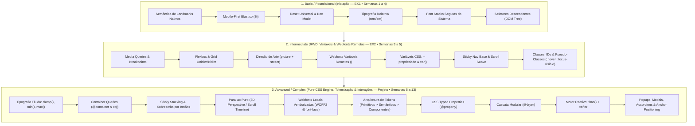

# MDN HTML5 & CSS3 Full Specifications: Comprehensive Technical Reference & Curriculum Matrix

**Unidade Curricular:** Web Design 101 (WD101) — Licenciatura em Design de Comunicação (FBAUP)  
**Coordenação Pedagógica:** Prof. Pedro Amado (`pamado@fba.up.pt`)  
**Norma Técnica:** W3C / WHATWG HTML5 Living Standard & W3C CSS Cascading Style Sheets Level 3/4/5 (via [MDN Web Docs](https://developer.mozilla.org/en-US/))

---

## 1. Enquadramento Pedagógico & Arquitetura por Níveis (Tiers)

Para capacitar os estudantes de Design de Comunicação a conceber e implementar websites responsivos de alta qualidade sem recurso a JavaScript (*Pure HTML5 + CSS3 Engine*), o ecossistema técnico é estruturado em três patamares de progressão pedagógica:



### 1.1 Matriz de Diferenciação Curricular dos Tópicos-Chave

| Domínio Técnico | Nível Intermédio (EX2 • Semanas 3 a 5) | Nível Avançado (Projeto • Semanas 5 a 13) |
| :--- | :--- | :--- |
| **Responsividade & Escala** | **Media Queries Tradicionais (`@media`):** Adaptação baseada na largura total da janela (*Viewport Width*). | **Container Queries (`@container`):** Responsividade intrínseca do componente baseada no seu contentor pai (`container-type: inline-size`, unidades `cqi`, `cqw`). |
| **Posicionamento & Scroll** | **Sticky Navigation Base:** Barra de topo fixa (`position: sticky; top: 0;`) com scroll suave (`scroll-behavior: smooth`). | **Sticky Stacking & Parallax:** Empilhamento de cartões deslizantes onde os irmãos seguintes sobrepõem e empurram os anteriores, e efeitos de profundidade com perspetiva 3D ou `animation-timeline: scroll()`. |
| **Variáveis & Tokens** | **Variáveis CSS Simples (`--*` & `var()`):** Reutilização de cores, tipografia base e redefinição fluida em media queries. | **Sistema Formal de Design Tokens:** Arquitetura em 3 camadas (*Primitivos $\rightarrow$ Semânticos $\rightarrow$ Componentes*), tipagem com `@property`, sincronização Figma e *Theming*. |
| **Webfonts Variáveis** | **Webfonts Remotas (CDN / Google Fonts):** Inclusão ágil no `<head>` via `<link rel="preconnect">` e `<link rel="stylesheet">`. | **Webfonts Vendorizadas / Self-Hosted:** Ficheiros WOFF2 locais em `assets/fonts/`, `@font-face` com intervalos contínuos de eixos, `<link rel="preload">`, `font-display: swap` e `size-adjust`. |

---

## 2. Matriz HTML5: Elementos Organizados por Marcos Estruturais (Landmarks)

### 2.1 Raiz & Metadados do Documento (Root & Document Metadata)

| # | Tag / Elemento | Tipo | Nível Curricular | No Curso WD101? | Referência MDN |
| :---: | :--- | :---: | :--- | :---: | :--- |
| 1 | `<!DOCTYPE html>` | HTML | Basic / Foundational | **YES** | [MDN: Doctype](https://developer.mozilla.org/en-US/docs/Glossary/Doctype) |
| 2 | `<html>` | HTML | Basic / Foundational | **YES** | [MDN: html](https://developer.mozilla.org/en-US/docs/Web/HTML/Element/html) |
| 3 | `<head>` | HTML | Basic / Foundational | **YES** | [MDN: head](https://developer.mozilla.org/en-US/docs/Web/HTML/Element/head) |
| 4 | `<title>` | HTML | Basic / Foundational | **YES** | [MDN: title](https://developer.mozilla.org/en-US/docs/Web/HTML/Element/title) |
| 5 | `<meta charset="UTF-8">` | HTML | Basic / Foundational | **YES** | [MDN: meta](https://developer.mozilla.org/en-US/docs/Web/HTML/Element/meta) |
| 6 | `<meta name="viewport">` | HTML | Basic / Foundational | **YES** | [MDN: Viewport meta tag](https://developer.mozilla.org/en-US/docs/Web/HTML/Viewport_meta_tag) |
| 7 | `<meta name="description">` | HTML | Basic / Foundational | **YES** | [MDN: Standard metadata names](https://developer.mozilla.org/en-US/docs/Web/HTML/Element/meta/name) |
| 8 | `<link rel="stylesheet">` | HTML | Basic / Foundational | **YES** | [MDN: link](https://developer.mozilla.org/en-US/docs/Web/HTML/Element/link) |
| 9 | `<link rel="preconnect">` | HTML | **Intermediate** | **YES** *(Otimização de Webfonts remotas)*| [MDN: rel=preconnect](https://developer.mozilla.org/en-US/docs/Web/HTML/Attributes/rel/preconnect) |
| 10 | `<link rel="preload" as="font">` | HTML | **Advanced / Complex** | **YES** *(Carregamento antecipado de WOFF2)* | [MDN: rel=preload](https://developer.mozilla.org/en-US/docs/Web/HTML/Attributes/rel/preload) |
| 11 | `<link rel="icon">` (Favicon) | HTML | Intermediate | **YES** | [MDN: link types: icon](https://developer.mozilla.org/en-US/docs/Web/HTML/Attributes/rel#icon) |
| 12 | `<style>` | HTML | Basic / Foundational | **NO** *(Folhas externas obrigatórias)* | [MDN: style](https://developer.mozilla.org/en-US/docs/Web/HTML/Element/style) |
| 13 | `<base>` | HTML | Advanced / Complex | **NO** | [MDN: base](https://developer.mozilla.org/en-US/docs/Web/HTML/Element/base) |

### 2.2 Secionamento & Marcos de Acessibilidade (Sectioning & ARIA Landmarks)

| # | Tag / Elemento | Tipo | Nível Curricular | No Curso WD101? | Referência MDN |
| :---: | :--- | :---: | :--- | :---: | :--- |
| 14 | `<header>` | HTML | Basic / Foundational | **YES** | [MDN: header](https://developer.mozilla.org/en-US/docs/Web/HTML/Element/header) |
| 15 | `<nav>` | HTML | Basic / Foundational | **YES** | [MDN: nav](https://developer.mozilla.org/en-US/docs/Web/HTML/Element/nav) |
| 16 | `<main>` | HTML | Basic / Foundational | **YES** | [MDN: main](https://developer.mozilla.org/en-US/docs/Web/HTML/Element/main) |
| 17 | `<section>` | HTML | Basic / Foundational | **YES** | [MDN: section](https://developer.mozilla.org/en-US/docs/Web/HTML/Element/section) |
| 18 | `<article>` | HTML | Basic / Foundational | **YES** | [MDN: article](https://developer.mozilla.org/en-US/docs/Web/HTML/Element/article) |
| 19 | `<aside>` | HTML | Basic / Foundational | **YES** | [MDN: aside](https://developer.mozilla.org/en-US/docs/Web/HTML/Element/aside) |
| 20 | `<footer>` | HTML | Basic / Foundational | **YES** | [MDN: footer](https://developer.mozilla.org/en-US/docs/Web/HTML/Element/footer) |
| 21 | `<h1>`, `<h2>`, `<h3>` | HTML | Basic / Foundational | **YES** | [MDN: Heading Elements](https://developer.mozilla.org/en-US/docs/Web/HTML/Element/Heading_Elements) |
| 22 | `<h4>`, `<h5>`, `<h6>` | HTML | Intermediate | **YES** | [MDN: Heading Elements](https://developer.mozilla.org/en-US/docs/Web/HTML/Element/Heading_Elements) |
| 23 | `<hgroup>` | HTML | Intermediate | **TBD** *(Excelente para subtítulos)* | [MDN: hgroup](https://developer.mozilla.org/en-US/docs/Web/HTML/Element/hgroup) |
| 24 | `<address>` | HTML | Basic / Foundational | **YES** | [MDN: address](https://developer.mozilla.org/en-US/docs/Web/HTML/Element/address) |
| 25 | `<search>` | HTML | Intermediate | **TBD** *(Substitui div/form de pesquisa)* | [MDN: search](https://developer.mozilla.org/en-US/docs/Web/HTML/Element/search) |

### 2.3 Estrutura de Conteúdo Textual (Text Content Blocks)

| # | Tag / Elemento | Tipo | Nível Curricular | No Curso WD101? | Referência MDN |
| :---: | :--- | :---: | :--- | :---: | :--- |
| 26 | `<p>` | HTML | Basic / Foundational | **YES** | [MDN: p](https://developer.mozilla.org/en-US/docs/Web/HTML/Element/p) |
| 27 | `<ul>` | HTML | Basic / Foundational | **YES** | [MDN: ul](https://developer.mozilla.org/en-US/docs/Web/HTML/Element/ul) |
| 28 | `<ol>` | HTML | Basic / Foundational | **YES** | [MDN: ol](https://developer.mozilla.org/en-US/docs/Web/HTML/Element/ol) |
| 29 | `<li>` | HTML | Basic / Foundational | **YES** | [MDN: li](https://developer.mozilla.org/en-US/docs/Web/HTML/Element/li) |
| 30 | `<dl>` | HTML | Intermediate | **TBD** *(Fichas técnicas e alinhamentos)* | [MDN: dl](https://developer.mozilla.org/en-US/docs/Web/HTML/Element/dl) |
| 31 | `<dt>` | HTML | Intermediate | **TBD** | [MDN: dt](https://developer.mozilla.org/en-US/docs/Web/HTML/Element/dt) |
| 32 | `<dd>` | HTML | Intermediate | **TBD** | [MDN: dd](https://developer.mozilla.org/en-US/docs/Web/HTML/Element/dd) |
| 33 | `<blockquote>` | HTML | Basic / Foundational | **YES** | [MDN: blockquote](https://developer.mozilla.org/en-US/docs/Web/HTML/Element/blockquote) |
| 34 | `<figure>` | HTML | Basic / Foundational | **YES** | [MDN: figure](https://developer.mozilla.org/en-US/docs/Web/HTML/Element/figure) |
| 35 | `<figcaption>` | HTML | Basic / Foundational | **YES** | [MDN: figcaption](https://developer.mozilla.org/en-US/docs/Web/HTML/Element/figcaption) |
| 36 | `<pre>` | HTML | Intermediate | **YES** | [MDN: pre](https://developer.mozilla.org/en-US/docs/Web/HTML/Element/pre) |
| 37 | `<hr>` | HTML | Basic / Foundational | **YES** | [MDN: hr](https://developer.mozilla.org/en-US/docs/Web/HTML/Element/hr) |
| 38 | `<div>` | HTML | Intermediate | **YES** *(Com restrição pedagógica estrita)* | [MDN: div](https://developer.mozilla.org/en-US/docs/Web/HTML/Element/div) |
| 39 | `<menu>` | HTML | Intermediate | **NO** *(Preterido por ul em nav)* | [MDN: menu](https://developer.mozilla.org/en-US/docs/Web/HTML/Element/menu) |

### 2.4 Semântica Textual em Linha (Inline Text Semantics)

| # | Tag / Elemento | Tipo | Nível Curricular | No Curso WD101? | Referência MDN |
| :---: | :--- | :---: | :--- | :---: | :--- |
| 40 | `<a>` | HTML | Basic / Foundational | **YES** | [MDN: a](https://developer.mozilla.org/en-US/docs/Web/HTML/Element/a) |
| 41 | `<strong>` | HTML | Basic / Foundational | **YES** | [MDN: strong](https://developer.mozilla.org/en-US/docs/Web/HTML/Element/strong) |
| 42 | `<em>` | HTML | Basic / Foundational | **YES** | [MDN: em](https://developer.mozilla.org/en-US/docs/Web/HTML/Element/em) |
| 43 | `<small>` | HTML | Basic / Foundational | **YES** | [MDN: small](https://developer.mozilla.org/en-US/docs/Web/HTML/Element/small) |
| 44 | `<cite>` | HTML | Basic / Foundational | **YES** | [MDN: cite](https://developer.mozilla.org/en-US/docs/Web/HTML/Element/cite) |
| 45 | `<q>` | HTML | Basic / Foundational | **YES** | [MDN: q](https://developer.mozilla.org/en-US/docs/Web/HTML/Element/q) |
| 46 | `<abbr>` | HTML | Basic / Foundational | **YES** | [MDN: abbr](https://developer.mozilla.org/en-US/docs/Web/HTML/Element/abbr) |
| 47 | `<time>` | HTML | Basic / Foundational | **YES** | [MDN: time](https://developer.mozilla.org/en-US/docs/Web/HTML/Element/time) |
| 48 | `<code>` | HTML | Intermediate | **YES** | [MDN: code](https://developer.mozilla.org/en-US/docs/Web/HTML/Element/code) |
| 49 | `<kbd>` | HTML | Intermediate | **TBD** *(Atalhos de teclado de navegação)* | [MDN: kbd](https://developer.mozilla.org/en-US/docs/Web/HTML/Element/kbd) |
| 50 | `<samp>` | HTML | Intermediate | **NO** | [MDN: samp](https://developer.mozilla.org/en-US/docs/Web/HTML/Element/samp) |
| 51 | `<var>` | HTML | Intermediate | **NO** | [MDN: var](https://developer.mozilla.org/en-US/docs/Web/HTML/Element/var) |
| 52 | `<mark>` | HTML | Intermediate | **YES** | [MDN: mark](https://developer.mozilla.org/en-US/docs/Web/HTML/Element/mark) |
| 53 | `<span>` | HTML | Basic / Foundational | **YES** | [MDN: span](https://developer.mozilla.org/en-US/docs/Web/HTML/Element/span) |
| 54 | `<br>` | HTML | Basic / Foundational | **YES** *(Uso poético/morada estrito)* | [MDN: br](https://developer.mozilla.org/en-US/docs/Web/HTML/Element/br) |
| 55 | `<wbr>` | HTML | Advanced / Complex | **TBD** *(Quebras fluidas de palavras longas)*| [MDN: wbr](https://developer.mozilla.org/en-US/docs/Web/HTML/Element/wbr) |
| 56 | `<sub>` / `<sup>` | HTML | Intermediate | **YES** | [MDN: sub](https://developer.mozilla.org/en-US/docs/Web/HTML/Element/sub) |
| 57 | `<s>` | HTML | Basic / Foundational | **YES** | [MDN: s](https://developer.mozilla.org/en-US/docs/Web/HTML/Element/s) |
| 58 | `<i>` / `<b>` | HTML | Basic / Foundational | **YES** *(Com distinção semântica de em/strong)* | [MDN: i](https://developer.mozilla.org/en-US/docs/Web/HTML/Element/i) |
| 59 | `<u>` | HTML | Basic / Foundational | **NO** *(Evitado por colidir com hiperligações)* | [MDN: u](https://developer.mozilla.org/en-US/docs/Web/HTML/Element/u) |
| 60 | `<data>` | HTML | Intermediate | **TBD** *(Para associação a atributos de dados)*| [MDN: data](https://developer.mozilla.org/en-US/docs/Web/HTML/Element/data) |
| 61 | `<dfn>` | HTML | Intermediate | **NO** | [MDN: dfn](https://developer.mozilla.org/en-US/docs/Web/HTML/Element/dfn) |
| 62 | `<bdi>` / `<bdo>` | HTML | Advanced / Complex | **NO** *(Apenas para multilinguismo bidirecional)* | [MDN: bdi](https://developer.mozilla.org/en-US/docs/Web/HTML/Element/bdi) |
| 63 | `<ruby>`, `<rt>`, `<rp>` | HTML | Advanced / Complex | **NO** *(Apenas para anotações fonéticas asiáticas)* | [MDN: ruby](https://developer.mozilla.org/en-US/docs/Web/HTML/Element/ruby) |

### 2.5 Imagens, Multimédia & Recursos Responsivos

| # | Tag / Elemento | Tipo | Nível Curricular | No Curso WD101? | Referência MDN |
| :---: | :--- | :---: | :--- | :---: | :--- |
| 64 | `` | HTML | Basic / Foundational | **YES** | [MDN: img](https://developer.mozilla.org/en-US/docs/Web/HTML/Element/img) |
| 65 | `<picture>` | HTML | Intermediate / Advanced | **YES** | [MDN: picture](https://developer.mozilla.org/en-US/docs/Web/HTML/Element/picture) |
| 66 | `<source>` | HTML | Intermediate / Advanced | **YES** | [MDN: source](https://developer.mozilla.org/en-US/docs/Web/HTML/Element/source) |
| 67 | `<video>` | HTML | Intermediate | **YES** | [MDN: video](https://developer.mozilla.org/en-US/docs/Web/HTML/Element/video) |
| 68 | `<audio>` | HTML | Intermediate | **YES** | [MDN: audio](https://developer.mozilla.org/en-US/docs/Web/HTML/Element/audio) |
| 69 | `<track>` | HTML | Intermediate | **TBD** *(Legendas de acessibilidade em vídeo)*| [MDN: track](https://developer.mozilla.org/en-US/docs/Web/HTML/Element/track) |
| 70 | `<map>` / `<area>` | HTML | Intermediate | **NO** *(Obsoleto vs Responsive SVG)* | [MDN: map](https://developer.mozilla.org/en-US/docs/Web/HTML/Element/map) |

### 2.6 Conteúdo Embebido & Gráficos Vetoriais

| # | Tag / Elemento | Tipo | Nível Curricular | No Curso WD101? | Referência MDN |
| :---: | :--- | :---: | :--- | :---: | :--- |
| 71 | `<iframe>` | HTML | Intermediate | **YES** | [MDN: iframe](https://developer.mozilla.org/en-US/docs/Web/HTML/Element/iframe) |
| 72 | `<svg>` | HTML | Intermediate | **YES** | [MDN: SVG](https://developer.mozilla.org/en-US/docs/Web/SVG/Element/svg) |
| 73 | `<embed>` | HTML | Intermediate | **NO** | [MDN: embed](https://developer.mozilla.org/en-US/docs/Web/HTML/Element/embed) |
| 74 | `<object>` | HTML | Intermediate | **NO** | [MDN: object](https://developer.mozilla.org/en-US/docs/Web/HTML/Element/object) |
| 75 | `<math>` | HTML | Advanced / Complex | **NO** | [MDN: math](https://developer.mozilla.org/en-US/docs/Web/MathML/Element/math) |
| 76 | `<canvas>` | HTML | Advanced / Complex | **NO** *(Exige JavaScript)* | [MDN: canvas](https://developer.mozilla.org/en-US/docs/Web/HTML/Element/canvas) |

### 2.7 Tabelas de Dados Estruturados (Tables)

| # | Tag / Elemento | Tipo | Nível Curricular | No Curso WD101? | Referência MDN |
| :---: | :--- | :---: | :--- | :---: | :--- |
| 77 | `<table>` | HTML | Intermediate | **YES** | [MDN: table](https://developer.mozilla.org/en-US/docs/Web/HTML/Element/table) |
| 78 | `<caption>` | HTML | Intermediate | **YES** | [MDN: caption](https://developer.mozilla.org/en-US/docs/Web/HTML/Element/caption) |
| 79 | `<thead>` | HTML | Intermediate | **YES** | [MDN: thead](https://developer.mozilla.org/en-US/docs/Web/HTML/Element/thead) |
| 80 | `<tbody>` | HTML | Intermediate | **YES** | [MDN: tbody](https://developer.mozilla.org/en-US/docs/Web/HTML/Element/tbody) |
| 81 | `<tfoot>` | HTML | Intermediate | **YES** | [MDN: tfoot](https://developer.mozilla.org/en-US/docs/Web/HTML/Element/tfoot) |
| 82 | `<tr>` | HTML | Intermediate | **YES** | [MDN: tr](https://developer.mozilla.org/en-US/docs/Web/HTML/Element/tr) |
| 83 | `<th>` | HTML | Intermediate | **YES** | [MDN: th](https://developer.mozilla.org/en-US/docs/Web/HTML/Element/th) |
| 84 | `<td>` | HTML | Intermediate | **YES** | [MDN: td](https://developer.mozilla.org/en-US/docs/Web/HTML/Element/td) |
| 85 | `<colgroup>` / `<col>` | HTML | Intermediate | **TBD** *(Estilização colunar eficiente)* | [MDN: colgroup](https://developer.mozilla.org/en-US/docs/Web/HTML/Element/colgroup) |

### 2.8 Formulários, Controlos & Estado Reativo

| # | Tag / Elemento | Tipo | Nível Curricular | No Curso WD101? | Referência MDN |
| :---: | :--- | :---: | :--- | :---: | :--- |
| 86 | `<form>` | HTML | Intermediate | **YES** | [MDN: form](https://developer.mozilla.org/en-US/docs/Web/HTML/Element/form) |
| 87 | `<fieldset>` | HTML | Intermediate | **YES** | [MDN: fieldset](https://developer.mozilla.org/en-US/docs/Web/HTML/Element/fieldset) |
| 88 | `<legend>` | HTML | Intermediate | **YES** | [MDN: legend](https://developer.mozilla.org/en-US/docs/Web/HTML/Element/legend) |
| 89 | `<label>` | HTML | Intermediate | **YES** | [MDN: label](https://developer.mozilla.org/en-US/docs/Web/HTML/Element/label) |
| 90 | `<input type="text">` | HTML | Intermediate | **YES** | [MDN: input/text](https://developer.mozilla.org/en-US/docs/Web/HTML/Element/input/text) |
| 91 | `<input type="email">` | HTML | Intermediate | **YES** | [MDN: input/email](https://developer.mozilla.org/en-US/docs/Web/HTML/Element/input/email) |
| 92 | `<input type="radio">` | HTML | Intermediate / Advanced | **YES** *(Motor de estado Pure CSS)* | [MDN: input/radio](https://developer.mozilla.org/en-US/docs/Web/HTML/Element/input/radio) |
| 93 | `<input type="checkbox">`| HTML | Intermediate / Advanced | **YES** *(Gatilho para gavetas/toggles)*| [MDN: input/checkbox](https://developer.mozilla.org/en-US/docs/Web/HTML/Element/input/checkbox) |
| 94 | `<input type="submit">` | HTML | Intermediate | **YES** | [MDN: input/submit](https://developer.mozilla.org/en-US/docs/Web/HTML/Element/input/submit) |
| 95 | `<button>` | HTML | Intermediate | **YES** | [MDN: button](https://developer.mozilla.org/en-US/docs/Web/HTML/Element/button) |
| 96 | `<select>` | HTML | Intermediate | **YES** | [MDN: select](https://developer.mozilla.org/en-US/docs/Web/HTML/Element/select) |
| 97 | `<optgroup>` | HTML | Intermediate | **YES** | [MDN: optgroup](https://developer.mozilla.org/en-US/docs/Web/HTML/Element/optgroup) |
| 98 | `<option>` | HTML | Intermediate | **YES** | [MDN: option](https://developer.mozilla.org/en-US/docs/Web/HTML/Element/option) |
| 99 | `<textarea>` | HTML | Intermediate | **YES** | [MDN: textarea](https://developer.mozilla.org/en-US/docs/Web/HTML/Element/textarea) |
| 100| `<datalist>` | HTML | Intermediate | **TBD** *(Autocomplete nativo sem scripts)*| [MDN: datalist](https://developer.mozilla.org/en-US/docs/Web/HTML/Element/datalist) |
| 101| `<output>` | HTML | Intermediate | **TBD** *(Apresentação de resultados)* | [MDN: output](https://developer.mozilla.org/en-US/docs/Web/HTML/Element/output) |
| 102| `<progress>` | HTML | Intermediate | **TBD** *(Barras nativas de progresso)* | [MDN: progress](https://developer.mozilla.org/en-US/docs/Web/HTML/Element/progress) |
| 103| `<meter>` | HTML | Intermediate | **TBD** *(Indicadores de medida/lotação)* | [MDN: meter](https://developer.mozilla.org/en-US/docs/Web/HTML/Element/meter) |

### 2.9 Elementos Interativos Nativos & Modais / Popovers

| # | Tag / Elemento | Tipo | Nível Curricular | No Curso WD101? | Referência MDN |
| :---: | :--- | :---: | :--- | :---: | :--- |
| 104| `<details>` | HTML | Intermediate / Advanced | **YES** *(Pure CSS Accordion)* | [MDN: details](https://developer.mozilla.org/en-US/docs/Web/HTML/Element/details) |
| 105| `<summary>` | HTML | Intermediate / Advanced | **YES** *(Cabeçalho clicável do accordion)*| [MDN: summary](https://developer.mozilla.org/en-US/docs/Web/HTML/Element/summary) |
| 106| `<dialog>` | HTML | Advanced / Complex | **TBD** *(Janelas modais acessíveis)* | [MDN: dialog](https://developer.mozilla.org/en-US/docs/Web/HTML/Element/dialog) |

### 2.10 Edições de Conteúdo, Scripts & Componentes Web

| # | Tag / Elemento | Tipo | Nível Curricular | No Curso WD101? | Referência MDN |
| :---: | :--- | :---: | :--- | :---: | :--- |
| 107| `<del>` | HTML | Basic / Foundational | **YES** | [MDN: del](https://developer.mozilla.org/en-US/docs/Web/HTML/Element/del) |
| 108| `<ins>` | HTML | Basic / Foundational | **YES** | [MDN: ins](https://developer.mozilla.org/en-US/docs/Web/HTML/Element/ins) |
| 109| `<template>` | HTML | Advanced / Complex | **NO** *(Exige JavaScript para clonagem)* | [MDN: template](https://developer.mozilla.org/en-US/docs/Web/HTML/Element/template) |
| 110| `<slot>` | HTML | Advanced / Complex | **NO** *(Shadow DOM / Web Components)* | [MDN: slot](https://developer.mozilla.org/en-US/docs/Web/HTML/Element/slot) |
| 111| `<script>` | HTML | Intermediate | **NO** *(Curso estritamente Zero JavaScript)* | [MDN: script](https://developer.mozilla.org/en-US/docs/Web/HTML/Element/script) |
| 112| `<noscript>` | HTML | Intermediate | **NO** | [MDN: noscript](https://developer.mozilla.org/en-US/docs/Web/HTML/Element/noscript) |

### 2.11 Atributos Globais & Atributos Modernos Críticos

| # | Tag / Elemento | Tipo | Nível Curricular | No Curso WD101? | Referência MDN |
| :---: | :--- | :---: | :--- | :---: | :--- |
| 113| `class` | HTML | Basic / Intermediate | **YES** | [MDN: class attribute](https://developer.mozilla.org/en-US/docs/Web/HTML/Global_attributes/class) |
| 114| `id` | HTML | Basic / Intermediate | **YES** | [MDN: id attribute](https://developer.mozilla.org/en-US/docs/Web/HTML/Global_attributes/id) |
| 115| `lang` / `dir` | HTML | Basic / Foundational | **YES** | [MDN: lang attribute](https://developer.mozilla.org/en-US/docs/Web/HTML/Global_attributes/lang) |
| 116| `hidden` | HTML | Intermediate | **YES** | [MDN: hidden attribute](https://developer.mozilla.org/en-US/docs/Web/HTML/Global_attributes/hidden) |
| 117| `tabindex` | HTML | Intermediate | **YES** | [MDN: tabindex attribute](https://developer.mozilla.org/en-US/docs/Web/HTML/Global_attributes/tabindex) |
| 118| `data-*` (Data Attributes) | HTML | Advanced / Complex | **YES** *(Para seletores `[data-theme]`)* | [MDN: data-* attributes](https://developer.mozilla.org/en-US/docs/Web/HTML/Global_attributes/data-*) |
| 119| `popover` | HTML | Advanced / Complex | **TBD** *(Modais e gavetas Pure CSS)* | [MDN: popover attribute](https://developer.mozilla.org/en-US/docs/Web/HTML/Global_attributes/popover) |
| 120| `popovertarget` | HTML | Advanced / Complex | **TBD** *(Gatilho declarativo sem JS)* | [MDN: popovertarget](https://developer.mozilla.org/en-US/docs/Web/HTML/Element/button#popovertarget) |
| 121| `popovertargetaction` | HTML | Advanced / Complex | **TBD** *(toggle, show, hide)* | [MDN: popovertargetaction](https://developer.mozilla.org/en-US/docs/Web/HTML/Element/button#popovertargetaction) |
| 122| `inert` | HTML | Advanced / Complex | **TBD** *(Bloqueio de foco fora de modais)* | [MDN: inert attribute](https://developer.mozilla.org/en-US/docs/Web/HTML/Global_attributes/inert) |

---

## 3. Matriz CSS: Seletores, Combinadores & Especificidade

### 3.1 Seletores Básicos, Universais, Classes & IDs

| # | Tag / Seletor | Tipo | Nível Curricular | No Curso WD101? | Referência MDN |
| :---: | :--- | :---: | :--- | :---: | :--- |
| 123| `*` (Universal) | CSS | Basic / Foundational | **YES** *(Reset de box-sizing e margens)* | [MDN: Universal selectors](https://developer.mozilla.org/en-US/docs/Web/CSS/Universal_selectors) |
| 124| `element` (Type / Tag) | CSS | Basic / Foundational | **YES** *(Estilização base e herança)* | [MDN: Type selectors](https://developer.mozilla.org/en-US/docs/Web/CSS/Type_selectors) |
| 125| `.class` (Class Selector) | CSS | Basic / Intermediate | **YES** | [MDN: Class selectors](https://developer.mozilla.org/en-US/docs/Web/CSS/Class_selectors) |
| 126| `#id` (ID Selector) | CSS | Basic / Intermediate | **YES** *(Usado com parcimónia para âncoras)*| [MDN: ID selectors](https://developer.mozilla.org/en-US/docs/Web/CSS/ID_selectors) |

### 3.2 Combinadores (Tree Combinators)

| # | Tag / Seletor | Tipo | Nível Curricular | No Curso WD101? | Referência MDN |
| :---: | :--- | :---: | :--- | :---: | :--- |
| 127| `A B` (Descendant Combinator) | CSS | Basic / Foundational | **YES** *(Pilar do EX1: `nav ul`, `header h1`)* | [MDN: Descendant combinator](https://developer.mozilla.org/en-US/docs/Web/CSS/Descendant_combinator) |
| 128| `A > B` (Child Combinator) | CSS | Intermediate | **YES** *(Filho direto estrito)* | [MDN: Child combinator](https://developer.mozilla.org/en-US/docs/Web/CSS/Child_combinator) |
| 129| `A + B` (Next-Sibling) | CSS | Intermediate | **YES** *(Irmão adjacente: parágrafos seguidos)*| [MDN: Next-sibling combinator](https://developer.mozilla.org/en-US/docs/Web/CSS/Next-sibling_combinator) |
| 130| `A ~ B` (Subsequent-Sibling) | CSS | Intermediate / Advanced | **YES** *(Irmãos subsequentes: tab panels)* | [MDN: Subsequent-sibling combinator](https://developer.mozilla.org/en-US/docs/Web/CSS/Subsequent-sibling_combinator) |
| 131| `\|\|` (Column Combinator) | CSS | Advanced / Complex | **NO** *(Suporte reduzido em browsers)* | [MDN: Column combinator](https://developer.mozilla.org/en-US/docs/Web/CSS/Column_combinator) |

### 3.3 Seletores de Atributo (Attribute Selectors)

| # | Tag / Seletor | Tipo | Nível Curricular | No Curso WD101? | Referência MDN |
| :---: | :--- | :---: | :--- | :---: | :--- |
| 132| `[attr]` | CSS | Intermediate | **YES** *(Ex.: `input[required]`)* | [MDN: Attribute selectors](https://developer.mozilla.org/en-US/docs/Web/CSS/Attribute_selectors) |
| 133| `[attr="value"]` | CSS | Intermediate | **YES** *(Ex.: `input[type="radio"]`)* | [MDN: Attribute selectors](https://developer.mozilla.org/en-US/docs/Web/CSS/Attribute_selectors) |
| 134| `[attr^="value"]` | CSS | Intermediate | **YES** *(Links externos: `a[href^="https://"]`)*| [MDN: Attribute selectors](https://developer.mozilla.org/en-US/docs/Web/CSS/Attribute_selectors) |
| 135| `[attr$="value"]` | CSS | Intermediate | **YES** *(Ficheiros: `a[href$=".pdf"]`)* | [MDN: Attribute selectors](https://developer.mozilla.org/en-US/docs/Web/CSS/Attribute_selectors) |
| 136| `[attr*="value"]` | CSS | Intermediate | **YES** *(Substring match)* | [MDN: Attribute selectors](https://developer.mozilla.org/en-US/docs/Web/CSS/Attribute_selectors) |
| 137| `[attr~="value"]` | CSS | Intermediate | **YES** *(Word match)* | [MDN: Attribute selectors](https://developer.mozilla.org/en-US/docs/Web/CSS/Attribute_selectors) |
| 138| `[attr\|="value"]` | CSS | Intermediate | **YES** *(Prefix hyphen match: idiomas)* | [MDN: Attribute selectors](https://developer.mozilla.org/en-US/docs/Web/CSS/Attribute_selectors) |
| 139| `[attr="val" i]` (Case Insensitive)| CSS | Advanced / Complex | **TBD** *(Robustez com extensões)* | [MDN: Attribute selectors (case-sensitivity)](https://developer.mozilla.org/en-US/docs/Web/CSS/Attribute_selectors#case-sensitivity) |

---

## 4. Matriz CSS: Pseudo-Classes & Pseudo-Elementos

### 4.1 Estados de Interação & Histórico

| # | Tag / Seletor | Tipo | Nível Curricular | No Curso WD101? | Referência MDN |
| :---: | :--- | :---: | :--- | :---: | :--- |
| 140| `:hover` | CSS | Basic / Foundational | **YES** | [MDN: :hover](https://developer.mozilla.org/en-US/docs/Web/CSS/:hover) |
| 141| `:active` | CSS | Basic / Foundational | **YES** | [MDN: :active](https://developer.mozilla.org/en-US/docs/Web/CSS/:active) |
| 142| `:focus` | CSS | Basic / Foundational | **YES** | [MDN: :focus](https://developer.mozilla.org/en-US/docs/Web/CSS/:focus) |
| 143| `:focus-visible` | CSS | Intermediate | **YES** *(Acessibilidade essencial)* | [MDN: :focus-visible](https://developer.mozilla.org/en-US/docs/Web/CSS/:focus-visible) |
| 144| `:focus-within` | CSS | Intermediate / Advanced | **TBD** *(Abertura de submenus via teclado)* | [MDN: :focus-within](https://developer.mozilla.org/en-US/docs/Web/CSS/:focus-within) |
| 145| `:link` | CSS | Basic / Foundational | **YES** | [MDN: :link](https://developer.mozilla.org/en-US/docs/Web/CSS/:link) |
| 146| `:visited` | CSS | Basic / Foundational | **YES** | [MDN: :visited](https://developer.mozilla.org/en-US/docs/Web/CSS/:visited) |
| 147| `:any-link` | CSS | Intermediate | **TBD** *(Reset unificado de hiperligações)* | [MDN: :any-link](https://developer.mozilla.org/en-US/docs/Web/CSS/:any-link) |

### 4.2 Estados de Formulário & Controlo

| # | Tag / Seletor | Tipo | Nível Curricular | No Curso WD101? | Referência MDN |
| :---: | :--- | :---: | :--- | :---: | :--- |
| 148| `:checked` | CSS | Intermediate / Advanced | **YES** *(Motor de cálculo e toggles)* | [MDN: :checked](https://developer.mozilla.org/en-US/docs/Web/CSS/:checked) |
| 149| `:disabled` / `:enabled` | CSS | Intermediate | **YES** | [MDN: :disabled](https://developer.mozilla.org/en-US/docs/Web/CSS/:disabled) |
| 150| `:required` / `:optional` | CSS | Intermediate | **YES** | [MDN: :required](https://developer.mozilla.org/en-US/docs/Web/CSS/:required) |
| 151| `:valid` / `:invalid` | CSS | Intermediate | **YES** | [MDN: :valid](https://developer.mozilla.org/en-US/docs/Web/CSS/:valid) |
| 152| `:user-valid` / `:user-invalid` | CSS | Intermediate / Advanced | **TBD** *(Validação pós-interação sem sustos)* | [MDN: :user-valid](https://developer.mozilla.org/en-US/docs/Web/CSS/:user-valid) |
| 153| `:placeholder-shown` | CSS | Intermediate | **TBD** *(Labels flutuantes Pure CSS)* | [MDN: :placeholder-shown](https://developer.mozilla.org/en-US/docs/Web/CSS/:placeholder-shown) |
| 154| `:read-only` / `:read-write` | CSS | Intermediate | **NO** | [MDN: :read-only](https://developer.mozilla.org/en-US/docs/Web/CSS/:read-only) |
| 155| `:default` | CSS | Intermediate | **TBD** | [MDN: :default](https://developer.mozilla.org/en-US/docs/Web/CSS/:default) |

### 4.3 Estrutura da Árvore DOM (Structural & Tree-Child)

| # | Tag / Seletor | Tipo | Nível Curricular | No Curso WD101? | Referência MDN |
| :---: | :--- | :---: | :--- | :---: | :--- |
| 156| `:root` | CSS | Basic / Foundational | **YES** *(Âncora global de variáveis/tokens)* | [MDN: :root](https://developer.mozilla.org/en-US/docs/Web/CSS/:root) |
| 157| `:first-child` / `:last-child` | CSS | Intermediate | **YES** *(Limpeza de bordas/margens em listas)* | [MDN: :first-child](https://developer.mozilla.org/en-US/docs/Web/CSS/:first-child) |
| 158| `:only-child` | CSS | Intermediate | **YES** | [MDN: :only-child](https://developer.mozilla.org/en-US/docs/Web/CSS/:only-child) |
| 159| `:nth-child(An+B)` | CSS | Intermediate | **YES** *(Zebra striping e padrões repetitivos)* | [MDN: :nth-child](https://developer.mozilla.org/en-US/docs/Web/CSS/:nth-child) |
| 160| `:nth-last-child(An+B)` | CSS | Intermediate | **TBD** *(Contagem a partir do fim)* | [MDN: :nth-last-child](https://developer.mozilla.org/en-US/docs/Web/CSS/:nth-last-child) |
| 161| `:first-of-type` / `:last-of-type` | CSS | Intermediate | **YES** | [MDN: :first-of-type](https://developer.mozilla.org/en-US/docs/Web/CSS/:first-of-type) |
| 162| `:nth-of-type(An+B)` | CSS | Intermediate | **YES** | [MDN: :nth-of-type](https://developer.mozilla.org/en-US/docs/Web/CSS/:nth-of-type) |
| 163| `:empty` | CSS | Intermediate | **YES** *(Ocultar contentores vazios)* | [MDN: :empty](https://developer.mozilla.org/en-US/docs/Web/CSS/:empty) |

### 4.4 Lógica Relacional & Funcional Avançada (`:has()`, `:is()`, `:where()`, `:not()`)

| # | Tag / Seletor | Tipo | Nível Curricular | No Curso WD101? | Referência MDN |
| :---: | :--- | :---: | :--- | :---: | :--- |
| 164| `:has()` (Relational Parent) | CSS | Advanced / Complex | **YES** *(Pilar da Fase 1 e Seletores Reativos)* | [MDN: :has()](https://developer.mozilla.org/en-US/docs/Web/CSS/:has) |
| 165| `:not()` (Negation) | CSS | Intermediate / Advanced | **YES** *(Ex.: `:not(:last-child)`)* | [MDN: :not()](https://developer.mozilla.org/en-US/docs/Web/CSS/:not) |
| 166| `:is()` (Matches-Any) | CSS | Intermediate / Advanced | **TBD** *(Redução dramática de seletores longos)*| [MDN: :is()](https://developer.mozilla.org/en-US/docs/Web/CSS/:is) |
| 167| `:where()` (Zero Specificity) | CSS | Intermediate / Advanced | **TBD** *(Estilos de reset fáceis de sobrepor)*| [MDN: :where()](https://developer.mozilla.org/en-US/docs/Web/CSS/:where) |

### 4.5 Estados de Apresentação, URL Fragment & Popover

| # | Tag / Seletor | Tipo | Nível Curricular | No Curso WD101? | Referência MDN |
| :---: | :--- | :---: | :--- | :---: | :--- |
| 168| `:target` | CSS | Intermediate / Advanced | **YES** *(Modais, tabs e slide highlights)* | [MDN: :target](https://developer.mozilla.org/en-US/docs/Web/CSS/:target) |
| 169| `:popover-open` | CSS | Advanced / Complex | **TBD** *(Estilização de menus/modais abertos)*| [MDN: :popover-open](https://developer.mozilla.org/en-US/docs/Web/CSS/:popover-open) |
| 170| `:modal` | CSS | Advanced / Complex | **TBD** *(Estilização do dialog em estado modal)*| [MDN: :modal](https://developer.mozilla.org/en-US/docs/Web/CSS/:modal) |
| 171| `:fullscreen` | CSS | Advanced / Complex | **TBD** | [MDN: :fullscreen](https://developer.mozilla.org/en-US/docs/Web/CSS/:fullscreen) |

### 4.6 Pseudo-Elementos

| # | Tag / Seletor | Tipo | Nível Curricular | No Curso WD101? | Referência MDN |
| :---: | :--- | :---: | :--- | :---: | :--- |
| 172| `::before` | CSS | Intermediate / Advanced | **YES** *(Conteúdo gerado, ícones, overlays)* | [MDN: ::before](https://developer.mozilla.org/en-US/docs/Web/CSS/::before) |
| 173| `::after` | CSS | Intermediate / Advanced | **YES** *(Motor reativo de preços, setas)* | [MDN: ::after](https://developer.mozilla.org/en-US/docs/Web/CSS/::after) |
| 174| `::marker` | CSS | Intermediate | **YES** *(Estilização do bullet de lista/summary)*| [MDN: ::marker](https://developer.mozilla.org/en-US/docs/Web/CSS/::marker) |
| 175| `::placeholder` | CSS | Intermediate | **YES** | [MDN: ::placeholder](https://developer.mozilla.org/en-US/docs/Web/CSS/::placeholder) |
| 176| `::backdrop` | CSS | Advanced / Complex | **TBD** *(Fundo escurecido/desfocado de modais)*| [MDN: ::backdrop](https://developer.mozilla.org/en-US/docs/Web/CSS/::backdrop) |
| 177| `::selection` | CSS | Intermediate | **YES** *(Personalização da cor de seleção)* | [MDN: ::selection](https://developer.mozilla.org/en-US/docs/Web/CSS/::selection) |
| 178| `::first-letter` | CSS | Intermediate | **YES** *(Letra capitular editorial)* | [MDN: ::first-letter](https://developer.mozilla.org/en-US/docs/Web/CSS/::first-letter) |
| 179| `::first-line` | CSS | Intermediate | **YES** *(Abertura editorial de parágrafo)* | [MDN: ::first-line](https://developer.mozilla.org/en-US/docs/Web/CSS/::first-line) |
| 180| `::file-selector-button` | CSS | Intermediate | **TBD** | [MDN: ::file-selector-button](https://developer.mozilla.org/en-US/docs/Web/CSS/::file-selector-button) |
| 181| `::view-transition` | CSS | Advanced / Complex | **TBD** *(Transições suaves entre páginas)* | [MDN: ::view-transition](https://developer.mozilla.org/en-US/docs/Web/CSS/::view-transition) |

---

## 5. Matriz CSS: Propriedades por Domínio Arquitetural

### 5.1 Modelo de Caixa, Reset & Contentores Responsivos

| # | Propriedade / Metodologia | Tipo | Nível Curricular | No Curso WD101? | Referência MDN |
| :---: | :--- | :---: | :--- | :---: | :--- |
| 182| `CSS Reset (Eric Meyer v2.0)` | CSS | **Intermediate** | **YES** *(Fundação estrutural da Fase 1 • Semanas 5 a 8)* | [MDN: Handling conflicts & resets](https://developer.mozilla.org/en-US/docs/Learn_web_development/Core/Styling_basics/Handling_conflicts#css_resets) |
| 183| `box-sizing` | CSS | Basic / Foundational | **YES** *(Obrigatório `border-box` no reset)* | [MDN: box-sizing](https://developer.mozilla.org/en-US/docs/Web/CSS/box-sizing) |
| 184| `width` / `height` | CSS | Basic / Foundational | **YES** | [MDN: width](https://developer.mozilla.org/en-US/docs/Web/CSS/width) |
| 185| `min-width` / `max-width` | CSS | Basic / Foundational | **YES** *(Fator de segurança mobile)* | [MDN: min-width](https://developer.mozilla.org/en-US/docs/Web/CSS/min-width) |
| 186| `min-height` / `max-height`| CSS | Basic / Foundational | **YES** *(Prevenção de sobreposições)* | [MDN: min-height](https://developer.mozilla.org/en-US/docs/Web/CSS/min-height) |
| 187| `margin` (e shorthand) | CSS | Basic / Foundational | **YES** *(Centralização com `0 auto`)* | [MDN: margin](https://developer.mozilla.org/en-US/docs/Web/CSS/margin) |
| 188| `padding` (e shorthand) | CSS | Basic / Foundational | **YES** *(Gutters de segurança lateral)* | [MDN: padding](https://developer.mozilla.org/en-US/docs/Web/CSS/padding) |
| 189| `margin-inline` / `margin-block` | CSS | Intermediate | **TBD** *(Propriedades lógicas modernas)* | [MDN: margin-inline](https://developer.mozilla.org/en-US/docs/Web/CSS/margin-inline) |
| 190| `padding-inline` / `padding-block` | CSS | Intermediate | **TBD** *(Propriedades lógicas modernas)* | [MDN: padding-inline](https://developer.mozilla.org/en-US/docs/Web/CSS/padding-inline) |
| 191| `aspect-ratio` | CSS | Intermediate | **YES** *(Preserva rácios 16:9, 1:1 sem jumps)*| [MDN: aspect-ratio](https://developer.mozilla.org/en-US/docs/Web/CSS/aspect-ratio) |
| 192| `container-type` | CSS | **Advanced / Complex** | **TBD** *(inline-size para Container Queries)*| [MDN: container-type](https://developer.mozilla.org/en-US/docs/Web/CSS/container-type) |
| 193| `container-name` | CSS | **Advanced / Complex** | **TBD** *(Nomeação de contexto do contentor)* | [MDN: container-name](https://developer.mozilla.org/en-US/docs/Web/CSS/container-name) |
| 194| `container` (shorthand) | CSS | **Advanced / Complex** | **TBD** *(Shorthand: name / type)* | [MDN: container](https://developer.mozilla.org/en-US/docs/Web/CSS/container) |

### 5.2 Layout: Display, Flexbox & CSS Grid

| # | Propriedade | Tipo | Nível Curricular | No Curso WD101? | Referência MDN |
| :---: | :--- | :---: | :--- | :---: | :--- |
| 194| `display` | CSS | Basic / Foundational | **YES** *(block, inline, inline-block, none)*| [MDN: display](https://developer.mozilla.org/en-US/docs/Web/CSS/display) |
| 195| `display: flex` | CSS | Intermediate | **YES** *(Semanas 5 a 8: alinhamento unidimensional)* | [MDN: CSS flexible box layout](https://developer.mozilla.org/en-US/docs/Web/CSS/CSS_flexible_box_layout) |
| 196| `flex-direction` | CSS | Intermediate | **YES** *(row, column, reverse)* | [MDN: flex-direction](https://developer.mozilla.org/en-US/docs/Web/CSS/flex-direction) |
| 197| `flex-wrap` | CSS | Intermediate | **YES** *(Quebra fluida de cartões)* | [MDN: flex-wrap](https://developer.mozilla.org/en-US/docs/Web/CSS/flex-wrap) |
| 198| `justify-content` | CSS | Intermediate | **YES** *(Alinhamento no eixo principal)* | [MDN: justify-content](https://developer.mozilla.org/en-US/docs/Web/CSS/justify-content) |
| 199| `align-items` | CSS | Intermediate | **YES** *(Alinhamento no eixo cruzado)* | [MDN: align-items](https://developer.mozilla.org/en-US/docs/Web/CSS/align-items) |
| 200| `flex-grow` / `flex-shrink` / `flex-basis` | CSS | Intermediate | **YES** | [MDN: flex](https://developer.mozilla.org/en-US/docs/Web/CSS/flex) |
| 201| `order` | CSS | Intermediate | **YES** *(Reordenação visual responsiva)* | [MDN: order](https://developer.mozilla.org/en-US/docs/Web/CSS/order) |
| 202| `display: grid` | CSS | Intermediate / Advanced | **YES** *(Semanas 5 a 8: 2 colunas e macro-grelhas)* | [MDN: CSS grid layout](https://developer.mozilla.org/en-US/docs/Web/CSS/CSS_grid_layout) |
| 203| `grid-template-columns` | CSS | Intermediate / Advanced | **YES** *(Uso de `fr`, `minmax()`, `repeat()`)* | [MDN: grid-template-columns](https://developer.mozilla.org/en-US/docs/Web/CSS/grid-template-columns) |
| 204| `grid-template-rows` | CSS | Advanced / Complex | **YES** *(Accordion animado `0fr -> 1fr`)* | [MDN: grid-template-rows](https://developer.mozilla.org/en-US/docs/Web/CSS/grid-template-rows) |
| 205| `grid-template-areas` | CSS | Intermediate / Advanced | **YES** *(Mapas visuais semânticos de grelha)* | [MDN: grid-template-areas](https://developer.mozilla.org/en-US/docs/Web/CSS/grid-template-areas) |
| 206| `grid-column` / `grid-row`| CSS | Intermediate | **YES** *(Posicionamento explícito de items)* | [MDN: grid-column](https://developer.mozilla.org/en-US/docs/Web/CSS/grid-column) |
| 207| `gap` / `row-gap` / `column-gap` | CSS | Intermediate | **YES** *(Espaçamento limpo em Grid e Flexbox)* | [MDN: gap](https://developer.mozilla.org/en-US/docs/Web/CSS/gap) |
| 208| `columns` / `column-count`| CSS | Intermediate | **TBD** *(Layout editorial multicolunas)* | [MDN: columns](https://developer.mozilla.org/en-US/docs/Web/CSS/columns) |

### 5.3 Posicionamento, Stacking & CSS Anchor Positioning

| # | Propriedade | Tipo | Nível Curricular | No Curso WD101? | Referência MDN |
| :---: | :--- | :---: | :--- | :---: | :--- |
| 209| `position: relative` | CSS | Basic / Foundational | **YES** *(Âncora local de coordenadas)* | [MDN: position](https://developer.mozilla.org/en-US/docs/Web/CSS/position#relative) |
| 210| `position: absolute` | CSS | Intermediate | **YES** *(Descolagem do fluxo normal)* | [MDN: position](https://developer.mozilla.org/en-US/docs/Web/CSS/position#absolute) |
| 211| `position: fixed` | CSS | Intermediate | **YES** *(Barras fixas de cabeçalho/leitura)* | [MDN: position](https://developer.mozilla.org/en-US/docs/Web/CSS/position#fixed) |
| 212| `position: sticky` | CSS | **Intermediate / Advanced** | **YES** *(Sticky Nav, Stacking Headers & Cards)* | [MDN: position](https://developer.mozilla.org/en-US/docs/Web/CSS/position#sticky) |
| 213| `top` / `right` / `bottom` / `left` | CSS | Basic / Intermediate | **YES** | [MDN: top](https://developer.mozilla.org/en-US/docs/Web/CSS/top) |
| 214| `inset` | CSS | Intermediate | **TBD** *(Shorthand para top/right/bottom/left)* | [MDN: inset](https://developer.mozilla.org/en-US/docs/Web/CSS/inset) |
| 215| `z-index` | CSS | Intermediate | **YES** *(Gestão de camadas e Stacking Contexts)* | [MDN: z-index](https://developer.mozilla.org/en-US/docs/Web/CSS/z-index) |
| 216| `anchor-name` | CSS | Advanced / Complex | **TBD** *(Identificador de elemento âncora)* | [MDN: anchor-name](https://developer.mozilla.org/en-US/docs/Web/CSS/anchor-name) |
| 217| `position-anchor` | CSS | Advanced / Complex | **TBD** *(Associação a uma âncora)* | [MDN: position-anchor](https://developer.mozilla.org/en-US/docs/Web/CSS/position-anchor) |
| 218| `position-area` | CSS | Advanced / Complex | **TBD** *(Posicionamento declarativo: `top span-all`)* | [MDN: position-area](https://developer.mozilla.org/en-US/docs/Web/CSS/position-area) |
| 219| `position-try-fallbacks`| CSS | Advanced / Complex | **TBD** *(Fallbacks se faltar espaço no viewport)*| [MDN: position-try-fallbacks](https://developer.mozilla.org/en-US/docs/Web/CSS/position-try-fallbacks) |

### 5.4 Tipografia, Fontes & Gestão de Eixos Variáveis

| # | Propriedade | Tipo | Nível Curricular | No Curso WD101? | Referência MDN |
| :---: | :--- | :---: | :--- | :---: | :--- |
| 220| `font-family` | CSS | Basic / Foundational | **YES** *(Stacks nativas + fallbacks genéricos)*| [MDN: font-family](https://developer.mozilla.org/en-US/docs/Web/CSS/font-family) |
| 221| `font-size` | CSS | Basic / Foundational | **YES** *(Em `rem`/`em` no básico; `clamp()` no av.)*| [MDN: font-size](https://developer.mozilla.org/en-US/docs/Web/CSS/font-size) |
| 222| `font-weight` | CSS | Basic / Foundational | **YES** *(Valores fixos ou intervalo em variáveis)*| [MDN: font-weight](https://developer.mozilla.org/en-US/docs/Web/CSS/font-weight) |
| 223| `font-style` | CSS | Basic / Foundational | **YES** *(normal, italic, oblique com ângulo)* | [MDN: font-style](https://developer.mozilla.org/en-US/docs/Web/CSS/font-style) |
| 224| `font-display` | CSS | **Intermediate / Advanced** | **YES** *(Obrigatório `swap` contra FOIT)* | [MDN: font-display](https://developer.mozilla.org/en-US/docs/Web/CSS/@font-face/font-display) |
| 225| `font-variation-settings`| CSS | **Advanced / Complex** | **YES** *(Controlo fino de eixos: `wght`, `wdth`)* | [MDN: font-variation-settings](https://developer.mozilla.org/en-US/docs/Web/CSS/font-variation-settings) |
| 226| `font-optical-sizing` | CSS | **Intermediate / Advanced** | **YES** *(`auto` para eixos ópticos `opsz`)* | [MDN: font-optical-sizing](https://developer.mozilla.org/en-US/docs/Web/CSS/font-optical-sizing) |
| 227| `font-stretch` | CSS | **Intermediate / Advanced** | **YES** *(Percentagens de condensação/expansão)* | [MDN: font-stretch](https://developer.mozilla.org/en-US/docs/Web/CSS/font-stretch) |
| 228| `size-adjust` | CSS | **Advanced / Complex** | **TBD** *(Compensação métrica para Zero CLS)* | [MDN: size-adjust](https://developer.mozilla.org/en-US/docs/Web/CSS/@font-face/size-adjust) |
| 229| `line-height` | CSS | Basic / Foundational | **YES** *(Unitless: 1.2 a 1.6)* | [MDN: line-height](https://developer.mozilla.org/en-US/docs/Web/CSS/line-height) |
| 230| `letter-spacing` | CSS | Basic / Intermediate | **YES** | [MDN: letter-spacing](https://developer.mozilla.org/en-US/docs/Web/CSS/letter-spacing) |
| 231| `text-align` | CSS | Basic / Foundational | **YES** | [MDN: text-align](https://developer.mozilla.org/en-US/docs/Web/CSS/text-align) |
| 232| `text-transform` | CSS | Basic / Intermediate | **YES** *(uppercase, lowercase, capitalize)* | [MDN: text-transform](https://developer.mozilla.org/en-US/docs/Web/CSS/text-transform) |
| 233| `text-decoration` | CSS | Basic / Foundational | **YES** *(Sublinhados e limpeza de links)* | [MDN: text-decoration](https://developer.mozilla.org/en-US/docs/Web/CSS/text-decoration) |
| 234| `text-underline-offset` | CSS | Intermediate | **YES** *(Afastamento tipográfico da linha)* | [MDN: text-underline-offset](https://developer.mozilla.org/en-US/docs/Web/CSS/text-underline-offset) |
| 235| `text-overflow` | CSS | Intermediate | **YES** *(ellipsis com `white-space: nowrap`)* | [MDN: text-overflow](https://developer.mozilla.org/en-US/docs/Web/CSS/text-overflow) |
| 236| `overflow-wrap` / `word-break` | CSS | Intermediate | **YES** *(Prevenção de quebra lateral em mobile)* | [MDN: overflow-wrap](https://developer.mozilla.org/en-US/docs/Web/CSS/overflow-wrap) |
| 237| `hyphens` | CSS | Intermediate | **TBD** *(Hifenação automática em português)* | [MDN: hyphens](https://developer.mozilla.org/en-US/docs/Web/CSS/hyphens) |
| 238| `writing-mode` | CSS | Advanced / Complex | **TBD** *(Títulos verticais para posters/menus)* | [MDN: writing-mode](https://developer.mozilla.org/en-US/docs/Web/CSS/writing-mode) |

### 5.5 Cores, Fundos, Bordas & Efeitos Visuais

| # | Propriedade | Tipo | Nível Curricular | No Curso WD101? | Referência MDN |
| :---: | :--- | :---: | :--- | :---: | :--- |
| 239| `color` | CSS | Basic / Foundational | **YES** | [MDN: color](https://developer.mozilla.org/en-US/docs/Web/CSS/color) |
| 240| `background-color` | CSS | Basic / Foundational | **YES** | [MDN: background-color](https://developer.mozilla.org/en-US/docs/Web/CSS/background-color) |
| 241| `background-image` | CSS | Intermediate | **YES** *(Gradientes e imagens)* | [MDN: background-image](https://developer.mozilla.org/en-US/docs/Web/CSS/background-image) |
| 242| `background-size` | CSS | Intermediate | **YES** *(cover, contain)* | [MDN: background-size](https://developer.mozilla.org/en-US/docs/Web/CSS/background-size) |
| 243| `background-position` | CSS | Intermediate | **YES** | [MDN: background-position](https://developer.mozilla.org/en-US/docs/Web/CSS/background-position) |
| 244| `border` (e sub-props) | CSS | Basic / Foundational | **YES** | [MDN: border](https://developer.mozilla.org/en-US/docs/Web/CSS/border) |
| 245| `border-radius` | CSS | Basic / Intermediate | **YES** *(Arredondamento e pílulas)* | [MDN: border-radius](https://developer.mozilla.org/en-US/docs/Web/CSS/border-radius) |
| 246| `outline` / `outline-offset`| CSS | Intermediate | **YES** *(Anéis de foco acessíveis sem deslocar)* | [MDN: outline](https://developer.mozilla.org/en-US/docs/Web/CSS/outline) |
| 247| `box-shadow` | CSS | Intermediate | **YES** | [MDN: box-shadow](https://developer.mozilla.org/en-US/docs/Web/CSS/box-shadow) |
| 248| `opacity` | CSS | Basic / Intermediate | **YES** | [MDN: opacity](https://developer.mozilla.org/en-US/docs/Web/CSS/opacity) |
| 249| `filter` | CSS | Intermediate / Advanced | **YES** *(blur, brightness, grayscale, etc.)* | [MDN: filter](https://developer.mozilla.org/en-US/docs/Web/CSS/filter) |
| 250| `backdrop-filter` | CSS | Advanced / Complex | **YES** *(Efeito de vidro fosco / frosted glass)* | [MDN: backdrop-filter](https://developer.mozilla.org/en-US/docs/Web/CSS/backdrop-filter) |
| 251| `mix-blend-mode` | CSS | Advanced / Complex | **TBD** *(Efeitos de sobreposição gráfica)* | [MDN: mix-blend-mode](https://developer.mozilla.org/en-US/docs/Web/CSS/mix-blend-mode) |
| 252| `clip-path` | CSS | Advanced / Complex | **TBD** *(Recortes geométricos e diagonais)* | [MDN: clip-path](https://developer.mozilla.org/en-US/docs/Web/CSS/clip-path) |

### 5.6 Overflow, Scroll Snap & Scroll-Driven Animations

| # | Propriedade | Tipo | Nível Curricular | No Curso WD101? | Referência MDN |
| :---: | :--- | :---: | :--- | :---: | :--- |
| 253| `overflow` / `overflow-x/y`| CSS | Basic / Intermediate | **YES** *(Prevenção de scroll parasita)* | [MDN: overflow](https://developer.mozilla.org/en-US/docs/Web/CSS/overflow) |
| 254| `scroll-behavior` | CSS | Intermediate | **YES** *(`smooth` para âncoras internas)* | [MDN: scroll-behavior](https://developer.mozilla.org/en-US/docs/Web/CSS/scroll-behavior) |
| 255| `scroll-snap-type` | CSS | Advanced / Complex | **YES** *(Carrossel de galeria: `x mandatory`)* | [MDN: scroll-snap-type](https://developer.mozilla.org/en-US/docs/Web/CSS/scroll-snap-type) |
| 256| `scroll-snap-align` | CSS | Advanced / Complex | **YES** *(`center` ou `start` nos slides)* | [MDN: scroll-snap-align](https://developer.mozilla.org/en-US/docs/Web/CSS/scroll-snap-align) |
| 257| `scroll-padding` / `scroll-margin` | CSS | Intermediate / Advanced | **YES** *(Evita que cabeçalho tape a âncora)* | [MDN: scroll-padding](https://developer.mozilla.org/en-US/docs/Web/CSS/scroll-padding) |
| 258| `animation-timeline` | CSS | Advanced / Complex | **YES** *(Semanas 9 a 13: barra de leitura via `scroll()`)* | [MDN: animation-timeline](https://developer.mozilla.org/en-US/docs/Web/CSS/animation-timeline) |
| 259| `animation-range` | CSS | Advanced / Complex | **TBD** *(Sincronização em `entry` ou `cover`)* | [MDN: animation-range](https://developer.mozilla.org/en-US/docs/Web/CSS/animation-range) |
| 260| `scrollbar-width` / `scrollbar-color` | CSS | Intermediate / Advanced | **TBD** *(Estilização da barra nativa)* | [MDN: scrollbar-width](https://developer.mozilla.org/en-US/docs/Web/CSS/scrollbar-width) |
| 261| `overscroll-behavior` | CSS | Advanced / Complex | **TBD** *(Impede scroll acorrentado em modais)* | [MDN: overscroll-behavior](https://developer.mozilla.org/en-US/docs/Web/CSS/overscroll-behavior) |

### 5.7 Transições, Transformações, Perspetiva 3D & Animações

| # | Propriedade | Tipo | Nível Curricular | No Curso WD101? | Referência MDN |
| :---: | :--- | :---: | :--- | :---: | :--- |
| 262| `transition` (e sub-props)| CSS | Intermediate | **YES** *(Microinterações de hover/focus)* | [MDN: transition](https://developer.mozilla.org/en-US/docs/Web/CSS/transition) |
| 263| `transform` | CSS | Intermediate / Advanced | **YES** *(translate, scale, rotate)* | [MDN: transform](https://developer.mozilla.org/en-US/docs/Web/CSS/transform) |
| 264| `transform-origin` | CSS | Intermediate / Advanced | **YES** *(Origem de escala na barra de scroll)* | [MDN: transform-origin](https://developer.mozilla.org/en-US/docs/Web/CSS/transform-origin) |
| 265| `perspective` | CSS | **Advanced / Complex** | **TBD** *(Base para Parallax 3D Pure CSS)* | [MDN: perspective](https://developer.mozilla.org/en-US/docs/Web/CSS/perspective) |
| 266| `perspective-origin` | CSS | **Advanced / Complex** | **TBD** *(Ponto de fuga visual 3D)* | [MDN: perspective-origin](https://developer.mozilla.org/en-US/docs/Web/CSS/perspective-origin) |
| 267| `transform-style` | CSS | **Advanced / Complex** | **TBD** *(`preserve-3d` para profundidade)* | [MDN: transform-style](https://developer.mozilla.org/en-US/docs/Web/CSS/transform-style) |
| 268| `animation` (e sub-props)| CSS | Intermediate / Advanced | **YES** *(Orquestração com `@keyframes`)* | [MDN: animation](https://developer.mozilla.org/en-US/docs/Web/CSS/animation) |
| 269| `will-change` | CSS | Advanced / Complex | **YES** *(Otimização de rendering da GPU)* | [MDN: will-change](https://developer.mozilla.org/en-US/docs/Web/CSS/will-change) |
| 270| `transition-behavior` | CSS | Advanced / Complex | **TBD** *(Permite transição de `display: none`)* | [MDN: transition-behavior](https://developer.mozilla.org/en-US/docs/Web/CSS/transition-behavior) |
| 271| `interpolate-size` | CSS | Advanced / Complex | **TBD** *(Animação nativa de `height: auto`)* | [MDN: interpolate-size](https://developer.mozilla.org/en-US/docs/Web/CSS/interpolate-size) |

### 5.8 Controlos de Interface, Tema, Variáveis & Conteúdo

| # | Propriedade / Sintaxe | Tipo | Nível Curricular | No Curso WD101? | Referência MDN |
| :---: | :--- | :---: | :--- | :---: | :--- |
| 272| `content` | CSS | Intermediate / Advanced | **YES** *(Uso com `::before`/`::after` e `:has()`)* | [MDN: content](https://developer.mozilla.org/en-US/docs/Web/CSS/content) |
| 273| `cursor` | CSS | Basic / Intermediate | **YES** *(`pointer` em botões/toggles)* | [MDN: cursor](https://developer.mozilla.org/en-US/docs/Web/CSS/cursor) |
| 274| `pointer-events` | CSS | Intermediate / Advanced | **YES** *(Desativar cliques em overlays inertes)*| [MDN: pointer-events](https://developer.mozilla.org/en-US/docs/Web/CSS/pointer-events) |
| 275| `user-select` | CSS | Intermediate | **YES** *(Evitar seleção acidental em botões)* | [MDN: user-select](https://developer.mozilla.org/en-US/docs/Web/CSS/user-select) |
| 276| `accent-color` | CSS | Intermediate | **TBD** *(Estilização nativa instantânea de inputs)*| [MDN: accent-color](https://developer.mozilla.org/en-US/docs/Web/CSS/accent-color) |
| 277| `color-scheme` | CSS | Intermediate / Advanced | **TBD** *(Sinalização de suporte a Dark/Light Mode)*| [MDN: color-scheme](https://developer.mozilla.org/en-US/docs/Web/CSS/color-scheme) |
| 278| `--*` (Custom Property Declaration) | CSS | **Intermediate** | **YES** *(Declaração de variáveis CSS simples)* | [MDN: Using CSS custom properties](https://developer.mozilla.org/en-US/docs/Web/CSS/Using_CSS_custom_properties) |

---

## 6. Matriz CSS: Regras-@ (At-Rules) & Funções

### 6.1 Regras-@ (At-Rules)

| # | Regra-@ | Tipo | Nível Curricular | No Curso WD101? | Referência MDN |
| :---: | :--- | :---: | :--- | :---: | :--- |
| 279| `@media` (min-width / max-width) | CSS | Intermediate | **YES** *(RWD Mobile-First)* | [MDN: @media](https://developer.mozilla.org/en-US/docs/Web/CSS/@media) |
| 280| `@media (prefers-color-scheme)` | CSS | Intermediate / Advanced | **YES** *(Dark Mode nativo)* | [MDN: prefers-color-scheme](https://developer.mozilla.org/en-US/docs/Web/CSS/@media/prefers-color-scheme) |
| 281| `@media (prefers-reduced-motion)`| CSS | Intermediate / Advanced | **YES** *(Acessibilidade vestibular)* | [MDN: prefers-reduced-motion](https://developer.mozilla.org/en-US/docs/Web/CSS/@media/prefers-reduced-motion) |
| 282| `@container` (Container Queries) | CSS | **Advanced / Complex** | **TBD** *(Componentes intrinsecamente responsivos)*| [MDN: @container](https://developer.mozilla.org/en-US/docs/Web/CSS/@container) |
| 283| `@font-face` (Local WOFF2 Vendorizado) | CSS | **Advanced / Complex** | **YES** *(Soberania de dados e zero CDNs)* | [MDN: @font-face](https://developer.mozilla.org/en-US/docs/Web/CSS/@font-face) |
| 284| `@keyframes` | CSS | Intermediate / Advanced | **YES** *(Sequenciação temporal de animações)* | [MDN: @keyframes](https://developer.mozilla.org/en-US/docs/Web/CSS/@keyframes) |
| 285| `@layer` | CSS | Advanced / Complex | **YES** *(Semanas 5 a 8: orquestração de especificidade)* | [MDN: @layer](https://developer.mozilla.org/en-US/docs/Web/CSS/@layer) |
| 286| `@supports` | CSS | Intermediate / Advanced | **YES** *(Progressive Enhancement de APIs)* | [MDN: @supports](https://developer.mozilla.org/en-US/docs/Web/CSS/@supports) |
| 287| `@property` (CSS Properties API) | CSS | **Advanced / Complex** | **TBD** *(Variáveis tipadas e animáveis)* | [MDN: @property](https://developer.mozilla.org/en-US/docs/Web/CSS/@property) |
| 288| `@starting-style` | CSS | Advanced / Complex | **TBD** *(Animação suave de entrada de modais/popups)*| [MDN: @starting-style](https://developer.mozilla.org/en-US/docs/Web/CSS/@starting-style) |
| 289| `@scope` | CSS | Advanced / Complex | **TBD** *(Isolamento estrito de componentes)* | [MDN: @scope](https://developer.mozilla.org/en-US/docs/Web/CSS/@scope) |
| 290| `@view-transition` | CSS | Advanced / Complex | **TBD** *(Navegação suave SPA sem scripts)* | [MDN: @view-transition](https://developer.mozilla.org/en-US/docs/Web/CSS/@view-transition) |
| 291| `@import` | CSS | Intermediate | **NO** *(Preterido por `<link>` por performance)* | [MDN: @import](https://developer.mozilla.org/en-US/docs/Web/CSS/@import) |

### 6.2 Funções Matemáticas, Fluidez & Unidades de Contentor

| # | Função / Unidade | Tipo | Nível Curricular | No Curso WD101? | Referência MDN |
| :---: | :--- | :---: | :--- | :---: | :--- |
| 292| `calc()` | CSS | Intermediate | **YES** *(Cálculos híbridos de medidas: `100% - 20px`)*| [MDN: calc()](https://developer.mozilla.org/en-US/docs/Web/CSS/calc) |
| 293| `clamp()` | CSS | Intermediate / Advanced | **YES** *(Pilar da Fase 1 • Semanas 5 a 8: tipografia e padding fluidos)*| [MDN: clamp()](https://developer.mozilla.org/en-US/docs/Web/CSS/clamp) |
| 294| `min()` | CSS | Intermediate / Advanced | **YES** *(Limites superiores automáticos)* | [MDN: min()](https://developer.mozilla.org/en-US/docs/Web/CSS/min) |
| 295| `max()` | CSS | Intermediate / Advanced | **YES** *(Limites inferiores automáticos)* | [MDN: max()](https://developer.mozilla.org/en-US/docs/Web/CSS/max) |
| 296| `cqi` / `cqw` (Container Query Units) | CSS | **Advanced / Complex** | **TBD** *(Percentagem da largura do contentor)* | [MDN: Container query length units](https://developer.mozilla.org/en-US/docs/Web/CSS/CSS_containment/Container_queries#container_query_length_units) |

### 6.3 Funções de Variáveis, Cor, Scroll, Âncora & Utilidades

| # | Função | Tipo | Nível Curricular | No Curso WD101? | Referência MDN |
| :---: | :--- | :---: | :--- | :---: | :--- |
| 297| `var()` | CSS | **Intermediate** | **YES** *(Consumo de variáveis CSS com fallback)*| [MDN: var()](https://developer.mozilla.org/en-US/docs/Web/CSS/var) |
| 298| `light-dark()` | CSS | Intermediate / Advanced | **TBD** *(Alternância de cor claro/escuro nativa)* | [MDN: light-dark()](https://developer.mozilla.org/en-US/docs/Web/CSS/light-dark) |
| 299| `color-mix()` | CSS | Advanced / Complex | **TBD** *(Mistura de cores na proporção `%`)* | [MDN: color-mix()](https://developer.mozilla.org/en-US/docs/Web/CSS/color-mix) |
| 300| `scroll()` | CSS | Advanced / Complex | **YES** *(Timeline ligada ao scroll do contentor)* | [MDN: scroll()](https://developer.mozilla.org/en-US/docs/Web/CSS/animation-timeline/scroll) |
| 301| `view()` | CSS | Advanced / Complex | **TBD** *(Animação de entrada do elemento no viewport)*| [MDN: view()](https://developer.mozilla.org/en-US/docs/Web/CSS/animation-timeline/view) |
| 302| `anchor()` | CSS | Advanced / Complex | **TBD** *(Cálculo de coordenadas relativas à âncora)* | [MDN: anchor()](https://developer.mozilla.org/en-US/docs/Web/CSS/anchor) |
| 303| `attr()` | CSS | Intermediate / Advanced | **YES** *(Extração de atributos no `content`)* | [MDN: attr()](https://developer.mozilla.org/en-US/docs/Web/CSS/attr) |
| 304| `env()` | CSS | Intermediate / Advanced | **YES** *(Safe areas em smartphones: `safe-area-inset-*`)*| [MDN: env()](https://developer.mozilla.org/en-US/docs/Web/CSS/env) |
| 305| `linear-gradient()` / `radial-gradient()` | CSS | Intermediate | **YES** | [MDN: linear-gradient()](https://developer.mozilla.org/en-US/docs/Web/CSS/gradient/linear-gradient) |

---

## 7. Mapeamento de Padrões de Interação do Projeto Final (Pure CSS)

A tabela seguinte cruza as componentes do **Projeto Final de Web Design** com o conjunto específico de tags, seletores e técnicas que viabilizam a sua implementação estritamente sem JavaScript:

| # | Padrão Interativo do Projeto Final | Componentes HTML5 Mobilizadas | Seletores, Propriedades & Regras CSS3 | Nível |
| :---: | :--- | :--- | :--- | :---: |
| 306| **Gestão Responsiva com Variáveis CSS** | Contentores semânticos (`main`, `header`, `section`) | `:root { --page-pad: 1rem; }`, `@media (min-width: 960px) { :root { --page-pad: 2.5rem; } }`, `padding: var(--page-pad)` | **Intermediate** |
| 307| **Webfonts Variáveis Remotas via CDN** | `<link rel="preconnect">`, `<link rel="stylesheet">` | `font-family: 'Space Grotesk', sans-serif;`, `font-weight: 300 700;` | **Intermediate** |
| 308| **Webfonts Variáveis Locais (Vendorizadas)** | `<link rel="preload" as="font">`, `@font-face` | `src: url(...) format('woff2')`, `font-weight: 100 900;`, `font-display: swap`, `font-variation-settings` | **Advanced** |
| 309| **Sistema de Design Tokens & `@property`** | Raiz `:root`, componentes com tokens semânticos | `@property --brand-hue { syntax: "<angle>"; inherits: true; initial-value: 0deg; }`, 3-tier tokens, `color-mix()` | **Advanced** |
| 310| **Navegação Principal com Submenus Flyout** | `<header>`, `<nav>`, `<ul>`, `<li>`, `<a>`, `<button>` | `nav li:hover > ul`, `li:focus-within > ul`, `position: absolute`, `opacity`, `visibility`, `transition` | Intermediate |
| 311| **Gaveta de Navegação Mobile (Off-Canvas Drawer)** | `<input type="checkbox" id="nav-toggle">`, `<label for="nav-toggle">`, `<nav>` | `#nav-toggle:checked ~ nav`, `position: fixed`, `transform: translateX()`, `transition: transform 0.3s ease`, `z-index` | Intermediate / Advanced |
| 312| **Galeria Responsiva com Art-Direction** | `<picture>`, `<source media="..." srcset="...">`, `` | `aspect-ratio`, `object-fit: cover`, `width: 100%`, `display: block` | Intermediate |
| 313| **Carrossel Horizontal com Paginação Suave** | `<div class="carousel">`, `<article id="slide-1">`, `<a>` | `overflow-x: auto`, `scroll-snap-type: x mandatory`, `scroll-snap-align: center`, `scroll-behavior: smooth`, `:target` | Advanced |
| 314| **Acordeão Dobrável Articulado (FAQ / Detalhes)** | `<details class="accordion">`, `<summary>`, `<div class="grid-wrap">` | `details[open] summary`, `grid-template-rows: 0fr -> 1fr`, `transition: grid-template-rows 0.35s ease`, `overflow: hidden` | Advanced |
| 315| **Janela Modal de Confirmação / Compra** | Opção A: `<div id="modal">` + `<a>` (Close)<br>Opção B: `<dialog popover>` | Opção A: `:target`, `position: fixed`, `inset: 0`, `backdrop-filter`<br>Opção B: `:popover-open`, `::backdrop`, `@starting-style` | Advanced |
| 316| **Barra de Progresso e Revelação por Scroll** | `<div class="progress-bar">`, `<section class="reveal">` | `@supports (animation-timeline: scroll())`, `animation-timeline: scroll(root)`, `animation-timeline: view()` | Advanced |
| 317| **Grelha de Cartões Auto-Ajustáveis com Sticky Aside** | `<main>`, `<div class="layout-2col">`, `<aside>`, `<div class="cards">` | `display: grid`, `grid-template-columns: minmax(0, 1.2fr) minmax(0, 1fr)`, `position: sticky; top: 2rem;`, `gap` | Intermediate / Advanced |
| 318| **Motor Reativo de Seleção & Preços** | `<input type="radio" name="plan" id="p1">`, `<span id="total">` | `:root:has(#p1:checked) #total::after { content: "€25"; }`, `:root:has(#p1:checked) .card-active` | Advanced |
| 319| **Alternador de Tema (Light / Dark) & Idioma** | `<fieldset class="theme-switch">`, `<input type="radio">` | `:root:has(#theme-dark:checked)`, `color-scheme: light dark`, `light-dark()`, `[data-theme="dark"]` | Advanced |
| 320| **Contentores Intrínsecos com Container Queries**| `<div class="card-container">`, `<article class="card">` | `container-type: inline-size`, `@container (min-width: 450px)`, unidades `cqi`, layout adaptativo independente | **Advanced** |
| 321| **Sticky Nav & Cartões Empilhados com Sobrescrita**| `<header class="sticky-nav">`, `<section class="stack-card">` | `position: sticky; top: calc(var(--h) + var(--offset));`, `z-index`, sobreposição natural de irmãos na rolagem | **Intermediate / Advanced** |
| 322| **Efeitos de Parallax Puro no Scroll** | `<div class="parallax-wrap">`, `<div class="parallax-bg">` | Opção A: `perspective: 1px`, `transform: translateZ(-1px) scale(2)`<br>Opção B: `animation-timeline: scroll()` com keyframes | **Advanced** |

---

## 8. Arquitetura Comparativa: Variáveis CSS (Intermédio) vs. Design Tokens (Avançado)

Para orientar os estudantes de Design de Comunicação na transição entre código funcional e sistemas escaláveis de design digital, estabelece-se o seguinte guião prático:

### 8.1 Nível Intermédio: Variáveis CSS Práticas
O objetivo é organizar valores reutilizáveis e ajustar o layout dinamicamente através de media queries:

```css
/* ==========================================================================
   CSS Intermédio: Variáveis Simples & Ajustes Responsivos
   ========================================================================== */
:root {
  /* Cores Base */
  --brand-primary: #e60000;
  --bg-surface: #ffffff;
  --text-main: #16171a;

  /* Espaçamentos e Geometria Elástica */
  --gutter: 1rem;
  --radius-card: 8px;
}

/* Redefinição de variáveis em Media Queries (sem reescrever seletores de componentes) */
@media (min-width: 960px) {
  :root {
    --gutter: 2.5rem;
    --radius-card: 16px;
  }
}

/* Consumo limpo nos componentes */
.card {
  padding: var(--gutter);
  border-radius: var(--radius-card);
  background-color: var(--bg-surface);
  color: var(--text-main);
  border: 1px solid var(--brand-primary);
}
```

### 8.2 Nível Avançado: Sistema de Design Tokens de 3 Camadas & `@property`
O objetivo é espelhar a estrutura formal de variáveis do Figma, garantindo tipagem, suporte estrito a temas (Light/Dark mode) e capacidade de interpolação em transições CSS:

```css
/* ==========================================================================
   CSS Avançado: Sistema Formal de Design Tokens (Figma -> Pure CSS Engine)
   ========================================================================== */

/* 1. Definição Tipada com @property (permite animar variáveis com segurança) */
@property --theme-accent {
  syntax: "<color>";
  inherits: true;
  initial-value: #e60000;
}

:root {
  /* CAMADA 1: Tokens Primitivos / Globais (Valores Brutos / Paleta Figma) */
  --primitive-color-neutral-0: #ffffff;
  --primitive-color-neutral-900: #0a0a0c;
  --primitive-color-neutral-800: #16171a;
  --primitive-color-neutral-200: #d1d3d8;
  --primitive-color-red-500: #e60000;
  --primitive-color-red-600: #cc0000;
  --primitive-color-purple-500: #8a2be2;

  --primitive-font-display: 'Syne', sans-serif;
  --primitive-font-body: 'Inter', sans-serif;
  --primitive-font-mono: 'Martian Mono', monospace;

  /* CAMADA 2: Tokens Semânticos / Contextuais (Light Mode Padrão) */
  --color-scheme: light;
  --surface-canvas: var(--primitive-color-neutral-0);
  --surface-raised: #f4f4f6;
  --text-primary: var(--primitive-color-neutral-900);
  --text-secondary: #71747e;
  --theme-accent: var(--primitive-color-red-500);
  --theme-accent-hover: var(--primitive-color-red-600);
  --border-subtle: rgba(113, 116, 126, 0.2);

  /* Tokens Paramétricos Fluidos (Equações de clamp) */
  --space-container-pad: clamp(1rem, 0.8rem + 1vw, 2.5rem);
  --font-size-hero: clamp(1.8rem, 1.2rem + 3vw, 3.2rem);
  --elevation-card: 0 4px 20px rgba(0, 0, 0, 0.08);
}

/* CAMADA 2B: Mapeamento Semântico para Modo Escuro (Dark Mode) */
@media (prefers-color-scheme: dark) {
  :root {
    --color-scheme: dark;
    --surface-canvas: var(--primitive-color-neutral-900);
    --surface-raised: var(--primitive-color-neutral-800);
    --text-primary: var(--primitive-color-neutral-0);
    --text-secondary: var(--primitive-color-neutral-200);
    --border-subtle: rgba(209, 211, 216, 0.15);
    --elevation-card: 0 8px 32px rgba(0, 0, 0, 0.5);
  }
}

/* Sobrecarga Reativa via Toggle Pure CSS (:has()) */
:root:has(#theme-dark:checked) {
  --surface-canvas: var(--primitive-color-neutral-900);
  --surface-raised: var(--primitive-color-neutral-800);
  --text-primary: var(--primitive-color-neutral-0);
  --text-secondary: var(--primitive-color-neutral-200);
}

/* CAMADA 3: Tokens de Componente (Encapsulamento Estrito) */
.hero-card {
  --card-bg: var(--surface-raised);
  --card-border: var(--border-subtle);
  --card-title-color: var(--text-primary);
  --card-cta-bg: var(--theme-accent);

  background-color: var(--card-bg);
  border: 1px solid var(--card-border);
  padding: var(--space-container-pad);
  box-shadow: var(--elevation-card);
  transition: --theme-accent 0.3s ease, background-color 0.3s ease;
}

.hero-card h1 {
  font-family: var(--primitive-font-display);
  font-size: var(--font-size-hero);
  color: var(--card-title-color);
}

.hero-card .btn-cta {
  background-color: var(--card-cta-bg);
  color: var(--primitive-color-neutral-0);
  padding: 0.75rem 1.5rem;
  border-radius: 9999px;
  text-decoration: none;
  font-family: var(--primitive-font-mono);
}
```

---

## 9. Arquitetura de Webfonts: Remotas (CDN) vs. Locais / Vendorizadas (Self-Hosted)

A gestão tipográfica no curso de Design de Comunicação divide-se em duas metodologias estratégicas:

### 9.1 Dimensão 1: Webfonts Variáveis Remotas via CDN (Nível Intermédio — Semanas 3 a 5)

```html
<!-- HEAD HTML: Preconexão e Carregamento de Fontes Variáveis Remotas (CDN) -->
<link rel="preconnect" href="https://fonts.googleapis.com">
<link rel="preconnect" href="https://fonts.gstatic.com" crossorigin>

<link rel="stylesheet" 
      href="https://fonts.googleapis.com/css2?family=Fraunces:opsz,wght@9..144,100..900&family=Space+Grotesk:wght@300..700&display=swap">
```

```css
/* Utilização direta no CSS Intermédio */
body {
  font-family: 'Space Grotesk', sans-serif;
  font-weight: 420;
}

h1 {
  font-family: 'Fraunces', serif;
  font-weight: 850;
  font-optical-sizing: auto;
}
```

---

### 9.2 Dimensão 2: Webfonts Variáveis Locais / Vendorizadas (Nível Avançado — Semanas 5 a 13 & Projeto Final)

```html
<!-- Preload da fonte crítica de títulos WOFF2 com atributo crossorigin obrigatório -->
<link rel="preload" 
      href="assets/fonts/Syne-VariableFont_wght.woff2" 
      as="font" 
      type="font/woff2" 
      crossorigin>
```

```css
@layer fonts {
  @font-face {
    font-family: 'Syne';
    src: url('../assets/fonts/Syne-VariableFont_wght.woff2') format('woff2');
    font-weight: 400 800;
    font-style: normal;
    font-display: swap;
  }

  @font-face {
    font-family: 'Martian Mono';
    src: url('../assets/fonts/MartianMono-VariableFont_wdth,wght.woff2') format('woff2');
    font-weight: 100 800;
    font-stretch: 75% 112.5%;
    font-style: normal;
    font-display: swap;
  }

  /* Prevenção de Layout Shift (Zero CLS) com Fallback Métrico */
  @font-face {
    font-family: 'Inter-Fallback';
    src: local('Arial');
    size-adjust: 104.5%;
    ascent-override: 90%;
    descent-override: 22.5%;
  }
}
```

---

## 10. Diagnóstico Curricular: Análise das Entradas "TBD" para Inclusão na FBAUP

Com base na análise exaustiva do repositório da disciplina (`WD101-26`), identificam-se as seguintes oportunidades prioritárias com estatuto **TBD** para enriquecer a progressão curricular:

1. **Adoção de CSS Container Queries (`@container` & `cqi`):** Permite aos estudantes conceber cartões verdadeiramente reutilizáveis que alteram a sua disposição horizontal/vertical dependendo do contentor pai e não apenas da janela do browser.
2. **Técnicas de Sticky Stacking & Sobrescrita Natural por Irmãos:** Ensina a modelação de cabeçalhos de secção e baralhos de cartões onde cada secção que faz scroll empurra ou cobre elegantemente a anterior sem recorrer a bibliotecas externas.
3. **Efeitos de Parallax Puro no Scroll:** Desmistifica a necessidade de JavaScript para efeitos de profundidade, ensinando tanto a perspetiva 3D nativa (`perspective: 1px`) como a moderna API de `animation-timeline: scroll()`.
4. **Formalização de Variáveis CSS no Nível Intermédio (Semanas 3 a 5):** Garantir que todos os estudantes utilizam `var(--*)` para valores repetidos de cor e margens antes de avançarem para a complexidade das grelhas.
5. **Introdução da Camada de Tokenização no Nível Avançado (Semanas 5 a 13 / Projeto Final):** Ensinar a separação formal entre tokens primitivos (extraídos das bibliotecas de variáveis do Figma) e tokens semânticos (consumidos no CSS).
6. **Exploração de `@property` (CSS Properties and Values API):** Demonstrar como registrar variáveis tipadas para permitir transições suaves de gradientes e cores com suporte de fallbacks automáticos.
7. **Metodologia de Vendorização de Fontes Variáveis (Semanas 5 a 8 / Fase 1):** Ensinar o uso de `@font-face` com intervalos contínuos de eixos (`100 900`) e `<link rel="preload">`, garantindo páginas 100% resilientes sem CDNs externas.
8. **Substituição Progressiva pela Popover API (`popover`, `popovertarget`):** Viabiliza modais e gavetas sem poluir o histórico do navegador nem recorrer ao hack de URL fragment `:target`.
9. **CSS Anchor Positioning (`anchor()`, `position-area`):** Resolve o ancoramento flutuante de submenus e tooltips sem necessidade de `position: relative` forçado nos contentores pai.

---

> **Diretório de Gravação Local:** Este documento técnico encontra-se consolidado no diretório de artefactos da sessão para consulta e atualização contínua durante a docência e orientação dos projetos dos estudantes.
