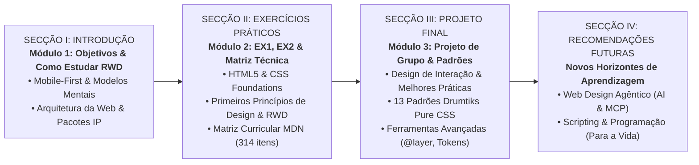
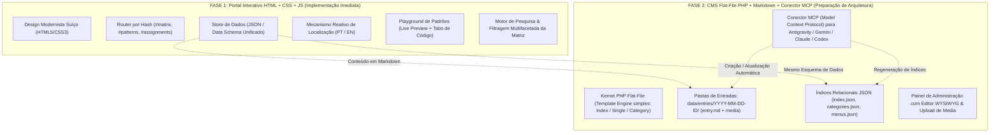
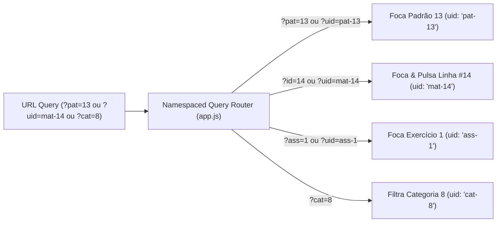

# Estratégia de Arquitetura & Plano de Implementação
## Plataforma de Aprendizagem Interativa WD101 — FBAUP (2026-2027)

> **Autor:** Prof. Pedro Amado (`pamado@fba.up.pt`)  
> **Unidade Curricular:** Web Design 101 (WD101) — Licenciatura em Design de Comunicação  
> **Conceito Temático Integrador:** Festival de Percussão e Som Experimental *DRUMTIKS '26* (Porto)  
> **Referenciais Normativos:** MDN Web Docs, W3C HTML5 Living Standard, CSS3/4/5 Specifications

---

## 1. Visão Geral & Objetivos Estratégicos

O objetivo central é conceber um **website de documentação e andaime pedagógico (*learning scaffold*) interativo**, bilingue (Português 🇵🇹 e Inglês 🇬🇧), com um design modernista suíço (limpo, rigoroso, tipográfico, funcional), que apoie os estudantes ao longo de todo o semestre letivo:

1. **Apresentação dos Objetivos de Aprendizagem & "Como Estudar RWD":**
   - Transição de mentalidade de *desktop-first* para *mobile-first*.
   - Domínio da fluidez e dimensionamento intrínseco vs. extrínseco.
   - Tipografia fluida com `clamp()` e fontes variáveis locais WOFF2.
   - Padrões de estado e reatividade puramente em CSS (*Zero JavaScript* para a camada de apresentação e componentes interativos dos alunos).
2. **Decomposição Progressiva dos Exercícios (EX1 -> EX2 -> Projeto Final):**
   - Todos os três momentos de avaliação utilizam o mesmo universo concetual ("DRUMTIKS '26") em níveis crescentes de complexidade, permitindo ao aluno ver o projeto final a nascer de forma iterativa.
3. **Matriz Curricular de Referência MDN (Pesquisável, Filtrável e Ordenável):**
   - Catálogo exaustivo (314 entradas de Tags, Seletores, Propriedades, At-Rules e Funções).
   - Filtros instantâneos por Categoria/Landmark, Marco (*EX1*, *EX2*, *Fase 1 (Sem. 5-8)*, *Fase 2 (Sem. 9-13)*, *Beyond*), Escalão (*Basic*, *Intermediate*, *Advanced*), Presença no Curso (*YES*, *TBD*, *NO*), e pesquisa textual.
   - Definições concisas de uma frase, link oficial MDN e atalho direto para o padrão de código demonstrativo associado.
4. **Laboratório Interativo de Padrões (*Demo Patterns Sandbox*):**
   - 13 padrões interativos com vista renderizada real em *sandbox*, abas de código HTML/CSS com realce sintático e botão de cópia, explicação pedagógica do propósito e técnicas avançadas.

---

## 1.1. Arquitetura Curricular em 4 Secções & Módulos Nucleares

A organização pedagógica da unidade curricular e da respetiva plataforma interativa estrutura-se em **4 Secções Estruturantes** que orientam o estudante desde a aquisição dos modelos mentais fundamentais até aos horizontes contemporâneos do design computacional:



### Detalhe Pedagógico por Secção & Exemplos Contextuais Drumtiks '26:

#### Secção I: Introdução (Fundamentos & Método)
* **Módulo 1: Objetivos de Aprendizagem & "Como Estudar RWD"**
  * *Âmbito Teórico-Prático:* Desconstrução do vício de desenhar para desktop. Compreensão do fluxo normal do documento, dimensionamento intrínseco vs. extrínseco, fluidez tipográfica e a física da rede (da intenção humana no ecrã táctil ao servidor web nas portas 80/443 e transferência sFTP na porta 22).
  * *Exemplos Contextuais no Andaime:* Módulo interativo `mobile-first-foundation.html` com o simulador visual de tráfego HTTP/IP e o projeto-modelo base `starter-mobile-first/`.

#### Secção II: Exercícios Práticos (Prática de Fundações & Primeiros Princípios)
* **Módulo 2: Exercícios EX1 e EX2 + Matriz Técnica Curricular MDN**
  * *Âmbito Teórico-Prático:* Desenvolvimento da compreensão técnica básica e intermédia de HTML e CSS. Aplicação dos primeiros princípios de design de comunicação para a web (hierarquia de leitura, acessibilidade semântica, contraste WCAG, modelo de caixa e relações entre elementos pais e filhos).
  * *EX1: "Hello Warp!"* — Landmarks HTML5 nativos, zero classes cosméticas, seletores puramente descendentes, medidas elásticas relativas (320px a 75ch), as 3 tipologias de hyperlinks.
  * *EX2: "Media & Box Model"* — Introdução ao Eric Meyer Reset v2.0, webfonts via Google Fonts, modelo de caixa rigoroso, classes semânticas e IDs funcionais, direção de arte com `<picture>`, vídeo/áudio embutidos e posições `relative`/`absolute`/`sticky`.
  * *Matriz Técnica Curricular (314 itens):* Referencial exaustivo pesquisável e filtrável ligando diretamente cada conceito à documentação canónica da MDN e aos respetivos exercícios e padrões do curso.
  * *Exemplos Contextuais no Andaime:* A persona do DJ Warp, a sua biografia pura em texto (EX1) e a sua transformação em cartaz gráfico multimédia responsivo (EX2).

#### Secção III: Projeto de Consolidação (Síntese Técnica & Princípios Concetuais de Design)
* **Módulo 3: Projeto de Grupo, Princípios de Design de Interação & Padrões Avançados**
  * *Âmbito Teórico-Prático:* Síntese das competências técnicas e conceptuais num produto digital coeso e de escala alargada. Domínio de padrões de interação semânticos sem recurso a JavaScript (*Zero-JS state machines*), arquitetura de estilos com `@layer`, variáveis CSS estruturadas a 3 níveis (*primitives*, *semantics*, *components*), `@property` e fontes variáveis locais WOFF2.
  * *Exemplos Contextuais no Andaime:* Os 13 Padrões Interativos Drumtiks '26 (`patterns.json` e `patterns-demo.css`), incluindo gaveta móvel, modais Popover API, carrossel com *scroll-snap*, seletores relacionais `:has()` e motor de bilheteira puramente em CSS.

#### Secção IV: Recomendações Futuras & Horizontes (Para Lá da UC)
* **Web Design Agêntico (*Agentic Web Design*):**
  * *Âmbito Teórico-Prático:* Capacitar os designers para orquestrarem fluxos de trabalho com agentes de IA generativa e autónomos (Antigravity, Gemini, Claude Code, Codex). Ensina o designer a atuar como diretor de arte e arquiteto de restrições, usando ferramentas de protocolo aberto (MCP) para inspeção, teste e atualização de conteúdos estruturados sem abdicar da autoria e do rigor estético.
  * *Exemplos Contextuais no Andaime:* A arquitetura do conector MCP em sandbox com restrição de escrita exclusiva a `.md` e `.json`, demonstrando como agentes colaboram com o designer sem violar a segurança da infraestrutura.
* **Aprender Scripting & Programação (Para a Web e para a Vida):**
  * *Âmbito Teórico-Prático:* O código como material de expressão e literacia cívica/profissional contínua. Introdução ao princípio de *Progressive Enhancement*, lógica algorítmica, manipulação programática do DOM (JavaScript) e motores de dados dinâmicos do lado do servidor (PHP / bases de dados relacionais e flat-file).
  * *Exemplos Contextuais no Andaime:* A evolução do motor de visualização cliente (Fase 1) para o CMS PHP modular em flat-files (Fase 2).


---

## 2. Roteiro em 2 Fases (Step 1 & Step 2)



### Relação entre a Fase 1 e a Fase 2:
A Fase 1 é desenhada para que **nenhuma reestruturação de dados ou código de frontend seja necessária** quando a Fase 2 for ativada:
- A estrutura de dados (categorias, menus, posts/entradas, entradas da matriz e padrões) adota exatamente os modelos de entidade exigidos pelo CMS em flat-files.
- Cada entrada possui um identificador único de formato `YYYY-MM-DD-XXX` ou identificador slug canónico.
- O sistema de categorias suporta taxonomia múltipla e relações hierárquicas.
- As vistas do frontend correspondem à metáfora clássica do WordPress: `index` (loop principal), `single` (detalhe de padrão/exercício), `category` (agregação filtrada) e `menu` dinâmico com links persistentes.

---


---

## 3. Especificação do Esquema de Dados (Data Schema)

### 3.1. Categorias & Taxonomias (`categories.json`)
```json
[
  {
    "id": "cat-landmarks",
    "slug": "landmarks",
    "title": { "pt": "Landmarks & Estrutura Semântica", "en": "Landmarks & Semantic Structure" },
    "description": { "pt": "Elementos semânticos essenciais do HTML5 para delimitação do documento.", "en": "Essential semantic HTML5 elements defining document regions." },
    "tier": "foundational",
    "parent": null
  },
  {
    "id": "cat-layout-grid",
    "slug": "layout-grid",
    "title": { "pt": "Layout Bi-Dimensional (CSS Grid)", "en": "2D Layout (CSS Grid)" },
    "description": { "pt": "Grelhas responsivas modernas e alinhamento de componentes.", "en": "Modern responsive grids and component alignment." },
    "tier": "intermediate",
    "parent": null
  }
]
```

### 3.1. Arquitetura de Identificadores Únicos com Namespace (Namespaced UIDs)
Para evitar colisões entre coleções diferentes (por exemplo, a propriedade CSS `#201` da matriz versus o exercício `EX1`), e garantir **espaço infinito de crescimento** sem limites arbitrários, adotamos o padrão de **Namespaces Canónicos**:

- **`uid` (Identificador Global Único com Prefixo de Tipo):**
  - Matriz MDN: `mat-1`, `mat-2`, ..., `mat-314`, `mat-N` (cresce sem limite).
  - Padrões Interativos: `pat-1`, ..., `pat-13`, `pat-N`.
  - Enunciados / Momentos do Curso: `ass-1` (EX1), `ass-2` (EX2), `ass-3` (Projeto Drumtiks).
  - Categorias / Taxonomias: `cat-1`, ..., `cat-12`.
  - Artigos / Posts de Documentação: `post-YYYY-MM-DD-XXX`.
- **`canonical_id` (Pasta Física Flat-File):** String estável no formato data-ID (`YYYY-MM-DD-XXX`) utilizada diretamente no sistema de ficheiros (ex: `data/entries/2026-10-24-113/`).
- **Navegação Amigável por Parâmetros de Domínio:** O roteador em `app.js` suporta tanto a chave global inequívoca (`?uid=pat-13`) como os atalhos semânticos de domínio:
  - `?mat=14` ou `?id=14` $\rightarrow$ Item 14 da Matriz (`uid: "mat-14"`).
  - `?pat=13` $\rightarrow$ Padrão 13 de Parallax (`uid: "pat-13"`).
  - `?ass=1` ou `?ass=ex1` $\rightarrow$ Enunciado 1 (`uid: "ass-1"`).
  - `?proj=1` $\rightarrow$ Projeto Final Drumtiks '26 (`uid: "ass-3"`).
  - `?cat=8` $\rightarrow$ Categoria 8 de Grid/Flexbox (`uid: "cat-8"`).
  - `?lev=2` $\rightarrow$ Escalão Intermédio.
  - `?uid=pat-13` $\rightarrow$ Resolução universal direta de qualquer entidade.



### 3.2. Categorias & Taxonomias (`categories.json`)
```json
[
  {
    "uid": "cat-1",
    "num_id": 1,
    "id": "cat-landmarks",
    "slug": "landmarks",
    "title": { "pt": "Landmarks & Estrutura Semântica", "en": "Landmarks & Semantic Structure" },
    "tier": "foundational",
    "lev": 1
  },
  {
    "uid": "cat-8",
    "num_id": 8,
    "id": "cat-flex-grid",
    "slug": "layout-flex-grid",
    "title": { "pt": "Layout (Flexbox & Grid)", "en": "Layout (Flexbox & Grid)" },
    "tier": "intermediate",
    "lev": 2
  }
]
```

### 3.3. Entradas da Matriz (`matrix.json`)
```json
{
  "uid": "mat-14",
  "id": 14,
  "num_id": 14,
  "canonical_id": "2026-10-24-014",
  "symbol": "<header>",
  "type": "HTML",
  "category": "cat-landmarks",
  "cat_id": 1,
  "tier": "foundational",
  "lev": 1,
  "status": "YES",
  "desc": {
    "pt": "Representa o cabeçalho introdutório ou grupo de navegação de um documento ou secção.",
    "en": "Represents introductory content, typically a group of introductory or navigational aids."
  },
  "mdn_url": "https://developer.mozilla.org/en-US/docs/Web/HTML/Reference/Elements/header",
  "pat_ref": 1
}
```

### 3.4. Padrões Interativos Drumtiks (`patterns.json`)
```json
{
  "uid": "pat-13",
  "num_id": 13,
  "pat": 13,
  "code": "P13",
  "id": "P13",
  "slug": "p13-parallax-scrolling",
  "canonical_id": "2026-10-24-113",
  "title": {
    "pt": "P13: Efeitos de Parallax Puro no Scroll (3D & Scroll-Driven)",
    "en": "P13: Pure CSS Parallax Scrolling (3D & Scroll-Driven)"
  },
  "tier": "advanced",
  "lev": 3,
  "assignment": "Projeto Final",
  "ass_ids": [3],
  "proj": 1,
  "cat_ids": [9, 10],
  "categories": ["cat-effects-animations", "cat-positioning"],
  "summary": { ... },
  "purpose": { ... },
  "html_code": "<!-- ... -->",
  "css_code": "/* ... */",
  "demo_html": "<div class=\"p13-sandbox\">...</div>"
}
```

---


---

## 4. Decomposição dos 3 Momentos de Avaliação com "DRUMTIKS '26"

| Exercício | Escopo Pedagógico | Padrões Mobilizados | Como o Caso "Drumtiks" é Decomposto |
| :---


--- | :---


--- | :---


--- | :---


--- |
| **EX1: Hello Warp! (Wendy)** | HTML5 semântico, fluxo normal do documento, seletores descendentes, unidades relativas (`rem`), sem classes ou IDs. | Landmarks básicos (`<header>`, `<nav>`, `<main>`, `<section>`, `<article>`, `<aside>`, `<footer>`). | **Versão "Hello Warp":** Apresentação oficial do artista residente DJ Warp no Drumtiks '26. Estruturado sem classes nem divs em `demos/hello-warp/`, com guião passo a passo e rubrica docente de 20 pontos em `ex1-hello-warp-guide.html`. |
| **EX2: Media & Box Model** | CSS Reset (Meyer v2.0), tipografia web via Google Fonts, modelo de caixa, classes/IDs, imagens responsivas, `position: absolute/relative/sticky`. | P2 (Art Direction), P7 (Palco Sticky simples), P12 (Cabeçalho Fixo). | **Versão "Cartaz Gráfico":** O Drumtiks ganha identidade visual, imagens otimizadas dos artistas (`dj-warp.jpg`), palcos com cartões em grelha básica e cabeçalho fixo no topo. |
| **Projeto Final: Drumtiks '26** | Portal completo responsivo multi-página, `@layer`, variáveis e tokens a 3 níveis (`@property`), fontes variáveis locais WOFF2, gaveta móvel, modais, acordeão, carrossel magnético, motor de bilhetes puro CSS. | P1 a P13 (todos os 13 padrões avançados). | **Versão "Festival Portal Completo":** Experiência imersiva multimédia com personalização de bilheteira em tempo real via `:has()`, galeria magnética, modo escuro/claro e animações orientadas ao scroll. |

---


---

## 5. Especificação do Conector MCP & Modelo de Segurança da API

Para permitir que o professor atualize a plataforma diretamente a partir do **Antigravity**, **Gemini Web**, **Claude Code** ou **Codex**, o servidor MCP expõe um conjunto de ferramentas operacionais estritamente delimitadas.

### 5.1. Fronteira Estrita de Segurança & Sandbox do MCP (Prevenção de Injeção / RCE)
> [!CAUTION]
> **Regra de Ouro de Segurança:** O conector MCP e os endpoints de gestão remota **NUNCA têm permissão para criar, editar ou apagar ficheiros PHP (`.php`, `.phtml`, `.phar`), ficheiros de servidor (`.htaccess`, `.env`, scripts de shell) ou qualquer código executável do lado do servidor**. A camada aplicacional PHP é estritamente **Read-Only** para o MCP e para a interface web.

1. **Sandbox de Caminhos Permitidos (Whitelist Exclusiva):**
   - Pasta de Entradas e Conteúdos: `data/entries/YYYY-MM-DD-XXX/` (apenas ficheiros `.md` e media: `.webp`, `.jpg`, `.png`, `.svg`).
   - Ficheiros de Base de Dados / Índices JSON: `data/matrix.json`, `data/patterns.json`, `data/assignments.json`, `data/categories.json`, `data/menus.json`.
   - Pasta de Media Partilhada: `assets/media/` (apenas imagens e áudio de demonstração).
2. **Validação Estrita de Caminhos no Kernel PHP:**
   ```php
   // Exemplo de barreira no endpoint do CMS:
   $allowed_dir = realpath(__DIR__ . '/../data');
   $target_real = realpath($requested_path);

   // 1. Bloqueia qualquer tentativa de Directory Traversal fora de /data/
   if ($target_real === false || strpos($target_real, $allowed_dir) !== 0) {
       http_response_code(403);
       die(json_encode(["error" => "Acesso Proibido: Destino fora da sandbox de dados."]));
   }

   // 2. Bloqueia extensões executáveis
   if (preg_match('/\.(php|phtml|phar|htaccess|env|sh|py|pl|cgi)$/i', $requested_path)) {
       http_response_code(403);
       die(json_encode(["error" => "Extensão executável proibida por razões de segurança."]));
   }
   ```
3. **Imutabilidade Estrutural:** Alterações ao código do motor PHP, templates de renderização ou ficheiros de configuração do servidor são realizadas exclusivamente pelo professor via **acesso direto FTP/SSH**.

### 5.2. Autenticação com Segredos em Hash (Zero-Account Management)
Não existe necessidade de sistemas pesados de gestão multi-utilizador, bases de dados relacionais, nem fluxos de registo ou recuperação de password por email:
- **Single-Tenant Hardcoded Secret Hash:** O servidor armazena um hash criptográfico seguro (gerado com `password_hash()` BCRYPT ou Argon2id) num ficheiro de configuração protegido fora do *document root* web (`config/secrets.php`).
- **Verificação com Proteção contra Timing Attacks:** Cada pedido do conector MCP ou do painel administrativo envia um token no cabeçalho HTTP:
  ```http
  Authorization: Bearer <SECRET_TOKEN>
  X-MCP-Signature: <HMAC_SHA256>
  ```
  O servidor valida o token utilizando `hash_equals()` e `password_verify()`. Se a validação falhar, a operação é rejeitada imediatamente com HTTP 401.

### 5.3. Ferramentas Expostas pelo Servidor MCP (`drumtiks-scaffold-cms`)
```yaml
mcp_server: "drumtiks-scaffold-cms"
tools:
  - name: "cms_create_entry"
    description: "Cria uma nova entrada de conteúdo em data/entries/YYYY-MM-DD-ID/ com ficheiro index.md e atualiza os índices JSON. Não permite ficheiros PHP."
    parameters:
      date: "YYYY-MM-DD"
      uid: "integer (optional, auto-generated if omitted)"
      title: "string"
      categories: ["integer or string"]
      tier: "foundational | intermediate | advanced"
      markdown_content: "string"
      demo_html: "string"
      demo_css: "string"

  - name: "cms_update_matrix_entry"
    description: "Insere ou atualiza um item na matriz curricular (data/matrix.json), gerando links MDN e referências a padrões sem tocar em ficheiros do servidor."
    parameters:
      id: "integer"
      symbol: "string"
      type: "HTML | CSS"
      tier: "foundational | intermediate | advanced"
      status: "YES | TBD | NO"
      cat_id: "integer"
      pat_ref: "integer (optional)"
      desc_pt: "string"
      desc_en: "string"

  - name: "cms_reindex_database"
    description: "Reconstrói todos os ficheiros de índice JSON (categories.json, menus.json, index.json) garantindo consistência referencial dos UIDs."
```

---


---

## 6. Especificação do Editor Visual WYSIWYG (Fase 2 / Flat-File CMS)

O painel administrativo integrará um editor visual moderno, rápido e sem dependências pesadas, concebido especificamente para a autoria pedagógica de Web Design:

### 6.1. Funcionalidades e Controlos do Editor
- **Títulos e Subtítulos:** Seletor de níveis (H1, H2, H3, H4) com tipografia proporcional em tempo real.
- **Tipografia e Parágrafos:** Parágrafo padrão, texto de introdução (*lead*), negrito (`**bold**`), itálico (`*italic*`), riscado (`~~strike~~`) e código inline (`` `code` ``).
- **Caixas de Destaque Pedagógico & Blockquotes:**
  - Citação clássica (`> quote`).
  - Blocos de alerta contextual com formatação tipográfica imediata: *Nota de Contexto*, *Dica de Otimização*, *Regra Obrigatória*, *Aviso de Risco*.
- **Secções Especializadas de Código (HTML5 & CSS3):**
  - Blocos de código syntax-highlighted com seletor de linguagem.
  - Abas duplas dedicadas: aba de marcação HTML5 e aba de regras CSS3.
  - Pré-visualização (*live preview*) instantânea do componente num iframe/sandbox integrado.
- **Notas de Rodapé & Texto Reduzido:** Formatação visual rápida para texto explicativo suplementar (`<small>` / notas de aula).
- **Comentários de Autor / Docente:** Secções de anotações internas invisíveis para os estudantes, facilitando o planeamento pedagógico de anos letivos futuros.
- **Listas Estruturadas:** Listas de marcadores (*bullets*), listas numeradas sequenciais e listas de verificação (*task checklists* com caixas de seleção).
- **Gestão & Upload de Media:**
  - Carregamento de imagens por arrastamento (*drag-and-drop*) diretamente sobre o editor.
  - As imagens são gravadas automaticamente na pasta física da entrada correspondente (`data/entries/YYYY-MM-DD-XXX/`), preservando a portabilidade absoluta do sistema em flat-files.
- **Serialização Transparente:** O editor apresenta uma experiência visual WYSIWYG limpa ao utilizador, mas grava ficheiros de texto Markdown (`.md`) com cabeçalho YAML frontmatter e sincroniza os metadados nos índices JSON.

---


---

## 7. Arquitetura de Ficheiros do Step 1 (No Workspace)

```text
/Volumes/Documents HD/FBAUP/2026-27/WD101-26/learning-scaffold/
├── index.html                   # Casca da aplicação em design modernista suíço (hash routing)
├── assets/
│   ├── css/
│   │   ├── reset.css            # Eric Meyer Reset v2.0 modernizado em @layer reset
│   │   ├── modernist-theme.css  # Variáveis de design tokens, tipografia fluida, paleta suíça
│   │   └── scaffold-layout.css  # Layout da aplicação, abas de código, sandbox de demos, filtros
│   ├── js/
│   │   ├── data-store.js        # Base de dados em JS (evita bloqueios de CORS em file:// local)
│   │   ├── i18n.js              # Dicionário de tradução reativa PT / EN
│   │   └── app.js               # Controlador da UI, router, filtros da matriz e visualizador de código
│   └── fonts/                   # Referência a fontes do Drumtiks
└── data/                        # Ficheiros JSON limpos (garante prontidão para o CMS PHP Flat-file)
    ├── categories.json
    ├── menus.json
    ├── matrix.json
    ├── patterns.json
    └── assignments.json
```
