# Blueprint de Padrões de Interação Responsiva Pure CSS (Zero JavaScript)

**Unidade Curricular:** Web Design 101 (WD101) — Licenciatura em Design de Comunicação (FBAUP)  
**Coordenação:** Prof. Pedro Amado (`pamado@fba.up.pt`)  
**Paradigma:** *Strictly Zero JavaScript* • HTML5 Semântico • CSS3 Moderno (Living Standard / W3C)

---

## 1. Introdução & Filosofia de Implementação

Este guia prático fornece os **13 Padrões Fundamentais de Interação e Layout** requeridos para a conceção do **Projeto Final de Marca / Evento** em Design de Comunicação. 

Cada padrão é estruturado com uma mentalidade de **Melhoria Progressiva (Progressive Enhancement)** e **Mobile-First**, garantindo:
1. **Resiliência Estrutural:** O conteúdo mantém-se integralmente legível e acessível mesmo se o navegador for antigo ou desativar folhas de estilo.
2. **Zero Dependências Externas:** Isenção total de bibliotecas de scripts (sem jQuery, sem React, sem plugins externos de carrossel ou modal).
3. **Compatibilidade W3C:** Código limpo e válido de acordo com os padrões do W3C Nu HTML Checker e W3C CSS Validator.

```mermaid
graph TD
  Reset["Fundação: Eric Meyer CSS Reset v2.0 (@layer reset)"] --> App["Website do Projeto Final (HTML5 + CSS3)"]
  P1["1. Navegação Dual (Desktop Flyout / Mobile Drawer)"] --> App
  P2["2. Direção de Arte Fotográfica (<picture> / srcset)"] --> App
  P3["3. Carrossel de Galeria (Scroll Snap + Âncoras)"] --> App
  P4["4. Acordeão Dobrável Animado (<details> + Grid)"] --> App
  P5["5. Modais & Janelas de Diálogo (:target & Popover API)"] --> App
  P6["6. Animações por Scroll (animation-timeline)"] --> App
  P7["7. Grelha com Palco Sticky (2 Colunas + Auto-Fit)"] --> App
  P8["8. Motor Reativo de Seleção & Preços (:has())"] --> App
  P9["9. Alternador de Tema (Light/Dark) & Idioma"] --> App
  P10["10. Menus Flutuantes com Anchor Positioning"] --> App
  P11["11. Contentores Intrínsecos (@container & cqi)"] --> App
  P12["12. Sticky Nav & Stacking Cards (Sobrescrita por Irmãos)"] --> App
  P13["13. Parallax Puro (3D Perspective / Scroll Timeline)"] --> App
```



---

## 2. Fundação de Reset: Eric Meyer CSS Reset v2.0 (Modernizado com `@layer reset`)

### 2.1 Enquadramento & Justificação Pedagógica
Na metodologia da FBAUP (iniciada no **EX2: Media & Box Model — Semanas 3 a 5** e consolidada na **Fase 1 do Projeto Final — Semanas 5 a 8**), o documento CSS adota como fundação estrutural o **CSS Reset de Eric Meyer (v2.0)**. 
Ao contrário de normalizações opinativas que mantêm margens e tamanhos padrão dos browsers, o reset de Eric Meyer **zera deliberadamente todas as margens, preenchimentos, bordas e tamanhos de fonte**, conferindo ao estudante de Design de Comunicação controlo geométrico e tipográfico absoluto sobre cada elemento semântico da página.

Na versão contemporânea aqui apresentada, o reset original é **modernizado com três adições estandardizadas essenciais**:
1. **Isolamento em Camada de Cascata (`@layer reset`):** Permite que qualquer regra de layout ou componente escrita nos ficheiros subsequentes sobreponha o reset com especificidade natural, sem necessidade de `!important`.
2. **Modelo de Caixa Universal (`box-sizing: border-box`):** Garante que `padding` e `border` são incluídos dentro da largura e altura declaradas, prevenindo quebras de layout (*overflow blowouts*).
3. **Comportamento Fluido de Média (`max-width: 100%`):** Garante que imagens, vetores SVG e vídeos nunca extravasam a largura do seu contentor pai.

### 2.2 Código CSS Completo: `assets/css/reset.css` (ou Camada `@layer reset`)
```css
/* ==========================================================================
   Fundação de Reset: Eric Meyer CSS Reset (v2.0 | 20110126)
   Adaptado e Modernizado para HTML5, Box-Sizing e CSS Cascade Layers (@layer)
   Domínio Público (Meyerweb) • WD101 Design de Comunicação (FBAUP)
   ========================================================================== */

@layer reset {
  /* 1. Reset Universal do Modelo de Caixa */
  *,
  *::before,
  *::after {
    box-sizing: border-box;
  }

  /* 2. Zerar Margens, Preenchimentos e Bordas em Todos os Elementos HTML5 */
  html, body, div, span, applet, object, iframe,
  h1, h2, h3, h4, h5, h6, p, blockquote, pre,
  a, abbr, acronym, address, big, cite, code,
  del, dfn, em, img, ins, kbd, q, s, samp,
  small, strike, strong, sub, sup, tt, var,
  b, u, i, center,
  dl, dt, dd, ol, ul, li,
  fieldset, form, label, legend,
  table, caption, tbody, tfoot, thead, tr, th, td,
  article, aside, canvas, details, embed, 
  figure, figcaption, footer, header, hgroup, 
  menu, nav, output, ruby, section, summary,
  time, mark, audio, video {
    margin: 0;
    padding: 0;
    border: 0;
    font-size: 100%;
    font: inherit;
    vertical-align: baseline;
  }

  /* 3. Garantir Renderização em Bloco para Elementos Semânticos HTML5 */
  article, aside, details, figcaption, figure, 
  footer, header, hgroup, menu, nav, section, main {
    display: block;
  }

  /* 4. Normalização do Documento e Altura Fluida */
  html {
    -webkit-text-size-adjust: 100%;
    scroll-behavior: smooth;
  }

  body {
    line-height: 1;
    min-height: 100dvh;
    text-rendering: optimizeSpeed;
  }

  /* 5. Remoção de Marcadores Visuais de Listas */
  ol, ul {
    list-style: none;
  }

  /* 6. Remoção de Aspas Automáticas em Citações */
  blockquote, q {
    quotes: none;
  }

  blockquote::before, blockquote::after,
  q::before, q::after {
    content: '';
    content: none;
  }

  /* 7. Colapso de Bordas em Tabelas */
  table {
    border-collapse: collapse;
    border-spacing: 0;
  }

  /* 8. Responsividade Intrínseca de Elementos de Média (Otimização Moderna) */
  img, picture, video, canvas, svg {
    display: block;
    max-width: 100%;
    height: auto;
  }

  /* 9. Herança de Tipografia em Elementos Interativos de Formulário */
  input, button, textarea, select {
    font: inherit;
    color: inherit;
  }
}
```

---

## Padrão 1: Sistema de Navegação Dual (Desktop Flyout & Mobile Off-Canvas Drawer)

### 1.1 Objetivo & Enquadramento
Garantir uma navegação fluida em telemóveis através de uma **gaveta deslizante lateral (*Off-Canvas Drawer*)** ativada por um botão hambúrguer sem scripts (recorrendo ao *checkbox hack*), que se transforma automaticamente num **menu horizontal com submenus suspensos (*Flyout Dropdowns*)** ao atingir o breakpoint de desktop (`min-width: 960px`).

### 1.2 Código HTML5 Semântico
```html
<header class="site-header">
  <div class="header-container">
    <!-- Logótipo / Marca do Festival ou Evento -->
    <a href="index.html" class="site-brand">
      <span class="brand-name">DRUMTIKS</span>
      <span class="brand-year">'26</span>
    </a>

    <!-- Controlo Oculto para Alternar Menu Mobile (Pure CSS Toggle) -->
    <input type="checkbox" id="nav-toggle" class="nav-toggle-input" aria-hidden="true">

    <!-- Botão Hambúrguer (Label visual associada ao checkbox) -->
    <label for="nav-toggle" class="nav-toggle-button" aria-label="Abrir Menu de Navegação">
      <span class="hamburger-bar"></span>
      <span class="hamburger-bar"></span>
      <span class="hamburger-bar"></span>
    </label>

    <!-- Contentor de Navegação Principal (Gaveta no Mobile, Barra no Desktop) -->
    <nav class="site-nav" aria-label="Navegação Principal">
      <ul class="nav-list">
        <li class="nav-item">
          <a href="index.html" class="nav-link">Início</a>
        </li>

        <!-- Item de Menu com Submenu Suspenso (Dropdown) -->
        <li class="nav-item has-dropdown">
          <a href="#artistas" class="nav-link">
            Artistas <span class="dropdown-icon" aria-hidden="true">▾</span>
          </a>
          <!-- Submenu Aninhado -->
          <ul class="dropdown-menu">
            <li><a href="dj-warp.html" class="dropdown-link">DJ Warp (Headliner)</a></li>
            <li><a href="battle-rules.html" class="dropdown-link">Batalha 808 Clash</a></li>
            <li><a href="#lineup" class="dropdown-link">Horários Completos</a></li>
          </ul>
        </li>

        <li class="nav-item">
          <a href="#bilhetes" class="nav-link">Bilheteira</a>
        </li>
        <li class="nav-item">
          <a href="credits.html" class="nav-link">Créditos</a>
        </li>
      </ul>
    </nav>
  </div>
</header>
```

### 1.3 Folha de Estilos CSS3 Modular
```css
/* ==========================================================================
   Padrão 1: Navegação Dual (Mobile Drawer + Desktop Flyout)
   ========================================================================== */

/* 1. Header e Layout Base */
.site-header {
  position: sticky;
  top: 0;
  z-index: 1000;
  background-color: var(--surface-canvas, #0a0a0c);
  border-bottom: 1px solid var(--border-subtle, rgba(255, 255, 255, 0.1));
}

.header-container {
  display: flex;
  justify-content: space-between;
  align-items: center;
  max-width: 1200px;
  margin: 0 auto;
  padding: 1rem 1.25rem;
}

.site-brand {
  font-family: var(--font-display, sans-serif);
  font-weight: 800;
  text-decoration: none;
  color: var(--text-primary, #ffffff);
  font-size: 1.4rem;
}

/* 2. Checkbox Oculto & Botão Hambúrguer (Mobile) */
.nav-toggle-input {
  position: absolute;
  opacity: 0;
  pointer-events: none;
}

.nav-toggle-button {
  display: flex;
  flex-direction: column;
  justify-content: space-between;
  width: 28px;
  height: 20px;
  cursor: pointer;
  z-index: 1100;
}

.hamburger-bar {
  display: block;
  width: 100%;
  height: 2px;
  background-color: var(--text-primary, #ffffff);
  border-radius: 2px;
  transition: transform 0.3s ease, opacity 0.3s ease;
}

/* Transformação das Barras em Ícone "X" ao Abrir */
.nav-toggle-input:checked ~ .nav-toggle-button .hamburger-bar:nth-child(1) {
  transform: translateY(9px) rotate(45deg);
}
.nav-toggle-input:checked ~ .nav-toggle-button .hamburger-bar:nth-child(2) {
  opacity: 0;
}
.nav-toggle-input:checked ~ .nav-toggle-button .hamburger-bar:nth-child(3) {
  transform: translateY(-9px) rotate(-45deg);
}

/* 3. Gaveta Mobile (Off-Canvas Drawer) */
.site-nav {
  position: fixed;
  top: 0;
  right: 0;
  width: 75vw;
  max-width: 320px;
  height: 100dvh;
  background-color: var(--surface-raised, #16171a);
  padding: 5rem 2rem 2rem;
  box-shadow: -4px 0 24px rgba(0, 0, 0, 0.6);
  transform: translateX(100%); /* Oculto fora do ecrã à direita */
  transition: transform 0.35s cubic-bezier(0.4, 0, 0.2, 1);
  overflow-y: auto;
}

/* Estado Aberto no Mobile */
.nav-toggle-input:checked ~ .site-nav {
  transform: translateX(0); /* Desliza para o ecrã */
}

.nav-list {
  list-style: none;
  padding: 0;
  margin: 0;
  display: flex;
  flex-direction: column;
  gap: 1.5rem;
}

.nav-link, .dropdown-link {
  text-decoration: none;
  color: var(--text-primary, #ffffff);
  font-family: var(--font-body, sans-serif);
  font-size: 1.1rem;
  transition: color 0.2s ease;
}

.nav-link:hover, .nav-link:focus-visible {
  color: var(--theme-accent, #e60000);
}

/* Submenu no Mobile (Listagem em Bloco) */
.dropdown-menu {
  list-style: none;
  padding-left: 1rem;
  margin-top: 0.75rem;
  display: flex;
  flex-direction: column;
  gap: 0.75rem;
}

/* 4. Breakpoint Desktop: Menu Horizontal com Submenu Suspenso */
@media (min-width: 960px) {
  .nav-toggle-button {
    display: none; /* Oculta hambúrguer */
  }

  .site-nav {
    position: static;
    width: auto;
    height: auto;
    background: transparent;
    padding: 0;
    box-shadow: none;
    transform: none; /* Sempre visível */
    overflow: visible;
  }

  .nav-list {
    flex-direction: row;
    align-items: center;
    gap: 2rem;
  }

  /* Submenu Suspenso em Desktop (Flyout) */
  .nav-item.has-dropdown {
    position: relative;
  }

  .dropdown-menu {
    position: absolute;
    top: 100%;
    left: 0;
    min-width: 220px;
    background-color: var(--surface-raised, #16171a);
    border: 1px solid var(--border-subtle, rgba(255, 255, 255, 0.15));
    border-radius: 8px;
    padding: 0.75rem 0;
    margin-top: 0.5rem;
    box-shadow: 0 8px 30px rgba(0, 0, 0, 0.4);
    display: flex;
    flex-direction: column;
    gap: 0;
    opacity: 0;
    visibility: hidden;
    transform: translateY(10px);
    transition: opacity 0.25s ease, transform 0.25s ease, visibility 0.25s;
  }

  .dropdown-menu li a {
    display: block;
    padding: 0.6rem 1.25rem;
    font-size: 0.95rem;
  }

  .dropdown-menu li a:hover {
    background-color: rgba(255, 255, 255, 0.05);
  }

  /* Abertura do Submenu com Rato (:hover) ou Teclado (:focus-within) */
  .nav-item.has-dropdown:hover > .dropdown-menu,
  .nav-item.has-dropdown:focus-within > .dropdown-menu {
    opacity: 1;
    visibility: visible;
    transform: translateY(0);
  }
}
```

---

## Padrão 2: Direção de Arte e Otimização com `<picture>` e `srcset`

### 2.1 Objetivo & Enquadramento
Servir imagens otimizadas com formatos modernos (**WebP** com fallback em **JPEG**) e composições fotográficas diferenciadas (*Art-Direction*): rácio panorâmico **16:9** para desktop, **1:1** quadrado para tablet e **9:16** vertical para smartphone, garantindo zero distorção visual e prioridade máxima de carregamento (*Largest Contentful Paint*).

### 2.2 Código HTML5 Semântico
```html
<figure class="hero-media-figure">
  <picture>
    <!-- 1. Ecrãs Desktop Widescreen (>= 1024px): Panorâmica 16:9 em WebP -->
    <source media="(min-width: 1024px)"
            type="image/webp"
            srcset="assets/images/dj-warp-16x9-960w.webp 960w, assets/images/dj-warp-16x9-1400w.webp 1400w"
            sizes="(min-width: 1280px) 1200px, 90vw">

    <!-- 2. Ecrãs Tablet (>= 600px): Quadrado 1:1 em WebP -->
    <source media="(min-width: 600px)"
            type="image/webp"
            srcset="assets/images/dj-warp-1x1-600w.webp 600w, assets/images/dj-warp-1x1-960w.webp 960w"
            sizes="85vw">

    <!-- 3. Smartphone Default (< 600px): Retrato Vertical 9:16 em WebP -->
    <source type="image/webp"
            srcset="assets/images/dj-warp-9x16-400w.webp 400w, assets/images/dj-warp-9x16-600w.webp 600w"
            sizes="100vw">

    <!-- 4. Fallback Universal em JPEG (Garante compatibilidade total) -->
    
  </picture>
  <figcaption class="media-caption">
    DJ Warp nos subterrâneos de granito • Performance exclusiva Drumtiks '26
  </figcaption>
</figure>
```

### 2.3 Folha de Estilos CSS3 Modular
```css
/* ==========================================================================
   Padrão 2: Direção de Arte e Controlo de Rácio de Aspeto
   ========================================================================== */
.hero-media-figure {
  margin: 0;
  width: 100%;
  overflow: hidden;
  border-radius: var(--radius-card, 12px);
  background-color: var(--surface-raised, #16171a);
  border: 1px solid var(--border-subtle, rgba(255, 255, 255, 0.1));
}

.responsive-hero-img {
  display: block;
  width: 100%;
  height: auto;
  object-fit: cover;
  /* Rácio mobile padrão: 9:16 vertical */
  aspect-ratio: 9 / 16;
  transition: transform 0.5s ease;
}

/* Transição do Rácio de Aspeto nos Breakpoints */
@media (min-width: 600px) {
  .responsive-hero-img {
    aspect-ratio: 1 / 1; /* Tablet: Quadrado */
  }
}

@media (min-width: 1024px) {
  .responsive-hero-img {
    aspect-ratio: 16 / 9; /* Desktop: Panorâmica */
  }
}

.hero-media-figure:hover .responsive-hero-img {
  transform: scale(1.02); /* Efeito sutil de respiração */
}

.media-caption {
  padding: 0.75rem 1rem;
  font-family: var(--font-mono, monospace);
  font-size: 0.8rem;
  color: var(--text-secondary, #71747e);
  border-top: 1px solid var(--border-subtle, rgba(255, 255, 255, 0.08));
}
```

---

## Padrão 3: Carrossel de Galeria Horizontal com CSS Scroll Snap & Âncoras

### 3.1 Objetivo & Enquadramento
Apresentar uma galeria fotográfica de atmosfera com deslizamento horizontal suave, fixação magnética nos slides (*Scroll Snap*) e paginação visual funcional sem JavaScript via âncoras internas e a pseudo-classe `:target`.

### 3.2 Código HTML5 Semântico
```html
<section class="gallery-section" aria-labelledby="gallery-heading">
  <div class="gallery-header-row">
    <h2 id="gallery-heading" class="section-title">Atmosfera do Festival</h2>
    <!-- Indicadores de Paginação via Âncoras -->
    <nav class="gallery-pagination" aria-label="Paginação da Galeria">
      <a href="#slide-1" class="page-dot" aria-label="Ver Fotografia 1">1</a>
      <a href="#slide-2" class="page-dot" aria-label="Ver Fotografia 2">2</a>
      <a href="#slide-3" class="page-dot" aria-label="Ver Fotografia 3">3</a>
      <a href="#slide-4" class="page-dot" aria-label="Ver Fotografia 4">4</a>
    </nav>
  </div>

  <!-- Contentor Deslizante com Scroll Snap -->
  <div class="gallery-viewport">
    <article id="slide-1" class="gallery-slide">
      
      <h3 class="slide-label">Palco Principal • Subterrâneo</h3>
    </article>

    <article id="slide-2" class="gallery-slide">
      
      <h3 class="slide-label">Batalha Beatmaking</h3>
    </article>

    <article id="slide-3" class="gallery-slide">
      
      <h3 class="slide-label">Mercado de Vinil</h3>
    </article>

    <article id="slide-4" class="gallery-slide">
      
      <h3 class="slide-label">Alfândega do Porto</h3>
    </article>
  </div>
</section>
```

### 3.3 Folha de Estilos CSS3 Modular
```css
/* ==========================================================================
   Padrão 3: Carrossel Horizontal Pure CSS
   ========================================================================== */
.gallery-section {
  width: 100%;
  margin: 3rem 0;
}

.gallery-header-row {
  display: flex;
  justify-content: space-between;
  align-items: center;
  margin-bottom: 1rem;
}

.gallery-pagination {
  display: flex;
  gap: 0.5rem;
}

.page-dot {
  display: inline-flex;
  justify-content: center;
  align-items: center;
  width: 32px;
  height: 32px;
  border-radius: 50%;
  background-color: var(--surface-raised, #16171a);
  color: var(--text-primary, #ffffff);
  text-decoration: none;
  font-family: var(--font-mono, monospace);
  font-size: 0.85rem;
  border: 1px solid var(--border-subtle, rgba(255, 255, 255, 0.2));
  transition: background-color 0.2s, border-color 0.2s;
}

.page-dot:hover, .page-dot:focus-visible {
  border-color: var(--theme-accent, #e60000);
  background-color: rgba(230, 0, 0, 0.15);
}

/* Contentor Deslizante com Scroll Snap */
.gallery-viewport {
  display: flex;
  gap: 1.25rem;
  overflow-x: auto;
  scroll-snap-type: x mandatory;
  scroll-behavior: smooth;
  padding-bottom: 1rem;
  scrollbar-width: thin;
  scrollbar-color: var(--theme-accent, #e60000) var(--surface-raised, #16171a);
}

.gallery-slide {
  flex: 0 0 85%; /* No telemóvel mostra 85% do slide para convidar ao swipe */
  scroll-snap-align: center;
  border-radius: 12px;
  overflow: hidden;
  background-color: var(--surface-raised, #16171a);
  border: 1px solid var(--border-subtle, rgba(255, 255, 255, 0.1));
  scroll-margin: 1rem;
  transition: border-color 0.3s ease, box-shadow 0.3s ease;
}

.gallery-slide img {
  width: 100%;
  height: 240px;
  object-fit: cover;
  display: block;
}

.slide-label {
  padding: 0.75rem 1rem;
  font-size: 0.95rem;
  font-family: var(--font-body, sans-serif);
  color: var(--text-primary, #ffffff);
}

/* Destaque Ativo do Slide Selecionado via Âncora */
.gallery-slide:target {
  border-color: var(--theme-accent, #e60000);
  box-shadow: 0 0 20px rgba(230, 0, 0, 0.4);
}

/* Tablet e Desktop: 2 a 3 slides visíveis em simultâneo */
@media (min-width: 600px) {
  .gallery-slide {
    flex: 0 0 calc(50% - 0.75rem);
  }
}

@media (min-width: 1024px) {
  .gallery-slide {
    flex: 0 0 calc(33.333% - 0.85rem);
  }
}
```

---

## Padrão 4: Acordeão Dobrável Animado (`<details>` + CSS Grid)

### 4.1 Objetivo & Enquadramento
Construir secções de FAQ e detalhes técnicos utilizando os elementos semânticos nativos `<details>` e `<summary>`, superando a limitação histórica de não ser possível animar `height: auto` através da técnica moderna de transição com **CSS Grid** (`grid-template-rows: 0fr -> 1fr`).

### 4.2 Código HTML5 Semântico
```html
<section class="faq-section" aria-labelledby="faq-title">
  <h2 id="faq-title" class="section-title">Perguntas Frequentes (FAQ)</h2>

  <!-- Item de Acordeão 1 -->
  <details class="accordion-item" name="festival-faq">
    <summary class="accordion-trigger">
      <span class="trigger-title">Qual é o horário e local do evento?</span>
      <span class="trigger-icon" aria-hidden="true">+</span>
    </summary>
    <div class="accordion-grid-wrapper">
      <div class="accordion-content">
        <p>O festival decorre nos dias 24 e 25 de Outubro de 2026, entre as 16h00 e as 04h00, nas Abóbadas Históricas da Alfândega do Porto (Entrada Poente).</p>
      </div>
    </div>
  </details>

  <!-- Item de Acordeão 2 -->
  <details class="accordion-item" name="festival-faq">
    <summary class="accordion-trigger">
      <span class="trigger-title">É permitida a entrada a menores de 16 anos?</span>
      <span class="trigger-icon" aria-hidden="true">+</span>
    </summary>
    <div class="accordion-grid-wrapper">
      <div class="accordion-content">
        <p>Apenas quando acompanhados pelos pais ou tutores legais devidamente identificados com bilhete correspondente.</p>
      </div>
    </div>
  </details>
</section>
```

### 4.3 Folha de Estilos CSS3 Modular
```css
/* ==========================================================================
   Padrão 4: Acordeão Animado com CSS Grid e Details
   ========================================================================== */
.faq-section {
  display: flex;
  flex-direction: column;
  gap: 1rem;
  margin: 3rem 0;
}

.accordion-item {
  background-color: var(--surface-raised, #16171a);
  border: 1px solid var(--border-subtle, rgba(255, 255, 255, 0.1));
  border-radius: 10px;
  overflow: hidden;
  transition: border-color 0.25s ease;
}

.accordion-item[open] {
  border-color: var(--theme-accent, #e60000);
}

/* Cabeçalho Interativo do Summary */
.accordion-trigger {
  display: flex;
  justify-content: space-between;
  align-items: center;
  padding: 1.25rem 1.5rem;
  cursor: pointer;
  list-style: none; /* Remove seta padrão nos browsers */
  user-select: none;
}

.accordion-trigger::-webkit-details-marker {
  display: none; /* Remove seta nativa no WebKit/Safari */
}

.trigger-title {
  font-family: var(--font-body, sans-serif);
  font-weight: 600;
  font-size: 1.05rem;
  color: var(--text-primary, #ffffff);
}

.trigger-icon {
  font-size: 1.4rem;
  font-family: var(--font-mono, monospace);
  color: var(--theme-accent, #e60000);
  transition: transform 0.35s ease;
}

/* Rotação do Ícone ao Abrir */
.accordion-item[open] .trigger-icon {
  transform: rotate(45deg); /* O '+' transforma-se em 'x' */
}

/* Contentor Animador via CSS Grid */
.accordion-grid-wrapper {
  display: grid;
  grid-template-rows: 0fr; /* Altura 0 no estado fechado */
  transition: grid-template-rows 0.35s cubic-bezier(0.4, 0, 0.2, 1);
}

.accordion-item[open] .accordion-grid-wrapper {
  grid-template-rows: 1fr; /* Expansão suave para a altura real */
}

.accordion-content {
  overflow: hidden; /* Obrigatório para a animação do grid funcionar */
}

.accordion-content p {
  padding: 0 1.5rem 1.25rem;
  margin: 0;
  color: var(--text-secondary, #d1d3d8);
  font-size: 0.95rem;
  line-height: 1.6;
}
```

---

## Padrão 5: Janelas Modais Pure CSS (Dual: `:target` & Popover API)

### 5.1 Objetivo & Enquadramento
Permitir a abertura de janelas de diálogo (resumo de compra, termos regulamentares ou ficha técnica) com fundo escurecido e desfocado (*backdrop*). Demonstram-se as duas técnicas: a **clássica via `:target`** (compatível e universal) e a **moderna via Popover API** (nativa, sem poluição de URL e com *light dismiss*).

### 5.2 Abordagem A: Modal com Pseudo-Classe `:target` (Compatibilidade Total)
```html
<!-- Gatilho de Abertura -->
<a href="#ticket-modal" class="btn-open-modal">Comprar Passe Festival</a>

<!-- Estrutura da Janela Modal -->
<div id="ticket-modal" class="css-modal-overlay">
  <div class="css-modal-card" role="dialog" aria-modal="true" aria-labelledby="modal-title">
    <div class="modal-header">
      <h3 id="modal-title">Passe de Acesso Total • Drumtiks '26</h3>
      <!-- Botão de Fecho (salta para âncora nula) -->
      <a href="#close" class="modal-close-btn" aria-label="Fechar Janela">✕</a>
    </div>
    <div class="modal-body">
      <p>Entrada garantida nos dois dias de programação, acesso exclusivo aos bastidores da Batalha 808 e kit de boas-vindas com vinil comemorativo.</p>
      <div class="modal-price-badge">Total: €30.00</div>
    </div>
    <div class="modal-footer">
      <a href="#close" class="btn-cancel">Cancelar</a>
      <a href="receipt.html" class="btn-confirm">Avançar para Pagamento</a>
    </div>
  </div>
</div>
```

```css
/* CSS da Abordagem :target */
.css-modal-overlay {
  position: fixed;
  inset: 0;
  background-color: rgba(0, 0, 0, 0.75);
  backdrop-filter: blur(6px);
  z-index: 2000;
  display: flex;
  justify-content: center;
  align-items: center;
  padding: 1.5rem;
  opacity: 0;
  visibility: hidden;
  pointer-events: none;
  transition: opacity 0.3s ease, visibility 0.3s ease;
}

/* Ativação quando o ID corresponde ao fragmento do URL (#ticket-modal) */
.css-modal-overlay:target {
  opacity: 1;
  visibility: visible;
  pointer-events: auto;
}

.css-modal-card {
  background-color: var(--surface-raised, #16171a);
  border: 1px solid var(--border-subtle, rgba(255, 255, 255, 0.15));
  border-radius: 16px;
  width: 100%;
  max-width: 500px;
  padding: 2rem;
  transform: translateY(20px) scale(0.96);
  transition: transform 0.3s cubic-bezier(0.4, 0, 0.2, 1);
}

.css-modal-overlay:target .css-modal-card {
  transform: translateY(0) scale(1);
}

.modal-header {
  display: flex;
  justify-content: space-between;
  align-items: center;
  margin-bottom: 1rem;
}

.modal-close-btn {
  text-decoration: none;
  color: var(--text-primary, #ffffff);
  font-size: 1.4rem;
  width: 36px;
  height: 36px;
  display: flex;
  align-items: center;
  justify-content: center;
  border-radius: 50%;
  background-color: rgba(255, 255, 255, 0.08);
}
```

### 5.3 Abordagem B: Modal Moderna com HTML Popover API (`popover`)
```html
<!-- Gatilho Declarativo (Zero JS) -->
<button popovertarget="rules-dialog" class="btn-open-modal">
  Regulamento da Batalha (Popover API)
</button>

<!-- Diálogo com Atributo Popover -->
<div id="rules-dialog" popover class="modern-popover-dialog">
  <div class="popover-content">
    <h3>Regras Oficiais do 808 Clash</h3>
    <p>1. Tempo máximo por ronda: 60 segundos.<br>2. Proibido o uso de portáteis ou software DAW em palco.<br>3. Avaliação cega pelo júri residente.</p>
    <button popovertarget="rules-dialog" popovertargetaction="hide" class="btn-cancel">Fechar</button>
  </div>
</div>
```

```css
/* CSS da Abordagem Popover API */
.modern-popover-dialog {
  border: 1px solid var(--border-subtle, rgba(255, 255, 255, 0.15));
  background-color: var(--surface-raised, #16171a);
  color: var(--text-primary, #ffffff);
  border-radius: 16px;
  padding: 2rem;
  max-width: 480px;
  margin: auto;
  box-shadow: 0 16px 40px rgba(0, 0, 0, 0.8);
}

/* Fundo Escurecido Automático da Popover API */
.modern-popover-dialog::backdrop {
  background-color: rgba(0, 0, 0, 0.8);
  backdrop-filter: blur(8px);
}

/* Animação Suave com @starting-style */
@starting-style {
  .modern-popover-dialog:popover-open {
    opacity: 0;
    transform: scale(0.9);
  }
}

.modern-popover-dialog:popover-open {
  opacity: 1;
  transform: scale(1);
  transition: opacity 0.3s ease, transform 0.3s ease;
}
```

---

## Padrão 6: Animações por Scroll (Scroll-Driven Animations)

### 6.1 Objetivo & Enquadramento
Sincronizar a leitura da página com uma **barra de progresso no topo** e animar a **revelação fluida de cartões (*Fade-in & Scale-up*)** à medida que entram no campo de visão (*Viewport*), utilizando a nova API estandardizada de Scroll-Driven Animations.

### 6.2 Código HTML5 Semântico
```html
<!-- Barra de Progresso Fixa no Topo da Página -->
<div class="scroll-progress-indicator" aria-hidden="true"></div>

<section class="program-schedule">
  <article class="reveal-card">
    <time datetime="2026-10-24T18:00">18:00 — 19:30</time>
    <h3>Masterclass: Sampling & Texturas Analógicas</h3>
    <p>Abertura das oficinas nas salas de ensaio do piso -1 com equipamento vintage.</p>
  </article>

  <article class="reveal-card">
    <time datetime="2026-10-24T20:00">20:00 — 22:30</time>
    <h3>The 808 Clash • Fase Eliminatória</h3>
    <p>16 produtores disputam as 4 vagas da final em formato bracket direto.</p>
  </article>

  <article class="reveal-card">
    <time datetime="2026-10-24T23:00">23:00 — 02:00</time>
    <h3>DJ Warp Live Set • Quad Turntablism</h3>
    <p>Performance imersiva a quatro gira-discos nas abóbadas de granito da Alfândega.</p>
  </article>
</section>
```

### 6.3 Folha de Estilos CSS3 Modular
```css
/* ==========================================================================
   Padrão 6: Scroll-Driven Animations (Strictly Pure CSS)
   ========================================================================== */

/* 1. Barra de Progresso no Topo */
.scroll-progress-indicator {
  position: fixed;
  top: 0;
  left: 0;
  width: 100%;
  height: 4px;
  background: linear-gradient(90deg, var(--theme-accent, #e60000), var(--color-purple, #8a2be2));
  transform-origin: 0% 50%;
  transform: scaleX(0);
  z-index: 9999;
}

/* Sincronização Progressiva com o Scroll Geral da Raiz */
@supports (animation-timeline: scroll()) {
  .scroll-progress-indicator {
    animation: advanceProgressBar auto linear;
    animation-timeline: scroll(root);
  }

  @keyframes advanceProgressBar {
    from { transform: scaleX(0); }
    to { transform: scaleX(1); }
  }

  /* 2. Revelação dos Cartões Conforme Entram no Viewport */
  .reveal-card {
    animation: revealInView auto linear both;
    animation-timeline: view();
    animation-range: entry 10% cover 30%;
  }

  @keyframes revealInView {
    from {
      opacity: 0;
      transform: translateY(40px) scale(0.95);
    }
    to {
      opacity: 1;
      transform: translateY(0) scale(1);
    }
  }
}

/* Estilização Base dos Cartões */
.reveal-card {
  background-color: var(--surface-raised, #16171a);
  border: 1px solid var(--border-subtle, rgba(255, 255, 255, 0.1));
  border-radius: 12px;
  padding: 1.5rem;
  margin-bottom: 1.5rem;
}
```

---

## Padrão 7: Grelha com Palco Sticky (2 Colunas & Auto-Fit)

### 7.1 Objetivo & Enquadramento
Estruturar o layout principal do website: no ecrã móvel tudo se organiza numa coluna fluida vertical; a partir de `min-width: 960px`, divide-se numa **grelha de duas colunas assimétricas**, onde a coluna esquerda (artista headliner e CTA de compra) fica **fixada verticalmente (*Sticky Stage*)** enquanto a coluna direita faz scroll com o programa, cartões e carrosséis.

### 7.2 Código HTML5 Semântico
```html
<main class="festival-main-stage">
  <div class="two-column-layout">
    <!-- Coluna Esquerda: Palco Fixo Sticky no Desktop -->
    <aside class="sticky-column">
      <div class="hero-stage-card">
        <span class="live-pill">AO VIVO • ALFÂNDEGA</span>
        <h1 class="stage-title">DRUMTIKS '26</h1>
        <p class="stage-description">Festival subterrâneo de cultura analógica, turntablism e campeonatos de beatmaking no coração do Porto.</p>
        <a href="#bilheteira" class="btn-stage-cta">RESERVAR ENTRADA</a>
      </div>
    </aside>

    <!-- Coluna Direita: Fluxo de Cartões em Grelha Auto-Fit -->
    <section class="dynamic-scroll-column">
      <h2 class="column-subtitle">Alinhamento & Atividades</h2>
      <div class="cards-auto-grid">
        <article class="grid-card">
          <h3>Sessão Vinil 01</h3>
          <p>Djs convidados dos lendários estúdios de Bristol.</p>
        </article>
        <article class="grid-card">
          <h3>Workshop SP-404</h3>
          <p>Técnicas de recorte de samples e compressão lo-fi.</p>
        </article>
        <article class="grid-card">
          <h3>Final 808 Clash</h3>
          <p>Duelo final ao vivo com transmissão em streaming.</p>
        </article>
        <article class="grid-card">
          <h3>Feira de Fanzines</h3>
          <p>Publicações independentes sobre design e música urbana.</p>
        </article>
      </div>
    </section>
  </div>
</main>
```

### 7.3 Folha de Estilos CSS3 Modular
```css
/* ==========================================================================
   Padrão 7: Grelha 2 Colunas com Palco Sticky e Auto-Fit
   ========================================================================== */
.festival-main-stage {
  max-width: 1240px;
  margin: 0 auto;
  padding: 1.5rem 1rem;
}

.two-column-layout {
  display: flex;
  flex-direction: column;
  gap: 2rem;
}

.hero-stage-card {
  background-color: var(--surface-raised, #16171a);
  border: 1px solid var(--border-subtle, rgba(255, 255, 255, 0.12));
  border-radius: 16px;
  padding: 2rem;
}

.cards-auto-grid {
  display: grid;
  grid-template-columns: 1fr;
  gap: 1.25rem;
}

.grid-card {
  background-color: var(--surface-raised, #16171a);
  border: 1px solid var(--border-subtle, rgba(255, 255, 255, 0.1));
  border-radius: 12px;
  padding: 1.5rem;
}

/* Breakpoint Desktop: 2 Colunas com Sticky */
@media (min-width: 960px) {
  .two-column-layout {
    display: grid;
    /* Coluna esquerda 1.15fr e coluna direita 1fr */
    grid-template-columns: minmax(0, 1.15fr) minmax(0, 1fr);
    gap: 3rem;
    align-items: start;
  }

  .sticky-column {
    position: sticky;
    top: 5rem; /* Permanece fixo a 5rem do topo da janela */
  }

  /* Cartões da coluna direita quebram em 2 colunas internas se houver espaço */
  .cards-auto-grid {
    grid-template-columns: repeat(auto-fill, minmax(220px, 1fr));
  }
}
```

---

## Padrão 8: Motor Reativo de Seleção & Preços (`:has()` + `::after`)

### 8.1 Objetivo & Enquadramento
Simular um carrinho ou calculadora interativa de bilhetes estritamente sem JavaScript: através do seletor relacional pai `:root:has(...)`, o CSS deteta a opção de `<input type="radio">` selecionada e reescreve os totais, os nomes do produto e o aspeto do cartão através de conteúdo gerado (`::after`).

### 8.2 Código HTML5 Semântico
```html
<section id="bilheteira" class="ticket-simulator-section">
  <h2 class="section-title">Simulador de Passes do Festival</h2>

  <form class="ticket-form" onsubmit="return false;">
    <fieldset class="ticket-options-group">
      <legend class="visually-hidden">Escolha o seu Passe</legend>

      <!-- Opção 1: Batalha 808 -->
      <label class="ticket-option-card" for="pass-battle">
        <input type="radio" name="festival-pass" id="pass-battle" value="10">
        <div class="option-details">
          <span class="option-name">THE 808 CLASH PASS</span>
          <span class="option-desc">Acesso exclusivo à arena de batalhas</span>
        </div>
        <div class="option-price">€10.00</div>
      </label>

      <!-- Opção 2: Concerto DJ Warp -->
      <label class="ticket-option-card" for="pass-warp">
        <input type="radio" name="festival-pass" id="pass-warp" value="25">
        <div class="option-details">
          <span class="option-name">DJ WARP HEADLINE PASS</span>
          <span class="option-desc">Concerto principal nas abóbadas</span>
        </div>
        <div class="option-price">€25.00</div>
      </label>

      <!-- Opção 3: Passe Combo (Pré-selecionado) -->
      <label class="ticket-option-card" for="pass-combo">
        <input type="radio" name="festival-pass" id="pass-combo" value="30" checked>
        <div class="option-details">
          <span class="option-name">ALL-ACCESS COMBO PASS</span>
          <span class="option-desc">Todos os concertos + Batalhas (2 Dias)</span>
        </div>
        <div class="option-price">€30.00</div>
      </label>
    </fieldset>

    <!-- Resumo Dinâmico Atualizado por CSS Puro -->
    <div class="ticket-checkout-box">
      <div class="checkout-row">
        <span>Bilhete Selecionado:</span>
        <strong id="dyn-ticket-name"></strong>
      </div>
      <div class="checkout-row total-row">
        <span>Valor a Liquidar:</span>
        <strong id="dyn-ticket-price"></strong>
      </div>
      <a href="receipt.html" class="btn-checkout">Emitir Recibo Oficial</a>
    </div>
  </form>
</section>
```

### 8.3 Folha de Estilos CSS3 Modular
```css
/* ==========================================================================
   Padrão 8: Motor Reativo de Preços Pure CSS (:has + ::after)
   ========================================================================== */
.ticket-options-group {
  border: none;
  padding: 0;
  display: flex;
  flex-direction: column;
  gap: 1rem;
}

.ticket-option-card {
  display: flex;
  align-items: center;
  justify-content: space-between;
  padding: 1.25rem 1.5rem;
  background-color: var(--surface-raised, #16171a);
  border: 1px solid var(--border-subtle, rgba(255, 255, 255, 0.1));
  border-radius: 12px;
  cursor: pointer;
  transition: border-color 0.25s, background-color 0.25s;
}

.ticket-option-card input[type="radio"] {
  accent-color: var(--theme-accent, #e60000);
  width: 20px;
  height: 20px;
  margin-right: 1rem;
}

.ticket-checkout-box {
  margin-top: 2rem;
  padding: 1.5rem;
  background-color: #101014;
  border: 1px dashed var(--theme-accent, #e60000);
  border-radius: 12px;
}

.checkout-row {
  display: flex;
  justify-content: space-between;
  margin-bottom: 0.75rem;
  font-size: 1rem;
}

/* 1. Estado Base Padrão (Combo Pass €30.00 Ativo) */
#dyn-ticket-name::after {
  content: "ALL-ACCESS COMBO PASS";
}
#dyn-ticket-price::after {
  content: "€30.00";
  color: var(--theme-accent, #e60000);
  font-size: 1.3rem;
}

/* 2. Destaque Visual no Cartão cujo Radio está Selecionado */
.ticket-option-card:has(input:checked) {
  border-color: var(--theme-accent, #e60000);
  background-color: rgba(230, 0, 0, 0.08);
}

/* 3. Reatividade de Estado A: Batalha 808 Selecionada */
:root:has(#pass-battle:checked) {
  #dyn-ticket-name::after {
    content: "THE 808 CLASH PASS";
  }
  #dyn-ticket-price::after {
    content: "€10.00";
  }
}

/* 4. Reatividade de Estado B: Concerto DJ Warp Selecionado */
:root:has(#pass-warp:checked) {
  #dyn-ticket-name::after {
    content: "DJ WARP HEADLINE PASS";
  }
  #dyn-ticket-price::after {
    content: "€25.00";
  }
}
```

---

## Padrão 9: Alternador de Tema (Light / Dark) & Idioma sem Scripts

### 9.1 Objetivo & Enquadramento
Disponibilizar aos utilizadores um seletor visual para comutar entre modo claro e escuro (*Light / Dark Theme*) e entre idiomas (Português / Inglês) estritamente com CSS. Aplica-se a função nativa `light-dark()` combinada com o gatilho relacional `:root:has()`.

### 9.2 Código HTML5 Semântico
```html
<div class="system-controls-bar">
  <!-- Alternador de Tema -->
  <fieldset class="theme-switcher-control">
    <legend class="visually-hidden">Escolha do Tema Visual</legend>
    <label class="control-label" for="theme-auto">
      <input type="radio" name="theme-mode" id="theme-auto" checked> Sistema
    </label>
    <label class="control-label" for="theme-light">
      <input type="radio" name="theme-mode" id="theme-light"> Claro
    </label>
    <label class="control-label" for="theme-dark">
      <input type="radio" name="theme-mode" id="theme-dark"> Escuro
    </label>
  </fieldset>

  <!-- Alternador de Idioma -->
  <fieldset class="lang-switcher-control">
    <legend class="visually-hidden">Escolha de Idioma</legend>
    <label class="control-label" for="lang-pt">
      <input type="radio" name="lang-mode" id="lang-pt" checked> PT
    </label>
    <label class="control-label" for="lang-en">
      <input type="radio" name="lang-mode" id="lang-en"> EN
    </label>
  </fieldset>
</div>

<!-- Conteúdos Bilingues Sensíveis ao Idioma Ativo -->
<div class="content-multilingual">
  <p lang="pt" class="lang-block-pt">Bem-vindo ao maior encontro de cultura beatmaking em Portugal.</p>
  <p lang="en" class="lang-block-en">Welcome to Portugal's premier beatmaking and vinyl culture summit.</p>
</div>
```

### 9.3 Folha de Estilos CSS3 Modular
```css
/* ==========================================================================
   Padrão 9: Motor de Tema e Idioma Pure CSS
   ========================================================================== */

/* 1. Definição Central de Suporte a Light/Dark com light-dark() */
:root {
  color-scheme: light dark;

  /* light-dark(Valor Claro, Valor Escuro) */
  --surface-canvas: light-dark(#ffffff, #0a0a0c);
  --surface-raised: light-dark(#f4f4f6, #16171a);
  --text-primary: light-dark(#111215, #ffffff);
  --text-secondary: light-dark(#555861, #a1a4ad);
  --border-subtle: light-dark(rgba(0, 0, 0, 0.12), rgba(255, 255, 255, 0.12));
}

/* Forçar Modo Claro Manualmente */
:root:has(#theme-light:checked) {
  color-scheme: light;
}

/* Forçar Modo Escuro Manualmente */
:root:has(#theme-dark:checked) {
  color-scheme: dark;
}

/* Aplicação Global das Cores */
body {
  background-color: var(--surface-canvas);
  color: var(--text-primary);
  transition: background-color 0.3s ease, color 0.3s ease;
}

/* 2. Motor de Alternância de Idiomas */
.lang-block-en {
  display: none; /* Em modo PT, o inglês está oculto */
}

:root:has(#lang-en:checked) {
  .lang-block-pt {
    display: none;
  }
  .lang-block-en {
    display: block;
  }
}

.system-controls-bar {
  display: flex;
  justify-content: flex-end;
  gap: 1.5rem;
  padding: 0.75rem 1rem;
}

.control-label {
  font-family: var(--font-mono, monospace);
  font-size: 0.8rem;
  cursor: pointer;
}
```

---

## Padrão 10: Menus Flutuantes com CSS Anchor Positioning

### 10.1 Objetivo & Enquadramento
Ancorar menus suspensos, caixas de informação e *tooltips* a botões específicos de forma declarativa através da especificação moderna de **CSS Anchor Positioning**, eliminando a necessidade de colocar `position: relative` no elemento pai e evitando problemas de *clipping* provocados por `overflow: hidden`.

### 10.2 Código HTML5 Semântico
```html
<div class="anchor-demo-container">
  <!-- Botão Âncora -->
  <button id="stage-info-btn" class="anchor-trigger-button">
    Informações da Sala Alfândega
  </button>

  <!-- Caixa Suspensa Ancorada ao Botão Acima -->
  <div class="anchor-popover-box" role="tooltip">
    <h4>Sala das Abóbadas</h4>
    <p>Capacidade máxima limitada a 450 pessoas. Acesso condicionado à lotação da sala.</p>
  </div>
</div>
```

### 10.3 Folha de Estilos CSS3 Modular
```css
/* ==========================================================================
   Padrão 10: CSS Anchor Positioning (Living Standard)
   ========================================================================== */

/* 1. Definição do Nome da Âncora no Botão */
#stage-info-btn {
  anchor-name: --stage-anchor;
  background-color: var(--surface-raised, #16171a);
  color: var(--text-primary, #ffffff);
  border: 1px solid var(--theme-accent, #e60000);
  border-radius: 8px;
  padding: 0.75rem 1.25rem;
  cursor: pointer;
  font-family: var(--font-body, sans-serif);
}

/* 2. Associação da Caixa Flutuante à Âncora */
.anchor-popover-box {
  position: fixed;
  position-anchor: --stage-anchor;
  
  /* Posicionamento declarativo: centrado imediatamente abaixo da âncora */
  position-area: bottom span-all;
  margin-top: 8px;

  /* Fallback automático se faltar espaço no fundo do ecrã */
  position-try-fallbacks: flip-block;

  background-color: #121217;
  color: #ffffff;
  border: 1px solid rgba(255, 255, 255, 0.2);
  border-radius: 10px;
  padding: 1.25rem;
  width: 280px;
  box-shadow: 0 8px 32px rgba(0, 0, 0, 0.6);

  /* Visível apenas ao passar o rato ou focar o botão */
  opacity: 0;
  visibility: hidden;
  transition: opacity 0.25s ease, visibility 0.25s;
}

/* Ativação via Hover ou Focus no Botão Âncora */
#stage-info-btn:hover + .anchor-popover-box,
#stage-info-btn:focus-visible + .anchor-popover-box {
  opacity: 1;
  visibility: visible;
}
```

---

## Padrão 11: Contentores Responsivos Intrínsecos com CSS Container Queries (`@container`)

### 11.1 Objetivo & Enquadramento
Desvincular a responsividade do componente da largura total do ecrã (*Viewport*). Com **Container Queries**, um cartão (`.adaptive-card`) adapta a sua disposição interna de acordo com o espaço disponível no elemento pai: assume layout vertical em coluna numa barra lateral estreita e expande-se automaticamente para layout horizontal em duas colunas (imagem à esquerda, texto à direita) quando inserido numa grelha ampla, utilizando `container-type: inline-size`, `@container` e unidades `cqi`.

### 11.2 Código HTML5 Semântico
```html
<section class="events-container-wrapper" aria-labelledby="cq-heading">
  <h2 id="cq-heading" class="section-title">Componentes com Container Queries</h2>

  <!-- Contentor Definidor de Contexto (@container) -->
  <div class="card-responsive-parent">
    <article class="adaptive-card">
      <div class="card-media-box">
        
        <span class="card-badge">WORKSHOP EXCLUSIVO</span>
      </div>
      <div class="card-content-box">
        <div class="card-meta">
          <time datetime="2026-10-24T17:00">24 OUT • 17:00</time>
          <span class="card-location">Sala das Abóbadas</span>
        </div>
        <h3 class="card-heading">Técnicas Avançadas de Chop & Loop</h3>
        <p class="card-excerpt">Aprenda a recortar amostras sonoras de vinil analógico e a construir batidas no hardware clássico sem olhar para o monitor.</p>
        <div class="card-actions">
          <a href="#inscrever" class="btn-card-primary">Garantir Vaga</a>
          <span class="card-capacity">Lotação: 15 Produtores</span>
        </div>
      </div>
    </article>
  </div>
</section>
```

### 11.3 Folha de Estilos CSS3 Modular
```css
/* ==========================================================================
   Padrão 11: CSS Container Queries (Componentes Auto-Adaptativos)
   ========================================================================== */

/* 1. Ativação do Contexto de Medição no Contentor Pai */
.card-responsive-parent {
  container-type: inline-size;
  container-name: event-card-container;
  width: 100%;
}

/* 2. Layout Base do Componente (Estilo Vertical Padrão para Espaços Estreitos < 460px) */
.adaptive-card {
  display: flex;
  flex-direction: column;
  background-color: var(--surface-raised, #16171a);
  border: 1px solid var(--border-subtle, rgba(255, 255, 255, 0.1));
  border-radius: 14px;
  overflow: hidden;
  gap: 1.25rem;
  padding: 1.25rem;
}

.card-media-box {
  position: relative;
  width: 100%;
  border-radius: 8px;
  overflow: hidden;
}

.card-media-box img {
  width: 100%;
  height: 200px;
  object-fit: cover;
  display: block;
}

.card-badge {
  position: absolute;
  top: 10px;
  left: 10px;
  background-color: var(--theme-accent, #e60000);
  color: #ffffff;
  font-family: var(--font-mono, monospace);
  font-size: 0.7rem;
  padding: 0.35rem 0.65rem;
  border-radius: 4px;
  letter-spacing: 0.05em;
}

.card-content-box {
  display: flex;
  flex-direction: column;
  gap: 0.75rem;
}

.card-heading {
  /* Tipografia parametrizada pelo tamanho do contentor (cqi = container query inline) */
  font-size: clamp(1.2rem, 3.5cqi, 1.8rem);
  color: var(--text-primary, #ffffff);
  margin: 0;
}

.card-excerpt {
  color: var(--text-secondary, #d1d3d8);
  font-size: 0.95rem;
  line-height: 1.5;
  margin: 0;
}

.btn-card-primary {
  display: inline-block;
  background-color: var(--theme-accent, #e60000);
  color: #ffffff;
  padding: 0.65rem 1.25rem;
  border-radius: 6px;
  text-decoration: none;
  font-family: var(--font-mono, monospace);
  font-size: 0.85rem;
  font-weight: 700;
  width: fit-content;
}

/* 3. Reorganização Quando o Contentor Atinge >= 500px (Layout Horizontal) */
@container event-card-container (min-width: 500px) {
  .adaptive-card {
    flex-direction: row;
    align-items: center;
    gap: 2rem;
    padding: 1.75rem;
  }

  .card-media-box {
    flex: 0 0 42%;
    height: 100%;
  }

  .card-media-box img {
    height: 100%;
    min-height: 220px;
  }

  .card-content-box {
    flex: 1 1 58%;
  }
}

/* 4. Enriquecimento Quando o Contentor Atinge >= 800px (Estilo Editorial Espaçoso) */
@container event-card-container (min-width: 800px) {
  .adaptive-card {
    padding: 2.5rem;
    gap: 3rem;
  }

  .card-heading {
    font-size: 2.2rem;
  }

  .card-excerpt {
    font-size: 1.05rem;
  }
}
```

---

## Padrão 12: Menu Fixo (Sticky Nav) & Cabeçalhos/Cartões Empilhados com Sobrescrita por Irmãos (Sticky Stacking Cards)

### 12.1 Objetivo & Enquadramento
Combinar uma barra de menu fixa no topo (`position: sticky; top: 0;`) com um **baralho de cartões temáticos empilhados (*Stacked Cards Deck*)**. À medida que o utilizador faz scroll na página, cada cartão ou secção fixa-se a uma distância escalonada (`top: calc(var(--nav-height) + var(--stack-offset))`) e o elemento irmão seguinte faz scroll ascendente por cima dele, **sobrepondo e ocultando naturalmente o cartão anterior (*Natural Sibling Overwrite*)**, criando um efeito visual cinemático estritamente com CSS.

### 12.2 Código HTML5 Semântico
```html
<!-- 1. Barra de Menu Sticky Principal -->
<header class="sticky-main-nav">
  <div class="nav-bar-inner">
    <span class="nav-logo">DRUMTIKS '26</span>
    <span class="nav-status">PROGRAMA OFICIAL</span>
  </div>
</header>

<!-- 2. Secção de Cartões com Empilhamento Sticky e Sobrescrita Natural -->
<section class="stacking-cards-deck" aria-label="Fases do Festival">
  
  <!-- Cartão 1: Abertura (Fixa a 70px) -->
  <article class="stack-card card-phase-1" style="--card-order: 1;">
    <div class="card-sticky-header">
      <span class="phase-number">FASE 01</span>
      <h3>16:00 • Arqueologia do Vinil</h3>
    </div>
    <div class="card-inner-body">
      <p>Abertura das portas subterrâneas da Alfândega. Feira de colecionadores de prensagens raras de jazz, funk e hip-hop dos anos 80 e 90.</p>
      <div class="card-stat-chip">35 Colecionadores Confirmados</div>
    </div>
  </article>

  <!-- Cartão 2: Masterclass (Sobrepõe e cobre o Cartão 1) -->
  <article class="stack-card card-phase-2" style="--card-order: 2;">
    <div class="card-sticky-header">
      <span class="phase-number">FASE 02</span>
      <h3>19:00 • Masterclass Beatmaking</h3>
    </div>
    <div class="card-inner-body">
      <p>Demonstração ao vivo de produção musical com samplers analógicos MPC 2000XL e sintetizadores modulares.</p>
      <div class="card-stat-chip">Acesso Incluído no Passe Geral</div>
    </div>
  </article>

  <!-- Cartão 3: Batalha 808 Clash (Sobrepõe e cobre o Cartão 2) -->
  <article class="stack-card card-phase-3" style="--card-order: 3;">
    <div class="card-sticky-header">
      <span class="phase-number">FASE 03</span>
      <h3>21:30 • The 808 Clash Tournament</h3>
    </div>
    <div class="card-inner-body">
      <p>Torneio eliminatório em bracket direta com 16 beatmakers a competir ao vivo perante o júri de peritos.</p>
      <div class="card-stat-chip">Grande Prémio: Gravação de EP</div>
    </div>
  </article>

  <!-- Cartão 4: Headliner DJ Warp (Sobrepõe e fecha o Baralho) -->
  <article class="stack-card card-phase-4" style="--card-order: 4;">
    <div class="card-sticky-header">
      <span class="phase-number">FASE 04</span>
      <h3>00:00 • DJ Warp Quad Turntablism Set</h3>
    </div>
    <div class="card-inner-body">
      <p>O concerto principal nas abóbadas de granito com 4 gira-discos sincronizados até às 04h da manhã.</p>
      <div class="card-stat-chip">Lotação Restrita • 450 Pax</div>
    </div>
  </article>

</section>
```

### 12.3 Folha de Estilos CSS3 Modular
```css
/* ==========================================================================
   Padrão 12: Sticky Nav & Baralho de Cartões Empilhados (Pure CSS)
   ========================================================================== */

:root {
  --nav-bar-height: 64px;
  --stack-step-offset: 12px; /* Escalonamento visual entre topos de cartões */
}

/* 1. Barra de Menu Fixa no Topo */
.sticky-main-nav {
  position: sticky;
  top: 0;
  height: var(--nav-bar-height);
  background-color: rgba(10, 10, 12, 0.95);
  backdrop-filter: blur(10px);
  border-bottom: 1px solid rgba(255, 255, 255, 0.12);
  z-index: 1000; /* Nível mais elevado para nunca ser coberto */
  display: flex;
  align-items: center;
}

.nav-bar-inner {
  display: flex;
  justify-content: space-between;
  width: 100%;
  max-width: 1100px;
  margin: 0 auto;
  padding: 0 1.5rem;
  font-family: var(--font-mono, monospace);
  font-size: 0.9rem;
  color: var(--text-primary, #ffffff);
}

/* 2. Baralho de Cartões com Empilhamento Sticky */
.stacking-cards-deck {
  max-width: 900px;
  margin: 2rem auto 8rem;
  padding: 0 1.25rem;
  display: flex;
  flex-direction: column;
  gap: 3rem; /* Espaço que permite o efeito de deslizamento e cobertura */
}

.stack-card {
  position: sticky;
  /* Cada cartão fixa ligeiramente abaixo do anterior para revelar uma aba */
  top: calc(var(--nav-bar-height) + (var(--card-order) * var(--stack-step-offset)));
  z-index: var(--card-order); /* O cartão seguinte fica numa camada superior */
  border-radius: 18px;
  padding: 2rem;
  box-shadow: 0 -8px 30px rgba(0, 0, 0, 0.6);
  border: 1px solid rgba(255, 255, 255, 0.15);
  transition: transform 0.3s ease;
}

/* Cores Diferenciadas de Cartões para Evidenciar a Sobrescrita */
.card-phase-1 {
  background-color: #16171d;
  border-top: 3px solid #71747e;
}

.card-phase-2 {
  background-color: #1b1624;
  border-top: 3px solid #8a2be2;
}

.card-phase-3 {
  background-color: #241618;
  border-top: 3px solid #e60000;
}

.card-phase-4 {
  background-color: #121217;
  border-top: 3px solid #ffcc00;
}

.card-sticky-header {
  display: flex;
  align-items: center;
  gap: 1rem;
  margin-bottom: 1rem;
  border-bottom: 1px solid rgba(255, 255, 255, 0.1);
  padding-bottom: 0.75rem;
}

.phase-number {
  font-family: var(--font-mono, monospace);
  font-size: 0.8rem;
  font-weight: 700;
  color: var(--text-secondary, #a1a4ad);
}

.card-sticky-header h3 {
  margin: 0;
  font-size: 1.3rem;
  color: #ffffff;
}

.card-inner-body p {
  font-size: 1.05rem;
  line-height: 1.6;
  color: #d1d3d8;
  margin-bottom: 1.5rem;
}

.card-stat-chip {
  display: inline-block;
  padding: 0.4rem 0.8rem;
  background-color: rgba(255, 255, 255, 0.08);
  border-radius: 9999px;
  font-family: var(--font-mono, monospace);
  font-size: 0.8rem;
  color: #ffffff;
}
```

---

## Padrão 13: Efeitos de Parallax Puro no Scroll (Perspetiva 3D & Scroll-Driven Timeline)

### 13.1 Objetivo & Enquadramento
Produzir a ilusão de profundidade e dinamismo ótico com imagens e elementos visuais de fundo a deslocarem-se a uma velocidade mais contida do que o texto e os títulos em primeiro plano. O padrão expõe as **duas soluções estritamente sem scripts**: a **perspetiva 3D universal** (`perspective: 1px`) e a **moderna Scroll-Driven Animation** (`animation-timeline: scroll(root)`).

### 13.2 Abordagem A: Parallax 3D com CSS Perspective (Universal)
```html
<!-- Contentor com Perspetiva 3D Habilitada -->
<div class="parallax-3d-viewport">
  <section class="parallax-3d-group">
    <!-- Camada de Fundo (Move-se a metade da velocidade pelo recuo Z) -->
    <div class="parallax-3d-layer-deep" aria-hidden="true">
      
    </div>

    <!-- Camada de Primeiro Plano (Move-se à velocidade normal) -->
    <div class="parallax-3d-layer-surface">
      <div class="parallax-editorial-card">
        <span class="sub-label">ACÚSTICA HISTÓRICA</span>
        <h2>O Som Entre as Paredes de Granito</h2>
        <p>A reverberação natural das caves subterrâneas da Alfândega confere aos graves do beatmaking uma assinatura sónica única e inimitável.</p>
      </div>
    </div>
  </section>
</div>
```

```css
/* CSS da Abordagem 3D Perspective */
.parallax-3d-viewport {
  height: 80vh;
  overflow-x: hidden;
  overflow-y: auto;
  perspective: 1px;
  perspective-origin: 0 0;
  border-radius: 16px;
  border: 1px solid rgba(255, 255, 255, 0.1);
  scrollbar-width: thin;
}

.parallax-3d-group {
  position: relative;
  height: 100vh;
  transform-style: preserve-3d;
}

/* Camada Fundo: Recuada no eixo Z (-1px) e escalada a 2x para compensar o tamanho */
.parallax-3d-layer-deep {
  position: absolute;
  inset: 0;
  transform: translateZ(-1px) scale(2);
  z-index: 1;
  pointer-events: none;
}

.parallax-bg-photo {
  width: 100%;
  height: 100%;
  object-fit: cover;
  filter: brightness(0.4) contrast(1.2);
}

/* Camada Superfície: No plano normal Z = 0 */
.parallax-3d-layer-surface {
  position: absolute;
  inset: 0;
  transform: translateZ(0);
  z-index: 2;
  display: flex;
  justify-content: center;
  align-items: center;
  padding: 2rem;
}

.parallax-editorial-card {
  background-color: rgba(22, 23, 26, 0.85);
  backdrop-filter: blur(12px);
  border: 1px solid rgba(255, 255, 255, 0.2);
  border-radius: 14px;
  padding: 2.5rem;
  max-width: 580px;
  text-align: center;
}
```

### 13.3 Abordagem B: Parallax Moderno com CSS Scroll-Driven Animations
```html
<section class="parallax-sda-stage">
  <!-- Imagem de Fundo Deslocada Dinamicamente pelo Scroll -->
  <div class="parallax-sda-bg-wrap" aria-hidden="true">
    
  </div>

  <!-- Conteúdo de Primeiro Plano em Scroll Normal -->
  <div class="parallax-sda-content">
    <span class="badge-tag">RIDER TÉCNICO</span>
    <h2>Hardware Analógico em Palco</h2>
    <p>Quatro gira-discos Technics 1200MK7 calibrados milimetricamente para performances de scratch de alta precisão.</p>
  </div>
</section>
```

```css
/* CSS da Abordagem Scroll-Driven Animation */
.parallax-sda-stage {
  position: relative;
  height: 65vh;
  overflow: hidden;
  border-radius: 16px;
  margin: 4rem 0;
  display: flex;
  align-items: center;
  justify-content: center;
}

.parallax-sda-bg-wrap {
  position: absolute;
  top: -20%;
  left: 0;
  width: 100%;
  height: 140%; /* Altura extra para permitir a translação sem deixar espaços brancos */
  z-index: 1;
}

.parallax-sda-bg-img {
  width: 100%;
  height: 100%;
  object-fit: cover;
  filter: brightness(0.35);
}

.parallax-sda-content {
  position: relative;
  z-index: 2;
  text-align: center;
  padding: 2rem;
  max-width: 600px;
}

/* Sincronização Progressiva com o Scroll Geral do Ecrã */
@supports (animation-timeline: scroll()) {
  .parallax-sda-bg-img {
    animation: driftParallax auto linear both;
    animation-timeline: view();
    animation-range: entry 0% exit 100%;
  }

  @keyframes driftParallax {
    from {
      transform: translateY(-15%);
    }
    to {
      transform: translateY(15%);
    }
  }
}
```

---

## 14. Checklist Pedagógica de Auto-Avaliação para os Estudantes (12 Pontos)

Antes da submissão final do projeto no servidor da universidade (`pages.up.pt`), os estudantes devem validar a totalidade dos seguintes pontos:

1. **[ ] Ficheiro de Entrada Único:** O documento inicial na raiz chama-se obrigatoriamente `index.html` em minúsculas, sem acentos nem espaços.
2. **[ ] Zero JavaScript:** Nenhum ficheiro `.js` ou elemento `<script>` está presente no repositório (*Strictly Pure HTML5 + CSS3*).
3. **[ ] Validação W3C:** Sem erros de sintaxe no [W3C Nu HTML Checker](https://validator.w3.org/nu/) e no [W3C CSS Validator](https://jigsaw.w3.org/css-validator/).
4. **[ ] RWD Mobile-First:** O CSS fora de media queries corresponde ao layout móvel padrão (~375px–390px) sem qualquer barra horizontal de scroll parasita.
5. **[ ] Tipografia Fluida:** Utilização consistente de `clamp()` nos títulos e dimensionamento relativo em `rem` e `em`.
6. **[ ] Imagens Responsivas:** O elemento `<picture>` serve WebP com fallback JPEG e rácio de aspeto estritamente fixado (`aspect-ratio`).
7. **[ ] Webfonts Vendorizadas:** Fontes variáveis locais WOFF2 declaradas com intervalos contínuos em `@font-face` e aceleradas com `<link rel="preload">`.
8. **[ ] Organização Modular com `@layer`:** A folha de estilos unificada declara e isola camadas (`reset`, `fonts`, `theme`, `base`, `layout`, `components`, etc.).
9. **[ ] Acessibilidade de Foco:** Todas as hiperligações e controlos de formulário possuem estados `:focus-visible` visíveis e legíveis (WCAG AA).
10. **[ ] Fidelidade aos Tokens do Figma:** As cores HEX, famílias tipográficas e margens coincidem rigorosamente com as variáveis originais do ficheiro Figma.
11. **[ ] Container Queries Integradas:** Aplicação de `container-type: inline-size` e `@container` em pelo menos um componente que adapte o seu layout de forma autónoma.
12. **[ ] Dinâmica de Scroll & Profundidade:** Utilização eficaz de `position: sticky` (com empilhamento ordenado de cartões ou cabeçalhos) e efeitos de profundidade ótica (*Parallax*).

---

> **Diretório de Gravação Local:** Este documento de engenharia de interação encontra-se consolidado no diretório de artefactos da sessão para acompanhamento em tutoria presencial e avaliação dos projetos dos estudantes da FBAUP.
